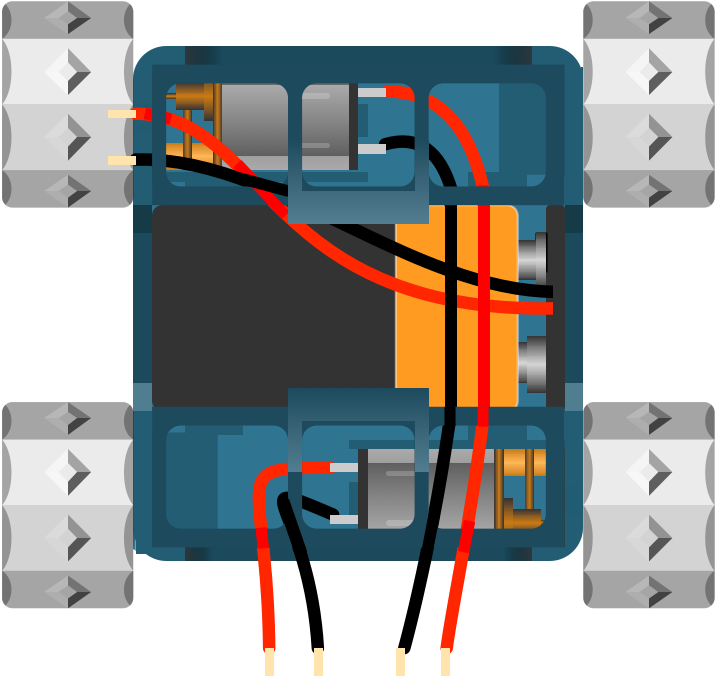
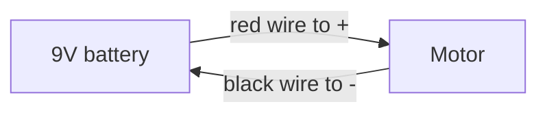

{:class="cover"}

---

By the end of this lesson you will be able to test both motors straight from the battery and diagnose one that does not spin.

## Test Motors

Test the motors are working correctly by touching the positive and negative wires to the battery. They should spin enthusiastically!

{:class="img-fluid w-50"}

Why test now, before any electronics are fitted? Because this is the easiest moment to find a fault. Right now there is no Arduino, no shield and no code, so if a motor does not spin there are only three suspects: the solder joint, the wire or the battery. Once everything is wired up, there are many more places to look.

## How to run the test

1. Hold the battery in one hand and one motor's red and black wires in the other.
2. Touch the red wire to the positive terminal and the black wire to the negative terminal.
3. The motor should spin straight away, and the wheel should turn with it.
4. Now touch the wires the other way round (red to negative, black to positive). The motor should spin the opposite way.
5. Repeat for the second motor.

Keep each touch short. You are only checking that the motor works, and there is no need to hold it on.

That reverse test is worth remembering. A DC motor changes direction when you swap its power wires, which is exactly what the shield does for you in code, and why a motor that turns the wrong way later can be fixed by swapping its two wires over.

## Troubleshooting

If the motors do not spin when connecting to the battery, check that the wires are still soldered to the motor and haven't come free when fitting (they are quite delicate). Also check the 9V battery is charged: a multimeter set to DC volts should read close to 9V. A flat battery is the most common reason a SMARS won't move.

## Try it Yourself

1. Test each motor in both directions. Do both motors turn the same way when you use the same colours?
2. Watch the wheel while you test. Does it turn smoothly, or can you feel it catch?
3. Challenge: swap the wires on one motor and test again. Which way does it turn now compared with before?

## Common Issues

- **Problem**: A motor does not spin at all.
- **Solution**: Check both wires are still soldered on, then try the other motor on the same battery. Re-solder any loose joint.
- **Why**: Trying the other motor tells you whether the fault is the motor or the battery.

- **Problem**: The motor is slow or stutters.
- **Solution**: Check the battery with a multimeter, which should read close to 9V, and replace it if it is flat.
- **Why**: A tired battery cannot deliver enough current to turn the motor.

- **Problem**: The wheel catches as it turns.
- **Solution**: Go back to lesson 6 and smooth any rough edges on the wheels and lugs.
- **Why**: Friction adds load, and small motors struggle with it.

> **Teachers**: Keep the test touches brief, and keep the battery terminals away from metal objects. A learner pair needs one battery between them for this lesson, and a multimeter is handy if you have one to share.

## Check your understanding


? Your motors don't spin when you test them. What should you check first?
- [ ] The Arduino code
- [x] That the wires are still soldered on and the battery is charged
- [ ] The tracks
> At this stage there's no code involved, so it's down to the wires or the battery.

? What should a multimeter read on a good 9V battery?
- [ ] About 1V
- [x] Close to 9V (DC volts)
- [ ] About 100V
> A reading close to 9V means the battery is healthy.

? What happens when you swap the two wires of a motor?
- [ ] Nothing
- [x] It spins the opposite way
- [ ] It stops working
> Reversing the power polarity reverses a DC motor.

