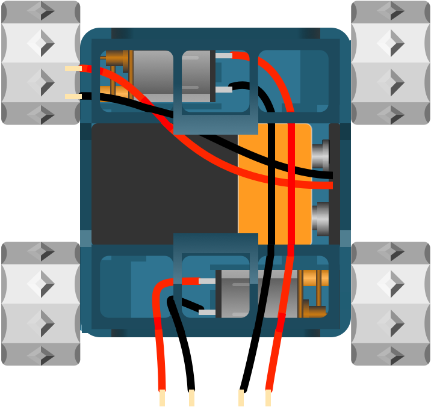

## Test Motors

Test the motors are working correctly by touching the positive and negative wires to the battery. They should spin enthusiastically!

---

## Troubleshooting

If the motors do not spin when connecting to the battery, check that the wires are still soldered to the motor and haven't come free when fitting (they are quite delicate). Also check the 9V battery is charged: a multimeter set to DC volts should read close to 9V. A flat battery is the most common reason a SMARS won't move.

---

{:class="img-fluid w-50"}

## Check your understanding


? What's the difference between the powered and unpowered wheels?
- [x] Powered wheels are driven by the motors, unpowered wheels spin freely
- [ ] Powered wheels have batteries inside them
- [ ] There is no difference
> The unpowered wheels push onto the lugs on the chassis and just turn with the tracks.

? Your motors don't spin when you test them. What should you check first?
- [ ] The Arduino code
- [x] That the wires are still soldered on and the battery is charged
- [ ] The tracks
> At this stage there's no code involved, so it's down to the wires or the battery.

