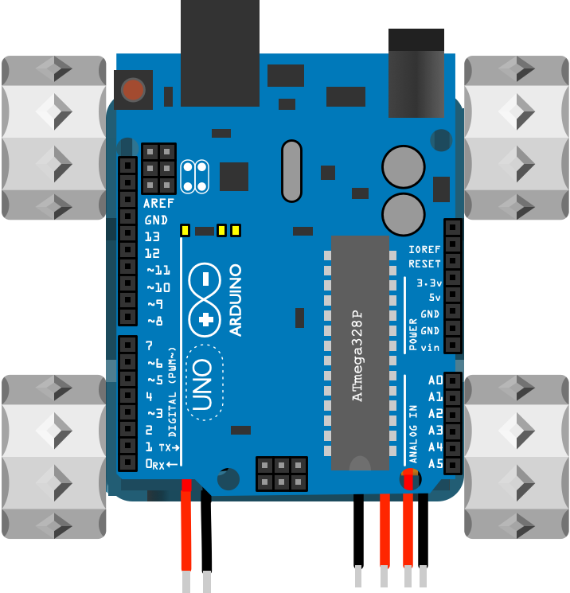
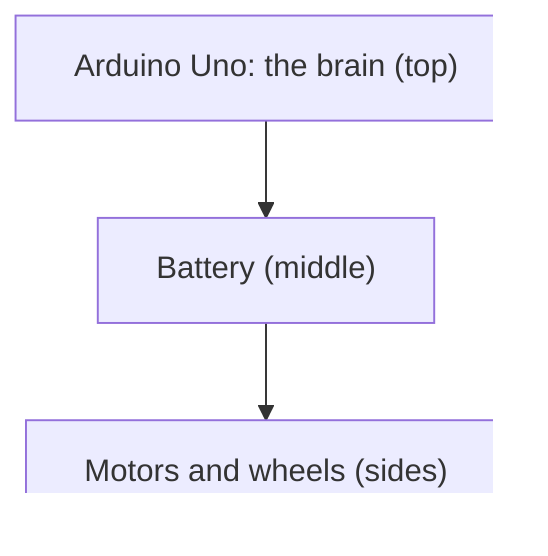

{:class="cover"}

---

By the end of this lesson you will be able to slide the Arduino Uno into the chassis without splitting the plastic.

## Watch the video

The wiring video covers lessons 8 to 11.



---

## Add the Arduino

Slide the Arduino into the robot chassis - there are two slots that run the length of the top of the SMARS chassis. To avoid splitting the top of the SMARS chassis, slowly insert the Arduino and stop and remove it if you encounter any resistance. It's best to sandpaper or file the channel if it is not large enough.

{:class="img-fluid w-50"}

## The brain goes on top

The mechanics are done, and now we add the brain. The Arduino Uno runs the sketch you will upload in lesson 12, and decides what the motors do. It sits on top of the chassis, above the battery, held by the two slots.

## Sliding it in

1. Hold the Arduino level, with its edges lined up with the two slots.
2. Slide it in slowly and evenly, a little at a time.
3. If you feel resistance, stop and take it out. Do not force it.
4. Look for a tight spot, and take a little off the channel with sandpaper or a file. Then try again.

Taking a minute to file a channel is much cheaper than printing a new chassis. Printed parts vary slightly from printer to printer, and a tight slot is common.

## Try it Yourself

1. Slide the Arduino in and out once without any force. Does it move smoothly the whole way?
2. With the Arduino in place, check you can still reach the USB socket and the battery clip.
3. Challenge: lift the robot by the chassis and gently tilt it. Does the Arduino stay put?

## Common Issues

- **Problem**: The Arduino will not slide in, or the plastic starts to split.
- **Solution**: Stop, remove it, and sand or file the channel until the board moves freely.
- **Why**: Forcing a tight fit puts stress on the thin plastic of the chassis top, and it can crack.

- **Problem**: The Arduino feels loose in the slots.
- **Solution**: Check it is pushed fully home and that you have not over-sanded the channel. If the channel is now too loose, reprint the chassis.
- **Why**: The slots hold the board by friction alone, so only a little needs to come off to make it fit.

## Check your understanding


? What should you do if the Arduino meets resistance as you slide it in?
- [ ] Push harder
- [x] Stop, remove it, and sand or file the channel
- [ ] Remove the battery
> Forcing it can split the top of the chassis.

? How does the Arduino stay in the chassis?
- [x] It slides into two slots that run along the top
- [ ] It is screwed down
- [ ] It sits on the tracks
> The two slots hold the board without any screws.

? What is the Arduino's job in SMARS?
- [ ] Holding the battery
- [x] Running the code that controls the robot
- [ ] Printing the parts
> It is the brain of the robot.

