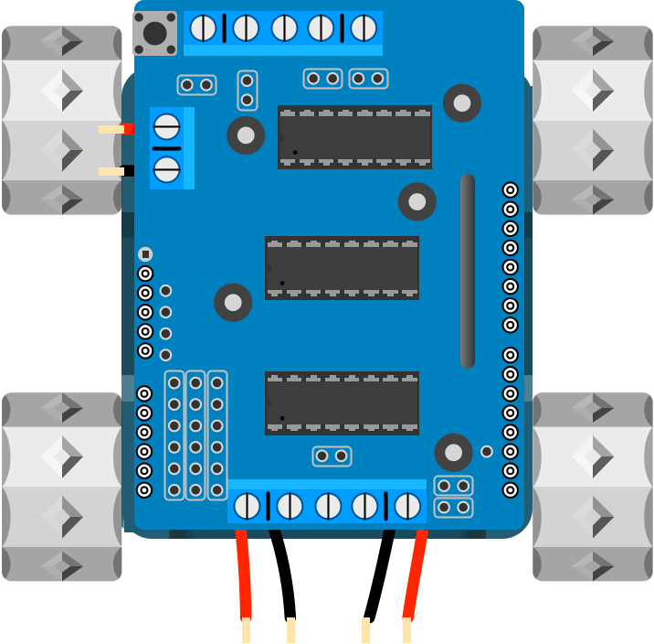
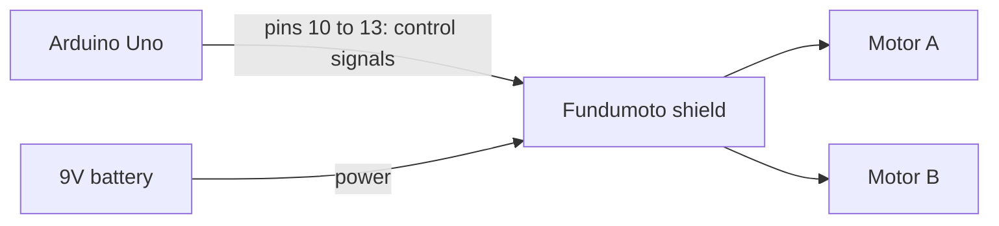

{:class="cover"}

---

By the end of this lesson you will be able to stack the Fundumoto motor shield on the Arduino and explain what it does.

## Add Motor Shield

Push the Motorshield carefully into the Arduino, making sure all the pins go into the header sockets without missing and bending.

{:class="img-fluid w-50"}

## Why we need a motor shield

An Arduino pin can only supply a tiny amount of current, far too little to drive a motor. A motor shield sits between the Arduino and the motors. The Arduino sends it small control signals, and the shield switches the much larger current from the battery to the motors.

A shield is a board built to plug straight onto the Arduino's header sockets, so there is no wiring to do between them. The sketch in lesson 13 talks to the Fundumoto shield through four Arduino pins:

| Arduino pin | Job |
| --- | --- |
| 12 | Motor A direction |
| 13 | Motor B direction |
| 10 | Motor A speed |
| 11 | Motor B speed |
{:class="table table-single"}

## Pressing it on

1. Look at the pins underneath the shield and the header sockets on the Arduino. Line them up.
2. Check that no pin is bent, and straighten any that are with a pair of pliers.
3. Press down gently and evenly, with the pins going in as you press.
4. Check the shield sits level on all four sides.

If the shield is off by one row or column, pins can bend or go into the wrong sockets, so check the alignment before you press.

## Try it Yourself

1. Before pressing the shield on, count the pins along one edge. Do they match the sockets?
2. After pressing, look from the side. Is there an even gap between the shield and the Arduino?
3. Challenge: look at the table above. Which two pins decide how fast each motor turns, and which two decide the direction?

## Common Issues

- **Problem**: A pin bends as you press the shield down.
- **Solution**: Pull the shield off, straighten the pin carefully with pliers, and re-align it.
- **Why**: Header pins are thin, and pressing a misaligned shield bends them instead of seating them in the socket.

- **Problem**: The shield sits crooked, or one side is higher than the other.
- **Solution**: Lift it off and check every pin is lined up, then press again evenly.
- **Why**: One or more pins have missed their sockets, so the board cannot seat flat.

## Check your understanding


? Why do we use a motor shield instead of connecting the motors straight to the Arduino?
- [ ] It makes the robot look better
- [x] Arduino pins can't supply enough current to drive motors
- [ ] It holds the tracks
> The shield switches the larger current from the battery, controlled by small signals from the Arduino.

? Which Arduino pins control the speed of motors A and B on the Fundumoto?
- [ ] 12 and 13
- [x] 10 and 11
- [ ] 0 and 1
> Pins 10 and 11 set speed, and pins 12 and 13 set direction.

? What should you check before pressing the shield on?
- [x] That all the pins are straight and line up with the sockets
- [ ] That the tracks are fitted
- [ ] That the battery is flat
> Misaligned or bent pins are the most common way to damage a shield.

