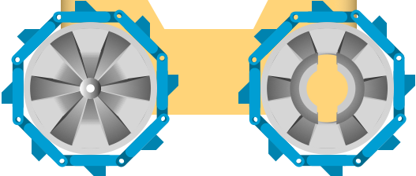
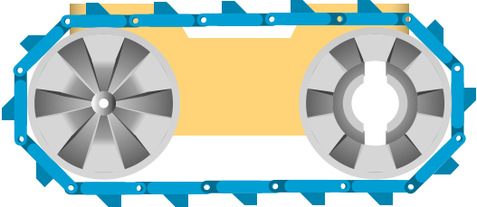
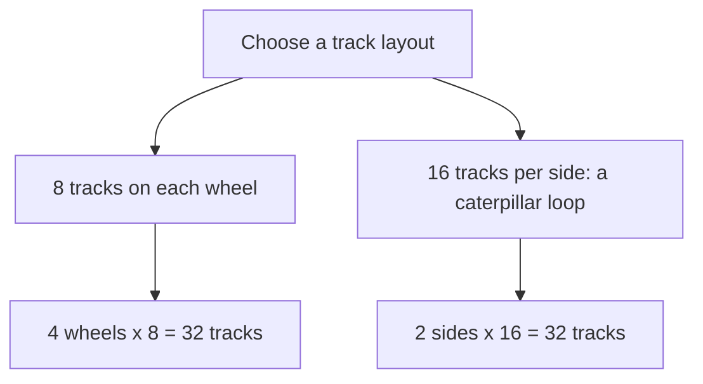

{:class="cover"}

---

By the end of this lesson you will be able to fit the tracks in either layout and fix tracks that are too tight.

## Attach Tracks

To give the wheels more traction on different surfaces you can either attach the 8 tracks to each wheel, or attach 16 tracks to each side, in a caterpillar arrangement:

{:class="img-fluid w-50"}

The tracks are attached to each other by using a piece of filament.

{:class="img-fluid w-50"}

## Which arrangement should I use?

You have two choices, and both use the 32 tracks you printed in lesson 1.

The caterpillar arrangement is the classic SMARS look: one continuous loop of 16 tracks on each side, running around both the powered and unpowered wheel. Each track is joined to the next by a short piece of filament, which acts like a hinge pin, so the loop can bend round the wheels.

## Putting the tracks together

1. Join two tracks together with a short piece of filament.
2. Keep adding tracks one at a time until you have 16 in a chain (for a caterpillar loop).
3. Wrap the chain round the powered and unpowered wheels on that side, and join the ends with filament.
4. Turn a wheel by hand. The track should move smoothly all the way round.

## Troubleshooting

You may find that the tracks are a really tight fit when connecting up in the caterpillar track formation. There are a couple of solutions to this:

* print another track at 110% - 120% scaling on the Y Axis
* use TPU / flexible filament, as this can stretch
* use a pre-sized piece from [Thingiverse](https://www.thingiverse.com/thing:3195991)

## Try it Yourself

1. Build a short chain of four tracks and bend it. Does each link flex freely?
2. Fit the tracks to one side, then spin the powered wheel. Does the unpowered wheel turn with it?
3. Challenge: build the second side, then lift SMARS and look at both loops. Do they have the same tension?

## Common Issues

- **Problem**: The track loop is too tight to fit over both wheels.
- **Solution**: Print one track at 110% to 120% scaling on the Y axis, print in flexible TPU, or use the pre-sized piece from Thingiverse.
- **Why**: The loop needs a little slack to wrap round both wheels, and a slightly longer or stretchy track gives it that.

- **Problem**: The tracks come apart when the robot drives.
- **Solution**: Check the filament pieces are pushed fully through the links and trim any that stick out.
- **Why**: A short or loose filament pin can slide out as the track bends.

- **Problem**: The tracks scrape on the chassis.
- **Solution**: Check the loop is level and that no track has rough edges, then remove any stringing.
- **Why**: Friction here slows the robot and makes the motors work harder.

## Check your understanding


? How many tracks go on each side in the caterpillar arrangement?
- [ ] 8
- [x] 16
- [ ] 32
> 16 on each side, which is 32 in total.

? How are the tracks joined together?
- [ ] With screws
- [x] With a piece of filament
- [ ] With glue
> A short piece of filament acts like a hinge pin between the links.

? Your caterpillar tracks are too tight. Which of these could help?
- [ ] Print the tracks at 50% infill
- [x] Print a track scaled to 110-120% on the Y axis, or use flexible TPU filament
- [ ] Remove the unpowered wheels
> A slightly longer track or a stretchy filament gives the loop the extra length it needs.

