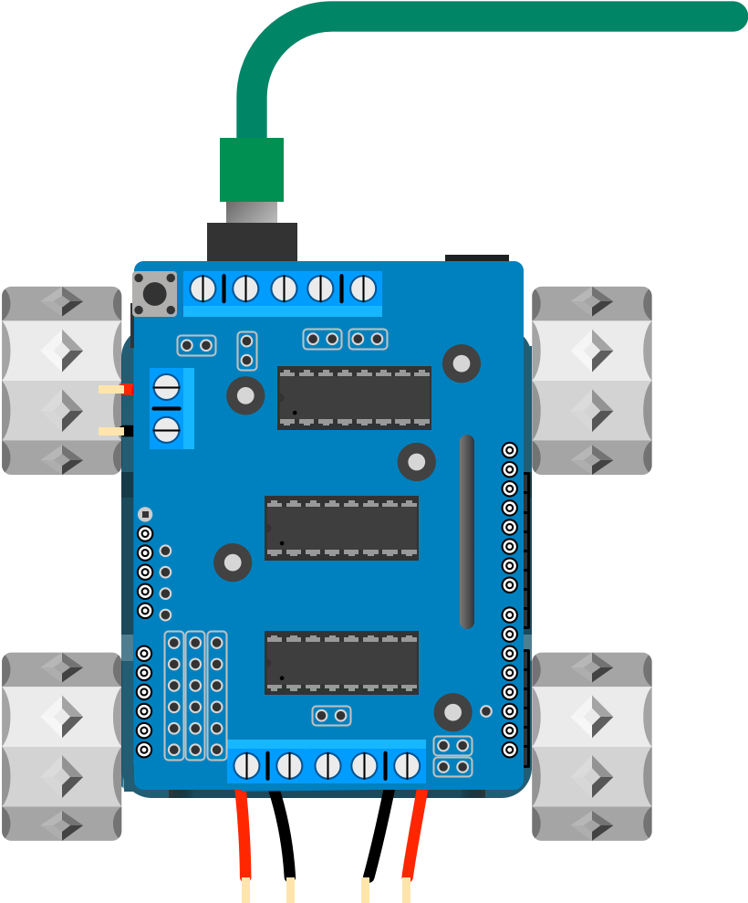
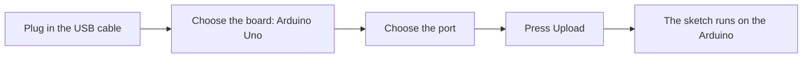

{:class="cover"}

---

By the end of this lesson you will be able to upload a sketch to the Arduino Uno and use it to make SMARS move for the first time.

## Watch the video



---

## Load the code

To bring your SMARS to life you need to write some code and upload it to your robot. [The Arduino IDE](https://www.arduino.cc/en/software) makes loading the code easy: connect the Arduino with a USB cable, choose **Arduino Uno** as the board, open the sketch and press **Upload**.

The SMARSLab suite has Arduino code for controlling the SMARS via bluetooth. [Click here to download it](https://github.com/kevinmcaleer/SMARSLab/). More information about [SMARSLab is available here](https://www.smarsfan.com/code/python).

{:class="img-fluid w-50"}

## The upload workflow

Uploading is the same every time you change your code, so it is worth learning as a routine.



1. Install the Arduino IDE from the link above and open it.
2. Plug the Arduino into your computer with the USB cable.
3. In the **Tools** menu, choose **Board** and select **Arduino Uno**.
4. Also in the **Tools** menu, choose **Port** and pick the one for your Arduino.
5. Open or paste in your sketch, and press the **Upload** button.

## A first test sketch

Before the Bluetooth sketch in the next lesson, let's check that the whole robot works with the smallest program possible. This sketch makes SMARS drive forward for one second, wait two seconds, and repeat. It uses the same four pins as the next lesson (pins 12 and 13 for direction, 10 and 11 for speed).

```cpp
// SMARS first test: drive forward for one second, then pause
int motor_A = 12;        // motor A direction
int motor_B = 13;        // motor B direction
int motor_A_speed = 10;  // motor A speed
int motor_B_speed = 11;  // motor B speed

void setup() {
  pinMode(motor_A, OUTPUT);
  pinMode(motor_B, OUTPUT);
}

void forward() {
  digitalWrite(motor_A, LOW);
  digitalWrite(motor_B, HIGH);
  analogWrite(motor_A_speed, 255);  // full speed
  analogWrite(motor_B_speed, 255);
  delay(1000);
  analogWrite(motor_A_speed, 0);    // stop
  analogWrite(motor_B_speed, 0);
}

void loop() {
  forward();
  delay(2000);
}
```

Upload it with the battery connected to the shield, and with SMARS sitting on its back or propped on a block so the tracks are off the desk. Both tracks should turn, forwards, for a second at a time. Then put it on the floor and watch it go.

If one side turns the wrong way, swap that motor's two wires on the shield (lesson 10).

> **Teachers**: Check before the lesson that the Arduino IDE is installed on the school computers, and that learners are allowed to install the USB driver if their clone board needs one. A shared computer is fine: each learner only needs the IDE open while they upload.

## Try it Yourself

1. Upload the sketch and watch SMARS drive. Which way does it go?
2. Change the `delay(1000)` inside `forward()` to `delay(500)` and upload again. What changes?
3. Change `255` to `128` for both speeds. Does the robot move more slowly?
4. Challenge: swap the `LOW` and `HIGH` in `forward()`. What happens?

## Common Issues

- **Problem**: The IDE says the upload failed, or it cannot find the board.
- **Solution**: Check the USB cable is plugged in, that the board is set to Arduino Uno under **Tools**, and that the right port is selected. Try a different cable if it still fails.
- **Why**: Some USB cables only carry power, not data, and the IDE needs the correct board and port to talk to the Arduino.

- **Problem**: The upload works, but the motors do not move.
- **Solution**: Check the battery is connected to the shield and charged, and that the motor wires are in the shield connectors.
- **Why**: The USB cable powers the Arduino, but the motors get their power from the battery through the shield.

- **Problem**: SMARS drives off the desk while you are testing.
- **Solution**: Prop it up on a block with the tracks in the air for the first test.
- **Why**: The robot drives as soon as it has power, and the USB cable can tug it round.

## Check your understanding


? Which board do you choose in the Arduino IDE for this SMARS?
- [ ] Arduino Mega
- [x] Arduino Uno
- [ ] Raspberry Pi Pico
> The original SMARS is built on an Arduino Uno.

? Which Arduino pins set the speed of motors A and B in the test sketch?
- [ ] 12 and 13
- [x] 10 and 11
- [ ] 0 and 1
> `motor_A_speed` is 10 and `motor_B_speed` is 11. Pins 12 and 13 set direction.

? The sketch uploads but the motors do not move. What should you check?
- [x] The battery is connected and charged
- [ ] The tracks are black
- [ ] The IDE version
> The USB cable powers the Arduino, but the motors are powered by the battery through the shield.

