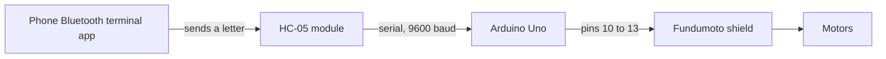

{:class="cover"}

---

By the end of this lesson you will be able to upload the SMARS Bluetooth sketch and drive your robot with single-letter commands from your phone.

## The sketch

Below is a sample program to control your SMARS with an additional Bluetooth serial module (such as an HC-05). The module is connected to the Arduino's serial pins, so anything you send from a Bluetooth terminal app on your phone arrives with `Serial.read()`.

| Send | What SMARS does |
| --- | --- |
| `u` | Drive forward for one second |
| `d` | Drive backward |
| `l` | Turn left |
| `r` | Turn right |
| `s` | Stop |
| `b` | Sound the buzzer |
{:class="table table-single"}



## Connecting the Bluetooth module

A serial Bluetooth module such as the HC-05 talks to the Arduino over the serial pins (0 and 1). Serial wires cross over: the module's TX goes to the Arduino's RX, and the module's RX goes to the Arduino's TX. Give the module power and ground as well, and check your module's board for its supply voltage. The HC-05's receive pin expects 3.3V logic, so many makers put a simple voltage divider between the Arduino's TX pin and the module's RX pin. Check the datasheet for your module.

The `b` command is optional: if you want it to work, connect a buzzer between pin 4 (`buzzerPin` in the sketch) and ground.

---

```cpp
// SMARS Bluetooth remote control
// Kevin McAleer
// April 2019
// May 2019 - added buzzer feature
// Requires a Fundumoto shield

int ch_A_Direction = 12;
int ch_B_Direction = 13;
int ch_A_speed = 10;
int ch_B_speed = 11;
int buzzerPin = 4;
char state = 0;
int delaylength = 1000;

void setup() {
  Serial.begin(9600, SERIAL_8N1);
  Serial.println("SMARSFan OS 1.1");
  Serial.println("---------------");

  // motor direction pins and the buzzer are outputs
  pinMode(ch_A_Direction, OUTPUT);
  pinMode(ch_B_Direction, OUTPUT);
  pinMode(buzzerPin, OUTPUT);
}

void buzz() {
  digitalWrite(buzzerPin, HIGH);
  delay(delaylength / 2);
  digitalWrite(buzzerPin, LOW);
}

// Set both motor directions, run at full speed for delaylength, then stop
void drive(int dirA, int dirB) {
  digitalWrite(ch_A_Direction, dirA);
  digitalWrite(ch_B_Direction, dirB);

  analogWrite(ch_A_speed, 255); // full speed ahead
  analogWrite(ch_B_speed, 255);

  delay(delaylength);

  analogWrite(ch_A_speed, 0); // stop
  analogWrite(ch_B_speed, 0);
}

void forward()  { drive(LOW, HIGH); }
void backward() { drive(HIGH, LOW); }
void left()     { drive(HIGH, HIGH); }
void right()    { drive(LOW, LOW); }

void fullstop() {
  analogWrite(ch_A_speed, 0);
  analogWrite(ch_B_speed, 0);
}

void loop() {
  if (Serial.available() > 0) {
    state = Serial.read();
    Serial.println(state);

    if (state == 'u') {
      Serial.println("MOTORS: UP");
      forward();
    } else if (state == 'd') {
      Serial.println("MOTORS: DOWN");
      backward();
    } else if (state == 'l') {
      Serial.println("MOTORS: LEFT");
      left();
    } else if (state == 'r') {
      Serial.println("MOTORS: RIGHT");
      right();
    } else if (state == 's') {
      Serial.println("MOTORS: STOP");
      fullstop();
    } else if (state == 'b') {
      Serial.println("BUZZER: SOUND");
      buzz();
    }
    state = 0;
  }
}
```

---

## How it works

- `setup()` starts the serial port at 9600 baud and sets the motor direction pins and buzzer pin as outputs.
- `drive()` sets the direction of each motor, then uses `analogWrite()` to run both at full speed (255) for one second before stopping. Turning the motors the same way spins the robot, because they face opposite directions in the chassis.
- `loop()` waits for a character to arrive and calls the matching function.

> ## Upload tip
>
> The Bluetooth module shares the Arduino's serial pins with the USB connection. Unplug the module while you upload the code, then plug it back in.

## Try it Yourself

1. Change `delaylength` to `500` so each command moves the robot a shorter distance.
2. Add a new command, `f`, that drives forward at half speed (`analogWrite(ch_A_speed, 128)`).
3. Make the `s` command stop the robot. Why can't it interrupt a move that is already running? (Look at how `drive()` uses `delay()`.)
4. Challenge: make the robot do a little dance when you send `x`.

## Common Issues

- **Problem**: The upload fails while the Bluetooth module is plugged in.
- **Solution**: Unplug the module's connection to the Arduino serial pins, upload, then plug it back in.
- **Why**: The module and the USB connection share the same serial pins, so they get in each other's way.

- **Problem**: You send a command and nothing happens.
- **Solution**: Check the phone is paired with the module, the terminal app is connected, and that the module's TX and RX are crossed over to the Arduino's RX and TX.
- **Why**: A serial link only works if one side's transmit goes to the other side's receive.

- **Problem**: The robot turns the wrong way when you send `l` or `r`, or drives backwards for `u`.
- **Solution**: Swap the two wires of one motor on the shield, or swap `LOW` and `HIGH` for that motor in the sketch.
- **Why**: The sketch assumes the motors are wired as in lesson 10, so reversing a motor reverses the move.

- **Problem**: The robot ignores `s` while it is moving.
- **Solution**: Send `s` before or after a move, or rewrite `drive()` without `delay()`.
- **Why**: `delay()` freezes the sketch for a second, so it cannot read the next letter until the move ends.

> **Teachers**: Bluetooth pairing can be fiddly in a classroom full of identical modules, so give each module a label and pair one at a time. Phones are not always allowed in lessons, so plan for this, or run the sketch from the Serial Monitor on the computer by connecting the Arduino via USB without a Bluetooth module: the same single letters work. For a deeper dive into the code, see [Learn how to program SMARS with Arduino](/learn/smars_code/).

## Check your understanding


? What does `analogWrite(ch_A_speed, 255)` do?
- [ ] Sets motor A to turn backwards
- [x] Runs motor A at full speed
- [ ] Reads the speed of motor A
> `analogWrite` sends a PWM signal from 0 (stopped) to 255 (full speed).

? Why should you unplug the Bluetooth module while uploading code?
- [x] It shares the serial pins with the USB connection and can block the upload
- [ ] It might get too hot
- [ ] The Arduino IDE can't see it
> Both use the Arduino's TX and RX pins, so they get in each other's way during an upload.

? What does the robot do when it receives the letter `u`?
- [ ] Turns left
- [x] Drives forward for one second
- [ ] Sounds the buzzer
> The table at the top of the lesson says `u` calls `forward()`, which drives for `delaylength` (1000 ms).


