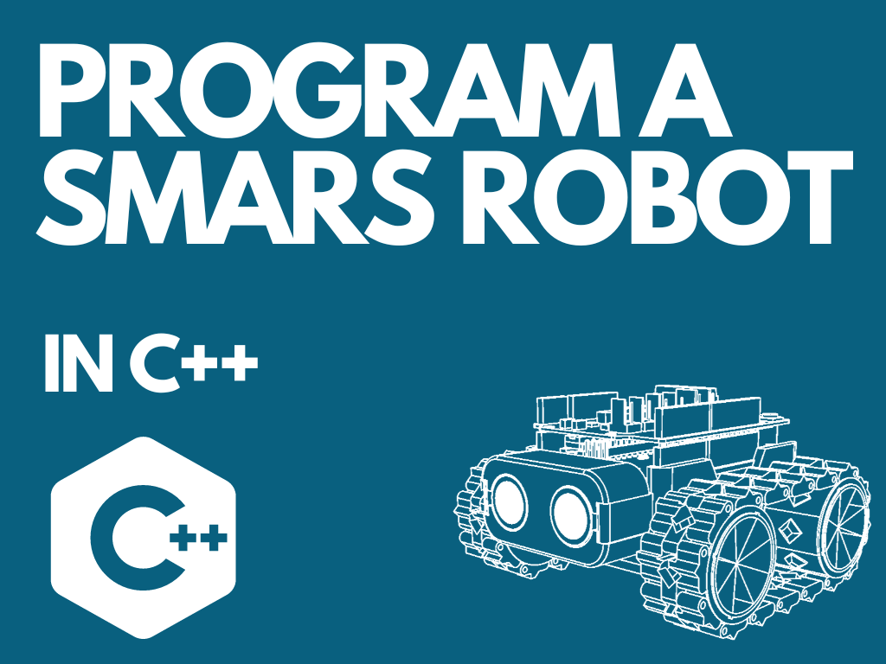

{:class="cover"}

## Watch the video



Every lesson in this course also has a livestream video where I build the code live, so you can follow along.

---

## Overview

You've built a SMARS robot, now let's bring it to life! This course teaches you to program SMARS in Arduino `C++`, one sensor or skill at a time. Each lesson builds on the last, starting with making the motors turn and ending with a robot that follows a line on its own.

## Course Content

- Moving forwards, backwards and turning
- Controlling SMARS from the keyboard with the Serial Monitor
- Measuring distance with an ultrasonic sensor and avoiding obstacles
- Sensing pitch, roll and heading with an MPU-6050
- Driving SMARS from your phone over Bluetooth
- Controlling servos
- Following a line with a TCRT5000 sensor

## Key Results

By the end of this course you will be able to:

- Write, verify and upload Arduino sketches
- Use variables, functions, `if` statements, `while` loops and `switch` statements
- Read sensors and make your robot react to the world around it

## What you'll need

- A [SMARS robot](/learn/smars/) with an Arduino Uno and Fundumoto motor shield
- A USB cable and a computer with the [Arduino IDE](https://www.arduino.cc/en/software)
- For later lessons: an HC-SR04 ultrasonic sensor, an MPU-6050 module, a Bluetooth module, an SG90 servo and a TCRT5000 line sensor (each lesson says what it needs)

## How the course works

Each lesson has a livestream video, the complete code to type in, and an explanation of what each part does. Typing the code yourself (rather than copying it) is the best way to learn. There's a quick quiz at the end of each lesson.

## Prerequisites

- [Build a SMARS Robot](/learn/smars/)
