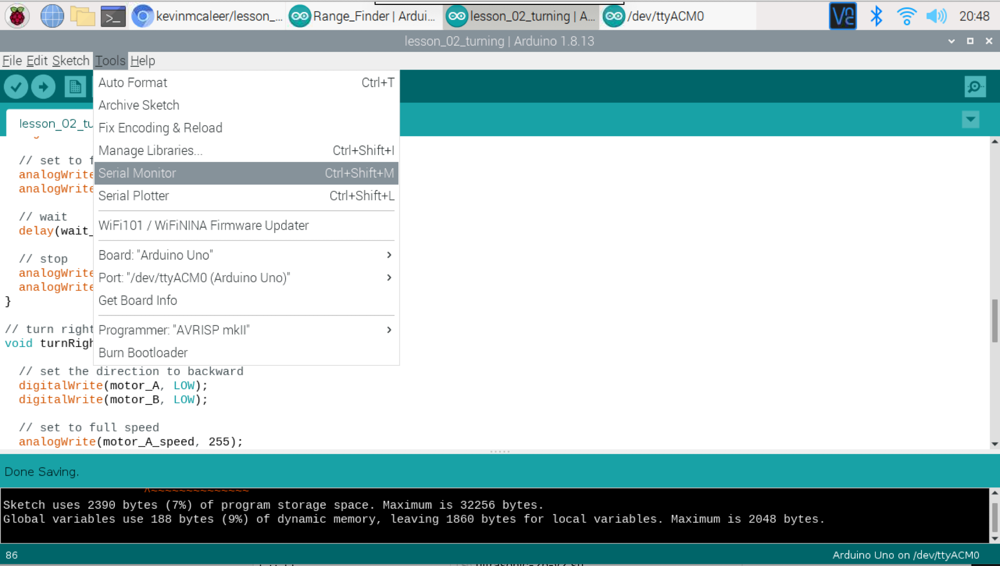
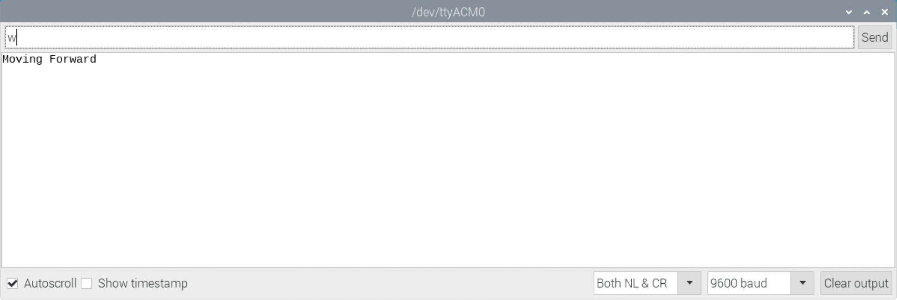

{:class="cover"}

---

By the end of this lesson you will be able to make SMARS go backwards and turn on the spot, and drive it from your keyboard using the Serial Monitor and a `switch` statement.

## What you'll learn

In this lesson you will learn how to move your robot backwards, turning left and right, and finally creating some code to control the SMARS over the serial port.

You can download the completed code from [GitHub - www.github.com/kevinmcaleer/lesson_02_turning](https://github.com/kevinmcaleer/lesson_02_turning)

---

## What you'll need

Before you begin, you'll need to make sure you have a couple of things before you start this lesson:

* A [SMARS robot](/learn/smars/)
* A USB Cable to connect to your computer
* A Computer that can run the [Arduino IDE](https://www.arduino.cc/en/software)
* The code from [Lesson 01 - Movement](01_lesson_01.html)

---

## Preparation

1. Connect the SMARS to the USB cable, and the USB Cable to your computer
1. Launch the [Arduino IDE](https://www.arduino.cc/en/software) on your computer
1. Create a new Sketch, by clicking the `New Sketch` button

---

## Let's code

We are going to create 3 more functions, almost identical to the function we made in [lesson 01](01_lesson_01.html), but with slightly different parameters for the direction of the motors.

---

## Moving backwards

``` c
// move backward
void backward() {

  // set the direction to backward
  digitalWrite(motor_A, HIGH);
  digitalWrite(motor_B, LOW);

  // set to full speed
  analogWrite(motor_A_speed, 255);
  analogWrite(motor_B_speed, 255);

  // wait
  delay(wait_in_milliseconds);

  // stop
  analogWrite(motor_A_speed, 0);
  analogWrite(motor_B_speed, 0);
}
```

---

## Turning Left

``` c
// turn left
void turnLeft() {

  // set both motors the same direction to spin on the spot
  digitalWrite(motor_A, LOW);
  digitalWrite(motor_B, LOW);

  // set to full speed
  analogWrite(motor_A_speed, 255);
  analogWrite(motor_B_speed, 255);

  // wait
  delay(wait_in_milliseconds);

  // stop
  analogWrite(motor_A_speed, 0);
  analogWrite(motor_B_speed, 0);
}
```

---

## Turning Right

``` c
// turn right
void turnRight() {

  // set both motors the same direction to spin on the spot
  digitalWrite(motor_A, HIGH);
  digitalWrite(motor_B, HIGH);

  // set to full speed
  analogWrite(motor_A_speed, 255);
  analogWrite(motor_B_speed, 255);

  // wait
  delay(wait_in_milliseconds);

  // stop
  analogWrite(motor_A_speed, 0);
  analogWrite(motor_B_speed, 0);
}
```

---

## What the code means

The code in each of these functions is virtually identical, apart from these lines:

``` c
digitalWrite(motor_A, HIGH);
digitalWrite(motor_B, HIGH);
```

These lines tell the motor shield which way to spin motor A and motor B. Because the motors on the SMARS face opposite directions, setting them to *different* values (`LOW`/`HIGH`) makes the robot drive forwards or backwards, and setting them to the *same* value makes the robot spin left or right on the spot.

---

## Remote Control

{:class="img-fluid w-25"}

To make the SMARS controllable from the keyboard, we can use the Arduino Serial Monitor to issue commands to our SMARS. We will do this by creating a new piece of code that will look for the following 4 keys from the keyboard:

* W - Forward
* S - Backward
* A - Left
* D - Right

We will do this by reading in characters from the Serial interface, and then running either the `forward()`, `backward()`, `turnLeft()`, or `turnRight()` functions.

We will change the code in the `void loop()` section to look like this. Make sure your `setup()` function also starts the serial port with `Serial.begin(9600);`, otherwise nothing will arrive from the keyboard.

``` c
while (Serial.available()) {
    char c = Serial.read();
    switch(c) {
        // press the 'w' key to move SMARS Forward
        case 'w':
        Serial.println("Moving Forward");
        forward();
        break;

        // press the 's' key to move SMARS backward
        case 's':
        Serial.println("Moving Backward");
        backward();
        break;

        // press the 'a' key to move SMARS left
        case 'a':
        Serial.println("Turning Left");
        turnLeft();
        break;

        // press the 'd' key to move SMARS right
        case 'd':
        Serial.println("Turning Right");
        turnRight();
        break;
        }
  }
  // wait 2 seconds
  delay(2000);
```

We can now open the Serial monitor from the Tools menu, set the speed box at the bottom to `9600 baud` so it matches `Serial.begin(9600)`, and begin typing any of the four direction commands 'w','s','a','d' and return to move the SMARS in any of the four directions.

{:class="img-fluid w-50"}

---

### The Serial Monitor

{:class="img-fluid w-50"}

---

### The complete sketch

Here is everything together, so you can check your own sketch against it. It is lesson 01's code with the three new functions added, `Serial.begin(9600);` in `setup()`, and the new `loop()`.

```arduino
// Lesson 02 Turning
// SMARS keyboard control over the Serial Monitor

int motor_A = 12;
int motor_B = 13;
int motor_A_speed = 10;
int motor_B_speed = 11;

int wait_in_milliseconds = 1000;

void setup() {
  Serial.begin(9600);
  pinMode(motor_A, OUTPUT);
  pinMode(motor_B, OUTPUT);
}

// set both motor directions, run for a while, then stop
void drive(int dirA, int dirB) {
  digitalWrite(motor_A, dirA);
  digitalWrite(motor_B, dirB);
  analogWrite(motor_A_speed, 255);
  analogWrite(motor_B_speed, 255);
  delay(wait_in_milliseconds);
  analogWrite(motor_A_speed, 0);
  analogWrite(motor_B_speed, 0);
}

void forward()   { drive(LOW, HIGH); }
void backward()  { drive(HIGH, LOW); }
void turnLeft()  { drive(LOW, LOW); }
void turnRight() { drive(HIGH, HIGH); }

void loop() {
  while (Serial.available()) {
    char c = Serial.read();
    switch (c) {
      case 'w':
        Serial.println("Moving Forward");
        forward();
        break;
      case 's':
        Serial.println("Moving Backward");
        backward();
        break;
      case 'a':
        Serial.println("Turning Left");
        turnLeft();
        break;
      case 'd':
        Serial.println("Turning Right");
        turnRight();
        break;
    }
  }
  // wait 2 seconds
  delay(2000);
}
```

This version folds the four near-identical functions into one helper called `drive()` that takes the two directions as parameters. The behaviour is identical to the longer functions above, just shorter to type. You will see the same trick again in the Bluetooth lesson.

---

## What the code means (part 2)

`char c = Serial.read();` - this means create a new variable, of type Character (which can hold a single letter or number) and call it `c` and make that read in from the Serial interface. This is how we read in keys from the serial monitor.

`switch(c) {` - the switch function will look at the value within the variable `c` that we have passed it, and then depending on that it will execute different parts of code, depending on each `case`.

There then follows four similar blocks of code:

```c
// press the 'w' key to move SMARS Forward
case 'w':
    Serial.println("Moving Forward");
    forward();
    break;
```

The first line is a comment (as denoted by the '//' characters).
The second line says, in the `case` of the value of `c` being `w` then execute the lines below.
The third line says, write the string `Moving Forward` to the `Serial` monitor.
The fourth line executes the `forward()` function.
The last line `break;` means stop running through the `case` statements.

---

## Try it Yourself

1. Change `wait_in_milliseconds` to `250` so each key press moves the robot a shorter distance.
2. Add a new key, `x`, that stops the robot (hint: you do not need to drive at all, just print a message).
3. Challenge: add `q` and `e` keys that turn the robot by a smaller amount. You could make a short turn by calling `turnLeft()` with a shorter wait.

> **Teachers**: The Serial Monitor needs one computer per robot, so pairs work best. Learners often type several letters at once and are surprised when SMARS keeps going for several seconds, because each key press runs for a full second and the `delay(2000)` at the end of `loop()` adds more. Ask them to press one key at a time and wait. Keep the robot on the floor or a tray with edges, and keep the USB cable slack so it does not drag the robot.

## Common Issues

- **Problem**: Typing `w` in the Serial Monitor does nothing.
- **Solution**: Check the baud rate box in the Serial Monitor says `9600`, that `Serial.begin(9600);` is in `setup()`, and that you pressed Enter or the Send button.
- **Why**: The Serial Monitor and the sketch must agree on the speed, and the letters are only sent when you send the line.

- **Problem**: SMARS turns the wrong way when you press `a` or `d`.
- **Solution**: Swap the two `drive()` calls in `turnLeft()` and `turnRight()`, or swap the motor wires.
- **Why**: Left and right depend on which motor is called A and which way the chassis faces.

- **Problem**: The robot keeps moving after you stop typing.
- **Solution**: Wait for it to finish. Each character you sent is queued up and runs one after another.
- **Why**: The Serial Monitor sends every letter into a queue, and `while (Serial.available())` works through them in order.

- **Problem**: Verify says `'forward' was not declared in this scope`.
- **Solution**: Make sure the movement functions are in your sketch above the `loop()` that calls them.
- **Why**: The functions in the sketch must exist before they are used, or be added to the same file.

## Check your understanding


? How do you make SMARS spin on the spot?
- [ ] Set both motor speeds to 0
- [x] Set both motor direction pins to the same value
- [ ] Set the motor direction pins to opposite values
> Same direction values make the motors push the robot round in a circle. Opposite values drive it forwards or backwards.

? In a `switch` statement, what does `break;` do?
- [x] Stops checking the remaining `case`s
- [ ] Stops the robot
- [ ] Restarts the Arduino
> Without `break;` the code would carry on into the next `case` as well.

? Which line must be in `setup()` for the Serial Monitor to receive anything from SMARS or send it keys?
- [ ] `pinMode(motor_A, OUTPUT);`
- [x] `Serial.begin(9600);`
- [ ] `Serial.read();`
> `Serial.begin(9600);` starts the serial port. The Serial Monitor must be set to the same 9600 baud.

