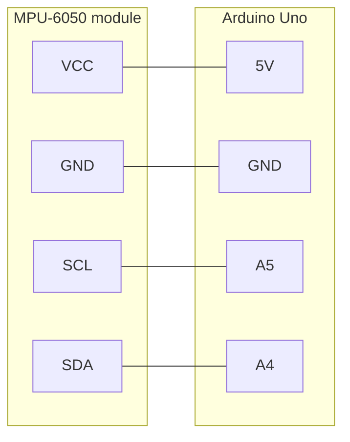

{:class="cover"}

---

By the end of this lesson you will be able to wire an MPU-6050 to an Arduino over I2C and read the robot's yaw, pitch and roll in degrees.

## Watch the livestream



---

## What you'll learn

In this lesson you will learn how to measure the heading, pitch and roll of the SMARS robot using the MPU-6050 sensor module.

---

## What you'll need

Before you begin, you'll need to make sure you have a couple of things before you start this lesson:

* A [SMARS robot](/learn/smars/)
* A USB Cable to connect to your computer
* A Computer that can run the [Arduino IDE](https://www.arduino.cc/en/software)
* An MPU-6050 module

---

## Preparation

1. Connect the SMARS to the USB cable, and the USB Cable to your computer
1. Launch the [Arduino IDE](https://www.arduino.cc/en/software) on your computer
1. Create a new Sketch, by clicking the `New Sketch` button

---

## Wiring and library

| MPU-6050 pin | Arduino pin |
| --- | --- |
| VCC | 5V (most MPU-6050 boards, such as the GY-521, have a regulator) |
| GND | GND |
| SCL | A5 |
| SDA | A4 |
{:class="table table-striped"}

The MPU-6050 talks to the Arduino over **I2C**, which needs only two data wires plus power:



Install the **MPU6050** library (by Electronic Cats) from **Tools > Manage Libraries** in the Arduino IDE. It includes the `I2Cdev` and `MotionApps` files this sketch needs.

## Let's code

You can download the code below from [GitHub](https://www.github.com/kevinmcaleer/lesson_04_positioning), but it's better to type it in yourself line by line, as you will get to understand what each line means.

---

```cpp
// Lesson 04 Positioning with the MPU-6050
// Based on the MPU6050_DMP6 example from Jeff Rowberg's i2cdevlib (MIT licence)
// https://github.com/jrowberg/i2cdevlib

#include "I2Cdev.h"
#include "MPU6050_6Axis_MotionApps20.h"
#include "Wire.h"

MPU6050 mpu;              // the sensor, at I2C address 0x68

bool dmpReady = false;    // true once the sensor's motion processor is running
uint8_t fifoBuffer[64];   // where each new reading is stored

Quaternion q;             // the sensor's orientation
VectorFloat gravity;      // which way is down
float ypr[3];             // yaw, pitch and roll, in radians

void setup() {
  Wire.begin();
  Wire.setClock(400000);  // fast 400kHz I2C
  Serial.begin(115200);

  mpu.initialize();
  Serial.println(mpu.testConnection() ? F("MPU6050 connected") : F("MPU6050 connection failed"));

  // start the Digital Motion Processor (DMP) inside the sensor
  if (mpu.dmpInitialize() == 0) {
    // keep the robot still while it calibrates
    mpu.CalibrateAccel(6);
    mpu.CalibrateGyro(6);
    mpu.setDMPEnabled(true);
    dmpReady = true;
    Serial.println(F("Ready!"));
  } else {
    Serial.println(F("DMP initialisation failed"));
  }
}

void loop() {
  if (!dmpReady) return;

  // read the latest packet from the sensor
  if (mpu.dmpGetCurrentFIFOPacket(fifoBuffer)) {
    mpu.dmpGetQuaternion(&q, fifoBuffer);
    mpu.dmpGetGravity(&gravity, &q);
    mpu.dmpGetYawPitchRoll(ypr, &q, &gravity);

    // convert radians to degrees and print them
    Serial.print("yaw ");
    Serial.print(ypr[0] * 180 / M_PI);
    Serial.print("\tpitch ");
    Serial.print(ypr[1] * 180 / M_PI);
    Serial.print("\troll ");
    Serial.println(ypr[2] * 180 / M_PI);
  }
}
```

---

## What the code means

- The MPU-6050 has an accelerometer (which way it's being pushed, including by gravity) and a gyroscope (how fast it's turning). Its built-in **Digital Motion Processor (DMP)** combines the two into a steady orientation for us.
- `mpu.initialize()` and `mpu.testConnection()` check the sensor is wired up and answering on the I2C bus.
- `CalibrateAccel` and `CalibrateGyro` measure the sensor's small errors while it's still, so keep the robot flat and still for a couple of seconds after it starts.
- In `loop()`, `dmpGetYawPitchRoll` gives three angles in radians, which we multiply by `180 / M_PI` to get degrees:
  - **Yaw**: which way the robot is facing (its heading)
  - **Pitch**: nose up or nose down, for example going up a ramp
  - **Roll**: tilting to the left or right

Open the Serial Monitor at **115200 baud**, then tilt and turn your robot to see the numbers change. Yaw will slowly drift over time because there's no compass to correct it.

This lesson only reads the sensor, so SMARS doesn't need to drive. Hold it in your hands and tilt it, which is much safer than chasing it round the desk.

---

## Try it Yourself

1. Tilt the robot nose-up and nose-down by hand. Which of the three numbers changes? Then roll it on its side.
2. Turn the robot slowly on the spot by hand. Watch yaw change, and see how far it has drifted after a minute of sitting still.
3. Add a line to `loop()` that prints `"Ramp!"` when the pitch is more than 15 degrees. You can use `if (ypr[1] * 180 / M_PI > 15) { Serial.println("Ramp!"); }`.
4. Challenge: print `"Tipping over!"` when roll goes past 45 degrees either way.

> **Teachers**: This lesson needs a library installed from the Library Manager, which needs internet access and often administrator rights on school laptops. Install it ahead of the lesson. The calibration step needs the robot held still, so tell learners not to nudge the table while they wait. The MPU-6050 is a small, easily bent board, so handle it by the edges and do not push the header pins in sideways.

## Common Issues

- **Problem**: The Serial Monitor shows `MPU6050 connection failed`.
- **Solution**: Check SDA is on A4 and SCL is on A5 (they are easy to swap), VCC is on 5V and GND is on GND, and that the header pins are soldered to the module.
- **Why**: The Arduino can only talk to the sensor when the two I2C data wires and power are right.

- **Problem**: The Serial Monitor shows garbled characters.
- **Solution**: Set the baud rate box at the bottom of the Serial Monitor to `115200`.
- **Why**: This sketch uses `Serial.begin(115200)`, not 9600 like the earlier lessons, and the two ends must match.

- **Problem**: Verify fails with `I2Cdev.h: No such file or directory`.
- **Solution**: Install the **MPU6050** library by Electronic Cats from the Library Manager, as described above.
- **Why**: The sketch includes files that come with that library and they are not part of the standard Arduino install.

- **Problem**: Yaw keeps changing when the robot is sitting still.
- **Solution**: This is normal. Restart the sketch to reset it, and use pitch and roll when you need steady readings.
- **Why**: Yaw is worked out from the gyroscope alone, and small errors build up over time.

---

## Check your understanding


? Your SMARS drives up a ramp. Which reading changes the most?
- [ ] Yaw
- [x] Pitch
- [ ] Roll
> Pitch is nose up or nose down. Yaw is the direction the robot faces, and roll is tilting side to side.

? Which two Arduino Uno pins are used for I2C?
- [ ] D7 and D8
- [x] A4 (SDA) and A5 (SCL)
- [ ] D0 and D1
> On the Uno, I2C data (SDA) is on A4 and the clock (SCL) is on A5.

? Why should the robot be kept still when the sketch starts?
- [x] It's calibrating the sensor
- [ ] The motors are warming up
- [ ] The Serial Monitor needs time to open

