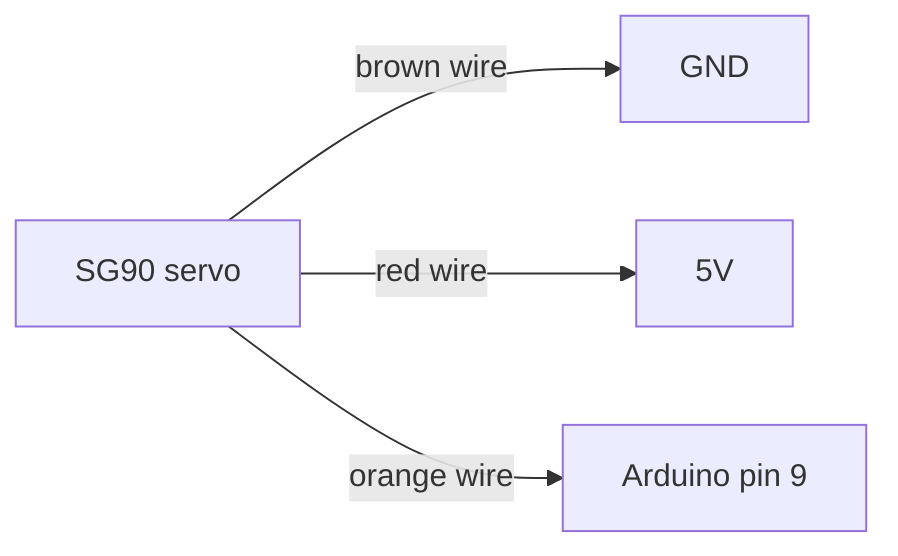

{:class="cover"}

---

By the end of this lesson you will be able to wire an SG90 servo to an Arduino and use the `Servo` library to move it to any angle from 0 to 180 degrees.

## Watch the livestream



---

## What you'll learn

In this lesson you will learn how to control a servo using an Arduino.

---

## What you'll need

Before you begin, you'll need to make sure you have a couple of things before you start this lesson:

* A [SMARS robot](/learn/smars/)
* A USB Cable to connect to your computer
* A Computer that can run the [Arduino IDE](https://www.arduino.cc/en/software)
* A [SG90 Servo](/resources/glossary#servo)

---

## Preparation

1. Connect the SMARS to the USB cable, and the USB Cable to your computer
1. Launch the [Arduino IDE](https://www.arduino.cc/en/software) on your computer
1. Create a new Sketch, by clicking the `New Sketch` button

---

## Let's code

``` c
/* Sweep
 by BARRAGAN <http://barraganstudio.com>
 This example code is in the public domain.

 modified 8 Nov 2013
 by Scott Fitzgerald
 https://www.arduino.cc/en/Tutorial/LibraryExamples/Sweep
*/

#include <Servo.h>

Servo myservo;  // create servo object to control a servo
// twelve servo objects can be created on most boards

int pos = 0;    // variable to store the servo position

void setup() {
  myservo.attach(9);  // attaches the servo on pin 9 to the servo object
}

void loop() {
  for (pos = 0; pos <= 180; pos += 1) { // goes from 0 degrees to 180 degrees
    // in steps of 1 degree
    myservo.write(pos);              // tell servo to go to position in variable 'pos'
    delay(15);                       // waits 15 ms for the servo to reach the position
  }
  for (pos = 180; pos >= 0; pos -= 1) { // goes from 180 degrees to 0 degrees
    myservo.write(pos);              // tell servo to go to position in variable 'pos'
    delay(15);                       // waits 15 ms for the servo to reach the position
  }
}

```

---

## Wiring

An SG90 servo has three wires:

| Servo wire | Connect to |
| --- | --- |
| Brown (ground) | GND |
| Red (power) | 5V |
| Orange (signal) | D9 |
{:class="table table-striped"}



## What the code means

- `#include <Servo.h>` loads the Arduino's built-in servo library.
- `myservo.attach(9)` tells the library the servo's signal wire is on pin 9.
- `myservo.write(pos)` moves the servo to an angle between 0 and 180 degrees.
- The two `for` loops step the angle up from 0 to 180, then back down again, one degree every 15 milliseconds, so the servo sweeps smoothly back and forth.

## Try it Yourself

1. Change `delay(15)` to `delay(5)`. What happens to the sweep?
2. Make the servo move to just three positions: 0, 90 and 180 degrees, pausing for a second at each.
3. Challenge: combine this lesson with lesson 3. Fix the ultrasonic sensor to the servo horn, and at 0, 90 and 180 degrees print the distance to the Serial Monitor, so SMARS can "look" left, ahead and right. Keep the motors still while you do this (see the first Common Issue below).

> **Teachers**: Servos are cheap but delicate: the plastic gears strip if a learner forces the arm by hand, so tell them to let the code move it. Fit the horn with the servo set to a known angle, and keep spare SG90 servos in the kit box. A servo that is jammed against something will get hot and draw a lot of current, so unplug the USB cable if it buzzes and does not move.

## Common Issues

- **Problem**: Motor A stops working after you add the `Servo` library to a robot sketch.
- **Solution**: Run the servo sketch on its own in this lesson. To use a servo and the motors in the same sketch you need motor speed pins other than 9 and 10, which depends on your motor shield.
- **Why**: On the Uno, the `Servo` library switches off `analogWrite()` (PWM) on pins 9 and 10, and our sketches use pin 10 for motor A's speed.

- **Problem**: The servo twitches, buzzes or the Arduino keeps resetting.
- **Solution**: Check the three wires are firmly in the right places. Power the servo from the Arduino 5V, not a 3.3V pin, and try it with the motors off.
- **Why**: A moving servo draws a burst of current, which can briefly pull the supply voltage down.

- **Problem**: The servo does not move at all.
- **Solution**: Check the orange signal wire is on D9, the same pin as in `myservo.attach(9)`, and that brown is on GND and red is on 5V.
- **Why**: The servo only moves when it sees its control signal on the pin the code is using.

- **Problem**: The servo moves, but never reaches its end positions.
- **Solution**: Try the sweep with values like 10 to 170 instead of 0 to 180.
- **Why**: Cheap servos vary, and driving one against its end stop makes it strain.

---

## Check your understanding


? What range of angles can you send to an SG90 servo with `myservo.write()`?
- [ ] 0 to 255
- [x] 0 to 180 degrees
- [ ] 0 to 360 degrees
> A standard hobby servo like the SG90 turns through about 180 degrees.

? What does the orange wire on an SG90 do?
- [ ] Ground
- [ ] Power
- [x] Carries the signal that tells the servo where to move

? Which line in the sketch tells the Arduino which pin the servo's signal wire is on?
- [ ] `#include <Servo.h>`
- [x] `myservo.attach(9);`
- [ ] `int pos = 0;`
> `attach(9)` links the servo object to pin 9, which is where the orange wire goes.

