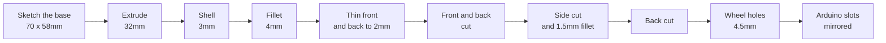

{:class="cover"}

---

## Watch the video first

This course goes with the video below. Watch it to see which planes each sketch goes on and how each step is done, then use the lessons as a step-by-step reference with every dimension you need.



---

## Overview

SMARS (Screwless Modular Assemblable Robotic System) is a small 3D-printed robot that's perfect for learning robotics. In this two-part course you'll design its chassis from scratch, using the same sketch, extrude, shell and fillet tools you'd use on any 3D-printed part.

Part 1 builds the outer shell: the box, the walls, the classic tank-like sides, the wheel holes and the slots the Arduino slides into. [Part 2](/learn/smars_fusion360_part2/) adds the motor holders and stub wheels.

> **A note on the name**: the software in this course was called Fusion 360 when the screenshots and video were made. It is now called Autodesk Fusion. The tools (Sketch, Extrude, Shell, Fillet, Mirror) do the same jobs, but menus and icons may have moved since the screenshots were taken. If a button is not where the picture shows it, look for the tool name in the toolbar, or use the search in the Fusion interface.

Every lesson is one step, and each step is a feature in Fusion's **timeline**, the strip along the bottom of the window that records what you did, in order. That order matters, so the lessons follow it exactly:

## Course Content

- Sketch and extrude the chassis base
- Shell, fillet and thin the walls
- Cut out the front, back and the classic SMARS side shape
- Cut the wheel holes and the slots the Arduino slides into

## Key Results

By the end of Part 1 you will be able to:

- Create a sketch with dimensions and turn it into a solid with **Extrude**
- Hollow out a part with **Shell** and round edges with **Fillet**
- Use a sketch profile to **extrude-cut** through a body
- Mirror a feature to the other side of a part
- Explain why a 3D-printed part needs wall thickness, rounded edges and clearance holes

## What you'll need

- [Autodesk Fusion](https://www.autodesk.com/products/fusion-360/personal) (the free personal-use licence is fine, but check Autodesk's current terms)
- A mouse with a scroll wheel makes orbiting and zooming much easier
- Paper and a pencil for sketching ideas, if you like to plan first
- No previous CAD experience is needed

## How the course works

Each lesson is one step in the design: a short explanation of what the step does and why, the dimensions to type in, and a drawing of what the part should look like afterwards. Dimensions are in millimetres and are given exactly as designed, so copy them as written.

Most lessons end with a few **Try it Yourself** ideas, a **Common Issues** list for when a step goes wrong, and a short quiz. If you get stuck, jump to that point in the video. Save your design as you go, and use the timeline to step back if something breaks.

> **Teachers**: this course suits ages 11 and up and works well as a design-and-make project that ends in a print. Each lesson takes about 10 to 20 minutes, so a double lesson covers a section. Each learner or pair needs a computer that can run Fusion and an Autodesk account (check your school's policy on accounts and the education licence). With no printer, learners can still finish the design and share screenshots. Printing the finished chassis needs a 3D printer and several hours, so plan that separately.

## Prerequisites

None! If you'd like to know more about the robot itself first, have a look at [Build a SMARS robot](/learn/smars/). If you prefer free, open-source software, the [FreeCAD version of this build](/learn/freecad_smars/) designs the same chassis.
