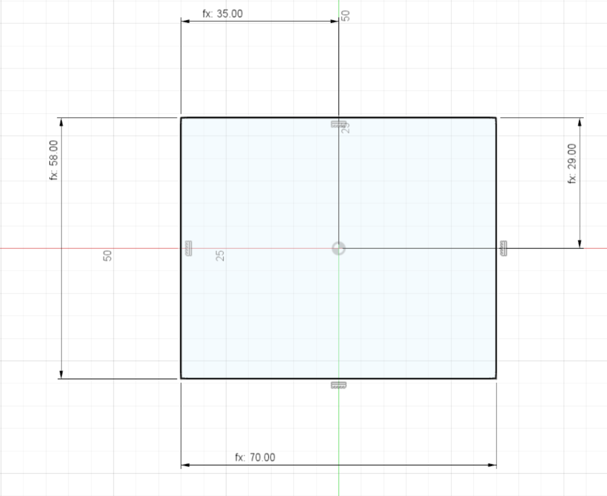

{:class="cover"}

---

By the end of this lesson you will be able to sketch a fully dimensioned rectangle that becomes the footprint of the SMARS chassis.

---

Every 3D part in Fusion starts life as a flat **sketch**. A sketch is a 2D drawing made of lines and shapes, with **dimensions** that fix their size. Later you turn that drawing into a solid. Think of it like drawing round the bottom of a box before you build it.

## The base rectangle

The Chassis Base is a rectangle with 2 dimensions:

* Length = 70mm
* Width = 58mm

{:class="img-fluid w-75 m-3"}

Draw the rectangle, then add the two dimensions with the sketch dimension tool and type in the values. Check the video to see which plane the sketch goes on.

## Why dimensions matter

If you only drag a rectangle to roughly the right size it will look fine, but it will be a slightly different size every time. Typed dimensions make the design **repeatable**: someone else can open your file, or you can come back next month, and every number is exactly what you meant. They also let you change one number later and have the whole design follow.

For a robot it matters even more. The 70 x 58mm footprint decides whether the motors, batteries and an Arduino fit inside. Getting it right now saves reprinting later.

## Common Issues

- **Problem**: The rectangle will not stay the size I typed, or drags around when I click it.
- **Solution**: Add a dimension to both the length and the width, and type the value into the box that appears.
- **Why**: A sketch with missing dimensions is under-defined, so its lines can still move. Dimensions pin them down.

- **Problem**: I cannot tell which direction is "length" and which is "width".
- **Solution**: Match your sketch to the picture above and the video.
- **Why**: The later lessons place cuts relative to these sides, so the orientation needs to match.

## Try it Yourself

1. Draw the rectangle first without dimensions and drag a corner. Notice it moves freely, then add the dimensions and try again.
2. Change the width to 60mm and see how the sketch updates. Put it back to 58mm afterwards.
3. Challenge: work out the area of the base in square millimetres. Why might a bigger footprint take longer to print?

## Check your understanding


? What are the dimensions of the chassis base sketch?
- [ ] 58mm long and 70mm high
- [x] 70mm long and 58mm wide
- [ ] 32mm by 58mm
> The base is a 70mm by 58mm rectangle. The 32mm figure is the height you extrude it to in the next lesson.

? Why do we type exact dimensions instead of just drawing a rectangle by eye?
- [ ] Because Fusion cannot draw rectangles without them
- [x] So the design is exact and repeatable, and can be changed later by editing a number
- [ ] To make the file smaller
> Dimensions fix a sketch's size, so the design is exact and every later step can rely on it.

? What is a sketch?
- [x] A flat 2D drawing with dimensions that you later turn into a solid
- [ ] A finished 3D-printable part
- [ ] A kind of fillet
> Every 3D part here starts as a flat sketch before it is extruded.

