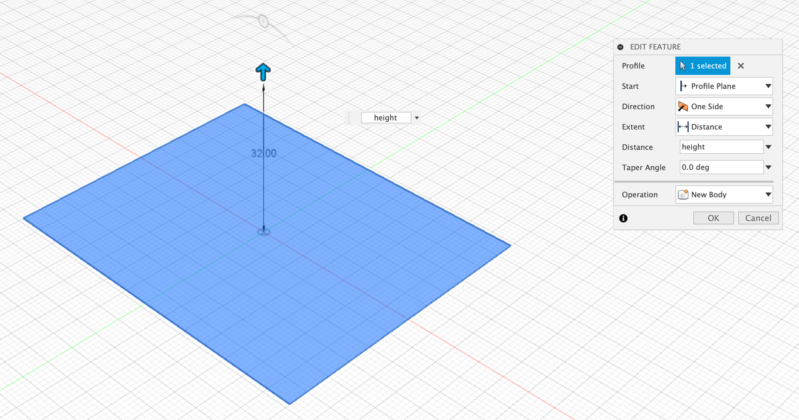

{:class="cover"}

---

By the end of this lesson you will be able to use **Extrude** to turn a sketch into a solid body of a set height.

---

A flat sketch is not yet a part. To get something you could print, you give it depth. The **Extrude** tool pushes a closed sketch shape out along a direction, like squeezing a stencil shape out of a tube of clay.

## Extruding the base

The base is then extruded up:

* Height = 32mm

{:class="img-fluid w-75 m-3"}

You now have a solid block, 70mm long, 58mm wide and 32mm tall. It is the raw material that the rest of the course carves into the SMARS chassis, much like a sculptor starting with a block of stone.

## What to check

After extruding, orbit around the block. It should be a single solid body, standing up from the sketch. If it grew the wrong way, undo and flip the direction.

## Why it matters

Notice the order we are working in: make a simple, accurate shape first, then remove material. That is far easier and more reliable than trying to draw the finished chassis in one go. Each step also shows up in the timeline, so you can go back and fix one step without redoing everything.

> **Teachers**: ask learners to predict what the block will look like before they extrude, then compare with the picture. Fusion's timeline lets learners step back, so a mistake costs very little.

## Common Issues

- **Problem**: Extrude does nothing, or the sketch will not highlight.
- **Solution**: Make sure the rectangle is a closed shape, with every corner joined, and select the area inside it.
- **Why**: Extrude needs a closed profile to know what area to push out.

- **Problem**: The block goes in the wrong direction or becomes a thin sheet.
- **Solution**: Check the distance reads 32mm and flip the direction if needed.
- **Why**: An extrude has a distance and a direction. Both must be right.

## Try it Yourself

1. Edit the extrude to 16mm instead and see how the block changes. Then set it back to 32mm.
2. Orbit the block and name each face (top, bottom, front, back, left, right). You will pick these faces in later lessons.
3. Challenge: the block is 58mm wide and 32mm tall. Which way would you prefer to print it, and why?

## Check your understanding


? What does the Extrude tool do to a sketch?
- [ ] Hollows it out
- [x] Pushes the closed shape out into a solid with depth
- [ ] Rounds its corners
> Extrude gives a flat sketch depth, here 32mm, turning it into a solid body.

? How tall is the extruded chassis base?
- [x] 32mm
- [ ] 58mm
- [ ] 70mm
> The base is extruded 32mm. The 70mm and 58mm are its length and width.

? Why will Extrude refuse a sketch with a gap in its outline?
- [ ] The gap makes the sketch too large
- [x] An open outline is not a closed profile, so there is no area to push out
- [ ] Extrude only works on circles
> Extrude needs a closed shape so it knows which area to turn into a solid.

