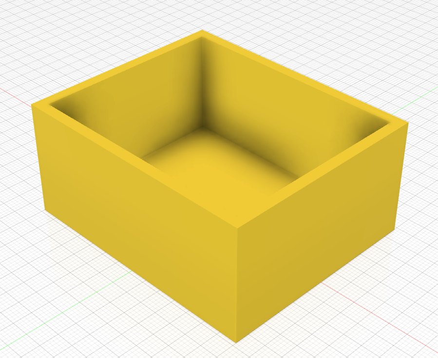

{:class="cover"}

---

By the end of this lesson you will be able to use **Shell** to hollow a solid block into a box with walls of a chosen thickness.

---

A solid block of plastic would be heavy, slow to print and no use as a chassis, because there would be nowhere to put the motors, batteries and electronics. The **Shell** tool fixes that in one step: it scoops out the inside of a solid and leaves walls of a thickness you choose.

## Shelling the block

Next a shell is applied to the extruded base cube, making it more into the familiar shape, if not a little blocky.

* Shell thickness = 3mm

{:class="img-fluid w-75 m-3"}

Shell asks you to pick which face (or faces) to remove, and the thickness of the walls that remain. Look at the picture and the video to see which face is left open.

## Why wall thickness matters

3mm is a sensible wall for a small printed robot. Walls that are too thin are fragile and can snap or even fail to print. Walls that are too thick waste plastic and time, and take space away from the parts that have to fit inside. As a rule of thumb, a printed wall should be several nozzle-widths thick, and 3mm comfortably achieves that on a typical printer.

This is the first real **design for 3D printing** decision in the course: the shape works because it is hollow, and the numbers are chosen with printing in mind.

> **Teachers**: printing time and plastic use drop sharply when a part is hollow. A good discussion point is to ask learners to estimate how much material a solid 70 x 58 x 32mm block would need compared with a shelled one.

## What to check

Orbit the model. You should see an open-topped box with an even wall all the way round. If the walls look uneven, or there is no opening, the wrong face was selected.

## Common Issues

- **Problem**: Shell fails or gives an error.
- **Solution**: Check that the thickness is 3mm and that you picked a face of the body, not an edge or a sketch.
- **Why**: Shell works on the faces of a solid. A bad selection or a thickness larger than the geometry allows will make it fail.

- **Problem**: The block became a closed hollow box with no opening.
- **Solution**: Undo and edit the shell, and make sure one face is selected to be removed.
- **Why**: Shell removes the faces you pick. If none is picked, the inside is hollow but sealed.

## Try it Yourself

1. Edit the shell in the timeline and try 6mm. What happens to the space inside? Set it back to 3mm.
2. Orbit around the box and work out the inside length and width from the numbers you know (the outside size minus a wall on each side).
3. Challenge: the inside width is the 58mm outside width minus a wall on each side. Work out the inside width with 3mm walls, and then with 6mm walls.

## Check your understanding


? What does the Shell tool do?
- [ ] Rounds the corners of a solid
- [x] Hollows out a solid, leaving walls of a set thickness
- [ ] Copies a feature to the other side
> Shell removes the inside of the block and leaves 3mm walls.

? What thickness is the shell in this lesson?
- [x] 3mm
- [ ] 2mm
- [ ] 4mm
> The shell thickness is 3mm. The 2mm is the thinned front and back, and 4mm is the fillet.

? Why make the chassis hollow?
- [ ] Hollow parts are always stronger
- [x] To leave room for electronics and to save plastic and printing time
- [ ] Fusion only prints hollow parts
> A hollow shell has space inside for parts and uses far less material.

