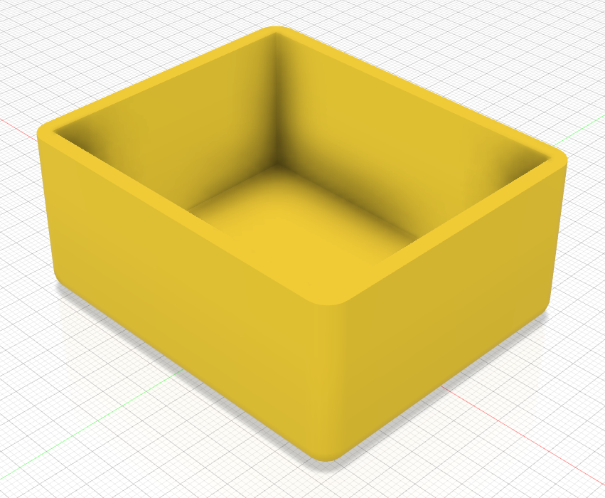

{:class="cover"}

---

By the end of this lesson you will be able to use **Fillet** to round edges and explain why rounded edges help a 3D-printed part.

---

Sharp edges look harsh, catch on things, and are weak points on a printed part. A **fillet** replaces a sharp edge with a smooth curve. The size you type is the radius of that curve.

## Rounding the chassis

The Chassis is now given a fillet around the bottom edges and each of the corners, to make it pleasing to the eye.

* Roundness = 4mm

{:class="img-fluid w-75 m-3"}

Select the edges shown in the picture, start the Fillet tool and type 4mm. All the selected edges are rounded together as a single feature.

## Why fillets help a print

- **Strength**: sharp inside and outside corners concentrate stress. A curve spreads it out, so the part is less likely to crack.
- **Printing**: the bottom edge of a printed part sits on the build plate. A rounded bottom edge helps avoid the slightly squashed, flared edge that can happen on the first layer.
- **Handling**: your robot will be picked up, dropped and knocked into furniture. Rounded corners are kinder to hands and to the robot.

The same tool is used again in lesson 10, with a much smaller value, to soften the edges of the side cut-outs.

## What to check

Zoom in on a corner. The edge should look like a smooth curve with no kinks or gaps. If a corner looks flat or one edge is still sharp, that edge was missed in the selection.

## Common Issues

- **Problem**: Fillet fails, or reports it cannot be built.
- **Solution**: Check you typed 4mm and selected only the edges shown. Try a slightly smaller value to test.
- **Why**: A fillet cannot be larger than the geometry next to it. If the radius is too big for the wall, Fusion cannot make the curve.

- **Problem**: Some edges are rounded and others are not.
- **Solution**: Edit the fillet in the timeline and add the missing edges to the selection.
- **Why**: Only the edges you select get rounded.

## Try it Yourself

1. Edit the fillet and change 4mm to 8mm. Does it still work? What changed? Return it to 4mm.
2. Compare a sharp corner and a filleted one by zooming in. Which would you prefer to print?
3. Challenge: the fillet is done before the front and back are thinned. Edit the fillet in the timeline and watch what the later steps do. Why is the timeline order important?

## Check your understanding


? What does the number you type into the Fillet tool mean?
- [ ] The number of edges to round
- [x] The radius of the curve that replaces the sharp edge
- [ ] The wall thickness
> The fillet value is the radius of the rounding, here 4mm.

? Which of these is a reason to round the edges of a 3D-printed part?
- [x] Rounded corners spread stress and are less likely to crack
- [ ] Rounded corners always print faster
- [ ] Sharp corners cannot be printed
> Fillets reduce stress concentration and make the part nicer to handle.

? You apply a fillet and some edges are still sharp. What should you do?
- [ ] Start the whole design again
- [x] Edit the fillet in the timeline and add the missing edges
- [ ] Use the Shell tool
> The timeline lets you edit an earlier feature without redoing the later steps.

