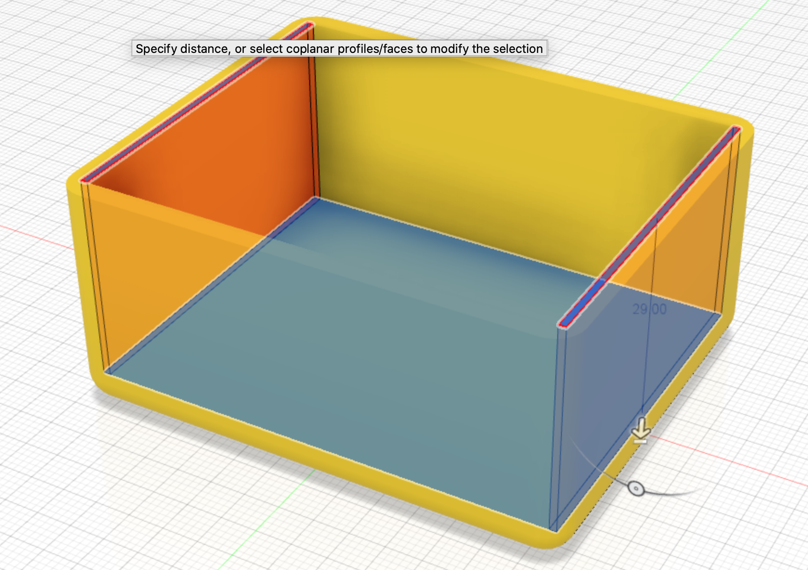

{:class="cover"}

---

By the end of this lesson you will be able to adjust the thickness of selected walls so some are thinner than the rest of the shell.

---

The Front and Back sides are currently the case thickness from the shell we applied earlier. This needs to be trimmed down so that they are only 2mm thick.

{:class="img-fluid w-75 m-3"}

## Why only the front and back?

The shell gave every wall the same thickness, 3mm. That is a good, safe starting point, but a robot is not the same strength everywhere. The front and back are where we will later cut openings, such as the area for a range finder at the front and the opening where the Arduino slides in at the back. Thinner walls there mean:

- more room inside the box for the electronics,
- less plastic to cut away later,
- and a better fit for parts that need to sit close to the edge.

The long sides carry the wheels and the load, so they keep their full 3mm.

## How to do it

The picture shows the result, and the video shows how the walls are brought down from 3mm to 2mm. Follow the video for the exact tool used, then check the result against the picture. Both the front and the back end up 2mm thick.

## What to check

Use a measure tool on the front and back walls: both should read 2mm. The two long sides should still read 3mm. If a long side changed, the wrong face was selected.

## Common Issues

- **Problem**: Only one of the two end walls got thinner.
- **Solution**: Edit the feature in the timeline and select both the front and back faces.
- **Why**: The change only applies to faces you select.

- **Problem**: The fillet around the edges now looks odd.
- **Solution**: Check the walls are 2mm and that the fillet from the last lesson is still in the timeline.
- **Why**: Features depend on the geometry before them, so changing a wall can change how a nearby edge looks.

## Try it Yourself

1. Measure the front wall, the back wall and a long side wall. Write the three thicknesses down.
2. Look at the chassis from above. How much wider is the inside space now than before the thinning?
3. Challenge: what is the thinnest wall you think your printer could print well? Check your slicer's settings for the nozzle size.

## Check your understanding


? How thick are the front and back walls after this lesson?
- [ ] 3mm
- [x] 2mm
- [ ] 4mm
> The front and back are trimmed from 3mm down to 2mm.

? Why are the front and back walls made thinner?
- [ ] Because the printer cannot print thick walls
- [x] To make more room inside and leave less material to cut away for the openings
- [ ] To make the robot taller
> The front and back are where the openings go, so thinner walls help.

? Which walls keep the full 3mm thickness?
- [x] The long sides that carry the wheels
- [ ] The front and the back
- [ ] None of them
> The shell is 3mm, and only the front and back are thinned.

