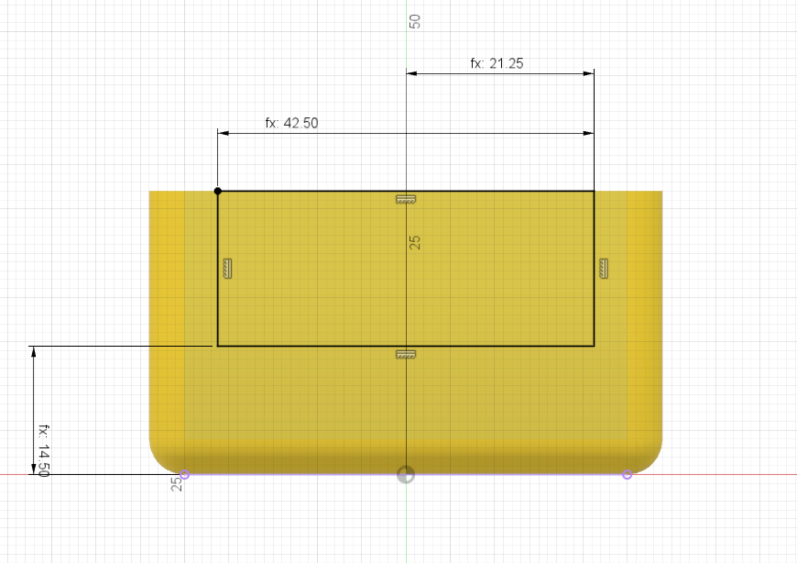

{:class="cover"}

---

By the end of this lesson you will be able to sketch a cut-out profile on a face of the chassis, using dimensions measured from its edges.

---

So far we have shaped the chassis from the outside, with a block, a shell and a fillet. Now we start **cutting** openings. Every cut in Fusion follows the same two-step recipe: first you draw the shape you want to remove (a **profile**), and then you use a tool to cut it away. This lesson is the first half, drawing the profile. The next lesson does the cut.

## The cutout profile

The Front and Back sides need to have a section cut out of them, first we need to create a profile for the cutout.

There are 2 main dimensions.

* Width = 42.5mm
* Height from bottom edge to the base = 14.5mm

{:class="img-fluid w-75 m-3"}

## Why this cut is useful

The opening at the front gives room for a range finder (the ultrasonic sensor that lets SMARS see obstacles). The same profile is cut through the back as well. Because both ends are cut with one sketch, the two sides are guaranteed to match.

## Sketching tips

- Start the sketch on the plane or face shown in the video.
- Dimension the width first, then the height.
- Dimensions are measured from the edges of the body, so use the picture to see where each measurement starts and ends.

## What to check

The profile should be a closed shape, centred on the end wall, and all of its dimensions should be typed in. When the sketch is fully dimensioned, the lines stop moving when you drag them.

## Common Issues

- **Problem**: My profile is in the wrong place, or on the wrong face.
- **Solution**: Delete the sketch and start again on the correct face or plane. The video shows the choice.
- **Why**: A sketch belongs to the plane you started it on, and the cut will follow that plane.

- **Problem**: The dimension shows a very different size from 42.5mm.
- **Solution**: Type the value with its units, for example 42.5 mm, and check the design units are millimetres.
- **Why**: Fusion works in the units of your design, so a number typed in the wrong unit gives the wrong size.

## Try it Yourself

1. Add up the numbers: the chassis is 58mm wide and the cutout is 42.5mm wide. How much wall is left on each side if the cutout is centred?
2. Drag a corner of your profile before it is fully dimensioned, and then again after. What changes?
3. Challenge: sketch the profile again with a different width, then delete it and return to 42.5mm.

## Check your understanding


? What are the two main dimensions of the front cutout profile?
- [ ] 70mm wide and 32mm high
- [x] 42.5mm wide and 14.5mm high from the bottom edge to the base
- [ ] 28mm wide and 16mm high
> The profile is 42.5mm wide and 14.5mm high, as listed in the lesson.

? What is a profile?
- [ ] A tool that rounds edges
- [x] A closed sketch shape that is used by a tool, here to cut away material
- [ ] A kind of wall
> A profile is the shape you draw before you extrude or cut it.

? Why is the same profile used for the front and the back?
- [x] One sketch cut through both ends keeps them matching
- [ ] Fusion only allows one sketch per part
- [ ] The back has no wall
> The cut goes all the way through, so both ends get the same shape.

