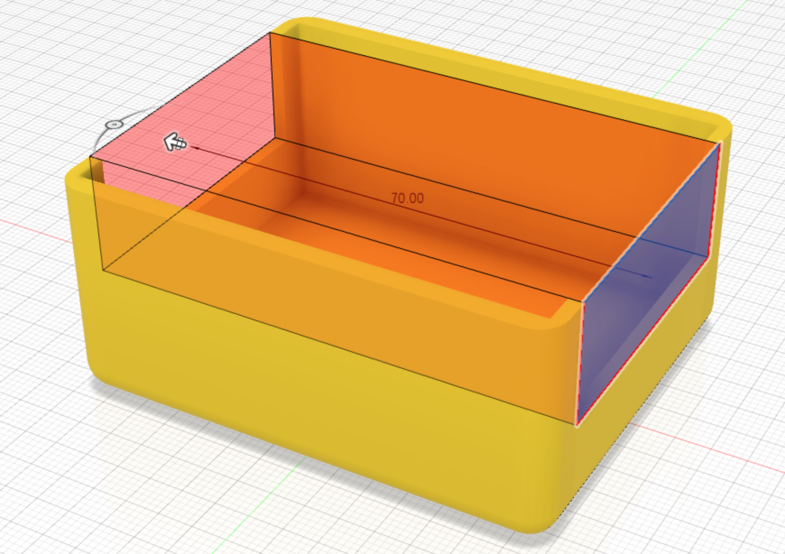

{:class="cover"}

---

By the end of this lesson you will be able to use **Extrude** in cut mode to remove material all the way through a body.

---

You have the profile. Now let's use it. This is the second half of the cut recipe from the last lesson: take the sketch and tell Fusion to remove, rather than add, material.

## Cutting through

The profile [created previously](06_front.html) is now used to extrude a cut all the way through the body.

{:class="img-fluid w-75 m-3"}

It is the same **Extrude** tool you used to make the base, but the operation is set to **Cut**. Instead of making a solid, it subtracts the shape from the body wherever the profile passes through. Setting the extent to go all the way through means one cut makes an opening in both the front and the back wall.

## What to check

Orbit round the chassis. You should be able to look through the front opening and out of the back. The opening should be the same shape at each end.

## Join, cut or new body?

Extrude has more than one operation, and the choice matters:

- **Join** adds the new solid to the body you already have.
- **Cut** removes material.
- **New Body** makes a separate solid that does not touch the first.

Many first-time CAD mistakes come from leaving the operation on the wrong setting. If your cut has added a block instead of removing one, that is why.

> **Teachers**: pair learners up and ask one to predict, before the cut is applied, what the model will look like from the front. It builds the habit of checking before pressing OK.

## Common Issues

- **Problem**: The extrude added material instead of cutting.
- **Solution**: Edit the feature and set the operation to Cut.
- **Why**: The same tool can join, cut or create a new body, depending on the operation.

- **Problem**: Only the front wall was cut, not the back.
- **Solution**: Edit the cut and set the extent so it passes all the way through the body.
- **Why**: A cut only removes material it actually reaches.

## Try it Yourself

1. Edit the cut in the timeline and switch it to Join and then back to Cut. What do you see in each case?
2. Look through the opening and describe what you can see inside the chassis.
3. Challenge: could this cut be made from only one end? What would be different about the back wall?

## Check your understanding


? What setting turns Extrude from adding material to removing it?
- [ ] The Shell thickness
- [x] Setting the operation to Cut
- [ ] The fillet radius
> An extrude can join, cut or create a new body. Cut removes material.

? Why does one cut make openings in both the front and back?
- [x] Because the cut goes all the way through the body
- [ ] Because the cut is mirrored
- [ ] Because the shell is open
> Cutting all the way through removes material at both walls.

? Your cut added a block instead of removing one. What is the most likely cause?
- [ ] The sketch was too small
- [x] The operation was left on Join
- [ ] The fillet was too big
> Check the operation setting first.

