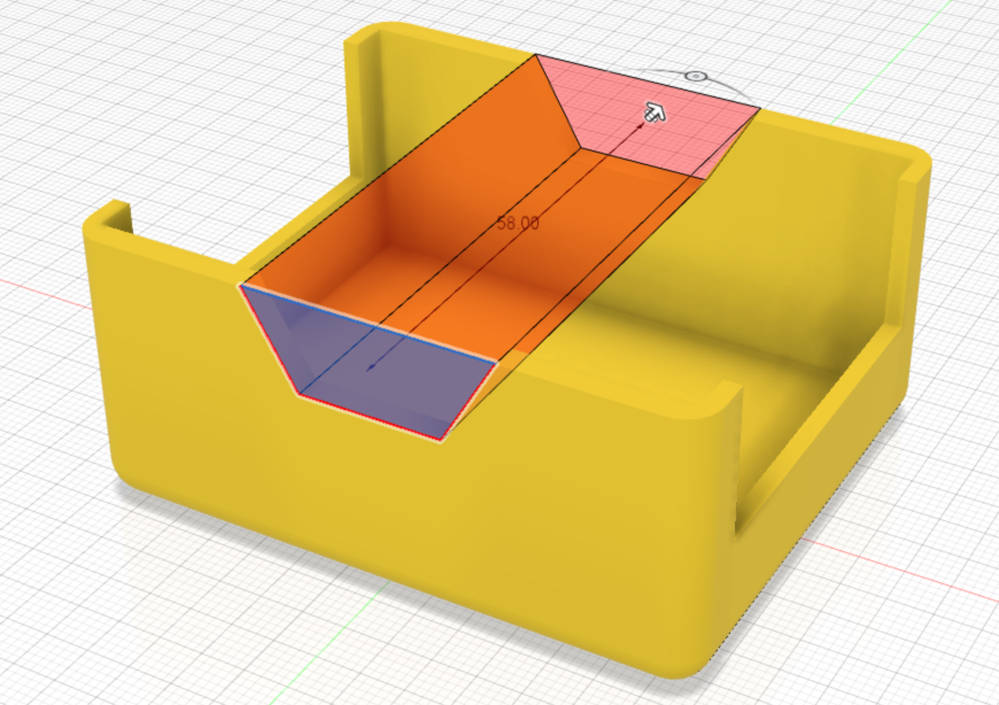

{:class="cover"}

---

By the end of this lesson you will be able to extrude-cut a side profile through a body and check the result from several angles.

---

The profile from the last lesson is just a drawing until you cut with it. This lesson turns the trapezium into the notch that makes a SMARS look like a SMARS.

## Cutting the sides

The [side profile](08_side.html) is now extruded to cut all the way through the main body.

{:class="img-fluid w-75 m-3"}

As in the front and back cut, this is Extrude with the operation set to **Cut** and the extent set to go all the way through. Because the sketch is drawn on the side, the cut passes from one side wall to the other, so both side walls get the notch from one feature.

## Why cut the sides

Removing plastic from the sides has three benefits:

- the robot is lighter, which helps small motors,
- there is less to print,
- and it creates the distinctive shape that makes the chassis recognisable.

## What to check

Look at the chassis side-on. The notch should be a clean inverted trapezium, 28mm wide at the top of the cut and 16mm wide at the bottom. Then orbit to the other side and check the notch is there too. If only one side is cut, the extent did not reach through the whole body.

> **Teachers**: this is a good moment for a quick design critique. Ask learners to hold up the screen and say what they like about the shape, and what they would change in a second version.

## Common Issues

- **Problem**: Only one side wall has a notch.
- **Solution**: Edit the cut and set the extent so it goes all the way through the body.
- **Why**: A cut only removes material it reaches.

- **Problem**: The cut removed too much, or cut through the base.
- **Solution**: Check the profile in the sketch is still 28mm, 16mm and 10.5mm deep, and that the cut is not set to a larger distance than intended.
- **Why**: The cut follows the profile exactly.

## Try it Yourself

1. Use the timeline to hide and show the cut feature so you can compare the chassis with and without it.
2. Turn the model so you can look straight into the notch from the top. What can you see through it?
3. Challenge: what would happen to the strength of the chassis if the notch were much deeper than 10.5mm?

## Check your understanding


? How is the side cutout made?
- [ ] With the Shell tool
- [x] By extruding the side profile with the operation set to Cut, all the way through
- [ ] With a fillet
> The trapezium profile is extruded as a cut through the whole body.

? Why does the side cut affect both side walls at once?
- [x] The cut goes all the way through the body
- [ ] The Shell tool copies it
- [ ] Fusion mirrors it automatically
> Because the cut goes right through, it removes material at both walls.

? Give one reason for cutting away the sides.
- [ ] To make the chassis heavier
- [x] To reduce weight and printing, and give SMARS its classic shape
- [ ] To make the wheels bigger
> Cutting away plastic makes the chassis lighter and gives its distinctive look.

