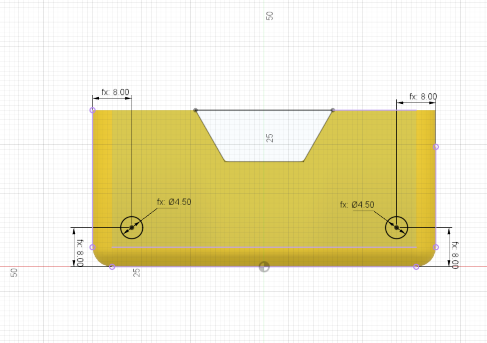

{:class="cover"}

---

By the end of this lesson you will be able to sketch a circular hole positioned by its distance from two edges, and explain why holes need clearance.

---

The wheels of a SMARS are turned by small motors, and each motor spindle has to pass through the side wall of the chassis. So we need a hole on each side. As usual the profile comes first.

## The hole profile

The profile for the wheel holes is created next. This has 2 dimensions:

* Hole diameter = 4.5mm (the motor spindle is 3mm so this is plenty of clearance)
* Hole centre from edge and bottom = 8mm

{:class="img-fluid w-75 m-3"}

## Why 4.5mm for a 3mm spindle?

3D printers are not perfectly accurate. Holes tend to come out a little smaller than designed, because the plastic is laid down in rounded lines that bulge inward. A hole drawn at exactly 3mm might print too tight for a 3mm spindle to turn. The extra 1.5mm is **clearance**: it lets the spindle spin freely without rubbing. Whenever you design a hole for something to pass through, add clearance.

## Placing the hole

The centre of the circle is measured from the edge and from the bottom, both 8mm. A circle is positioned by its centre, so get that right and the hole is in the right place. Dimension the diameter and then the two distances.

## What to check

The circle should read 4.5mm and its centre should sit 8mm from the end edge and 8mm up from the bottom edge. If you measure it, both distances should be 8mm.

## Common Issues

- **Problem**: The circle size is wrong, for example 9mm.
- **Solution**: Check you dimensioned the diameter, not the radius.
- **Why**: A diameter of 4.5mm is a radius of 2.25mm. Typing 4.5 into a radius box makes a hole twice as big.

- **Problem**: The circle slides around when I drag it.
- **Solution**: Add the two 8mm distances to fix its centre.
- **Why**: A circle needs a size and a position to be fully defined.

## Try it Yourself

1. Sketch the circle and dimension it. Then try dragging it before and after the 8mm distances are added.
2. Work out how much wall is left between the hole and the bottom of the chassis. Radius is half the diameter.
3. Challenge: your printer makes holes about 0.3mm too small. What diameter would you sketch for a 3mm spindle with a little clearance?

## Check your understanding


? What diameter is the wheel hole?
- [ ] 3mm
- [x] 4.5mm
- [ ] 8mm
> The hole is 4.5mm across, for a 3mm motor spindle.

? Why is the hole bigger than the spindle?
- [x] Printed holes come out small, so clearance lets the spindle turn freely
- [ ] To make the chassis lighter
- [ ] To fit a bigger wheel
> Clearance allows for inaccuracy in 3D printing.

? How far is the centre of the hole from the edge and the bottom?
- [ ] 4.5mm
- [x] 8mm
- [ ] 3mm
> The hole centre sits 8mm from the edge and 8mm from the bottom.

