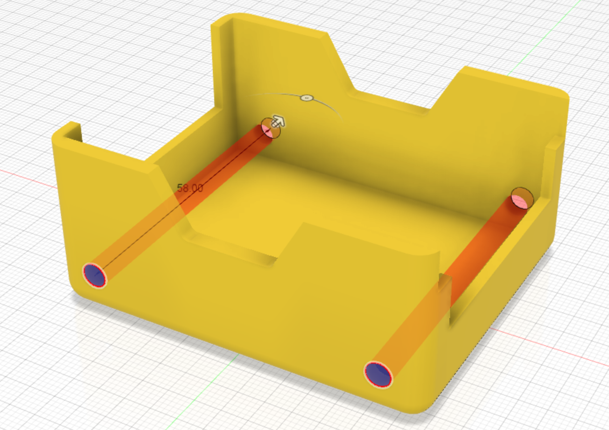

{:class="cover"}

---

By the end of this lesson you will be able to cut holes through a body and check them from both sides.

---

With the circle drawn, we can cut the wheel holes. This is another Extrude cut, the fourth one in the course, and by now the recipe should feel familiar: profile first, then cut.

## Cutting the holes

The [wheel hole profile](13_wheel.html) is used to extrude a cut all the way through the body.

{:class="img-fluid w-75 m-3"}

Set the operation to **Cut** and the extent to go all the way through. A single cut passes through every wall in its path, so the holes appear in the side walls where the motor spindles will go.

## Why it matters

Getting holes in the right place matters on a robot. If the holes are too high, too low or too close to the front, the wheels will not line up with the motors, and the robot will not roll straight. Because both holes come from one sketch, they are guaranteed to line up with each other.

> **Teachers**: printers differ in how accurately they print holes. If you can, print a small test piece with a 4.5mm hole and check a 3mm spindle turns freely in it before spending hours printing the whole chassis.

## What to check

Look at the side of the chassis. You should see a clean round hole through each wall. Look through one hole: you should be able to see daylight through the other if they line up.

## Common Issues

- **Problem**: The holes only go through one wall.
- **Solution**: Edit the cut and set the extent to go all the way through the body.
- **Why**: A cut only removes the material it reaches.

- **Problem**: The holes cut other parts of the chassis too, such as an opening you did not expect.
- **Solution**: Check the extent and the direction, and look at the timeline for earlier cuts that may overlap.
- **Why**: A cut that goes all the way through removes everything in its path.

## Try it Yourself

1. Hide the cut in the timeline, then show it again to see what it adds.
2. Check the hole centre again by measuring from the bottom edge and the end edge.
3. Challenge: what would happen to the robot if the two holes were not at exactly the same height?

## Check your understanding


? Which tool and operation make the wheel holes?
- [ ] Fillet
- [x] Extrude with the operation set to Cut
- [ ] Shell
> The circle profile is extruded as a cut through the body.

? Why must both holes be at the same height?
- [x] So the wheels line up and the robot rolls straight
- [ ] So the chassis is lighter
- [ ] Fusion needs them to match
> Wheels at different heights would make the robot lopsided.

? What is a quick way to check the holes line up?
- [ ] Count the timeline steps
- [x] Look through one hole and see whether you can see through the other
- [ ] Apply a fillet
> If the holes line up, you can see straight through.

