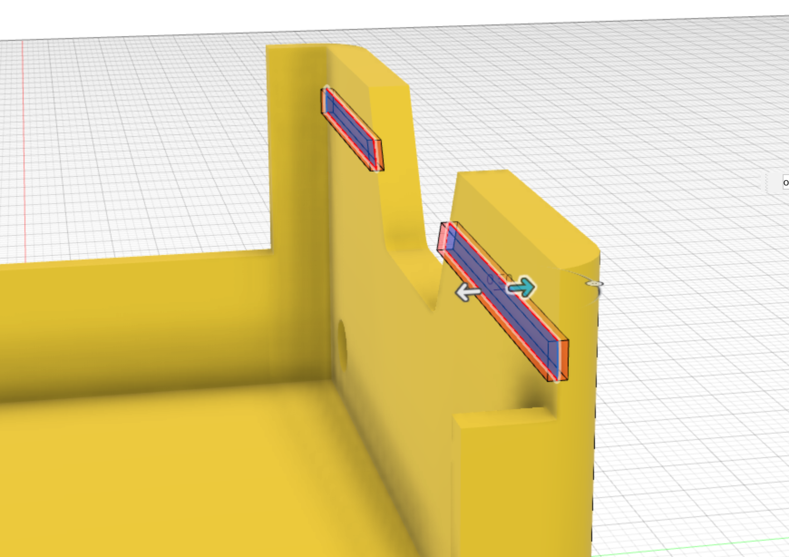
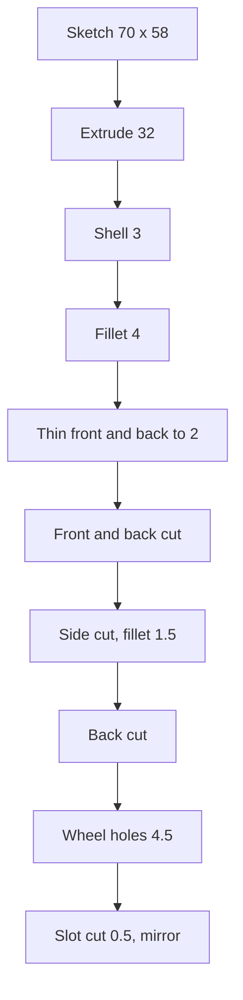

{:class="cover"}

---

By the end of this lesson you will be able to cut a shallow slot, mirror the feature to the opposite wall, and finish Part 1 of the chassis.

---

This is the last step of the shell. We take the slot profile and cut it, then mirror it so both sides of the chassis have the same slot.

## Cutting the slots

The [Arduino slot profile](15_slots.html) created previously is used to extrude a cut into the body, to a depth of 0.5mm.

* Arduino slot depth 0.5mm

This feature is mirrored across to the other side of the chassis.

{:class="img-fluid w-75 m-3"}

## Why only 0.5mm?

The slot is only 0.5mm deep, so it is a shallow groove in the wall rather than a hole through it. A shallow cut leaves most of the wall intact, whereas a deeper slot would leave the wall thinner and weaker.

## Why Mirror?

The **Mirror** tool copies a feature across a plane, so you get an exact reflection on the other side. It is better than sketching and cutting a second time for two reasons:

- the two sides are always identical,
- and if you change the original (for example, make the slot a little deeper), the mirror follows.

## Where you've got to

That's the outer shell finished! You now have the base, the shaped sides, the wheel holes and the slots the Arduino slides into. Here is the whole timeline in one go:

Save your design, because Part 2 builds on it.

> **Teachers**: before anyone prints, ask learners to compare their timeline against the one above. Printing the full chassis takes a long time (hours on many printers), so check the design first. Save the file under a clear name, and keep a copy in case a shared computer is wiped.

## Common Issues

- **Problem**: The mirror did not work, or the slot is only on one side.
- **Solution**: Check you selected the slot cut as the feature to mirror, and the middle plane of the chassis as the mirror plane.
- **Why**: Mirror copies the feature you pick across the plane you pick. The wrong choice gives a wrong or empty copy.

- **Problem**: The slot cut seems to do nothing.
- **Solution**: Check the depth is 0.5mm and the direction goes into the wall.
- **Why**: A shallow cut is easy to miss, and the wrong direction cuts into air.

## Check your understanding


? Why is the wheel hole 4.5mm across when the motor spindle is only 3mm?
- [x] To give the spindle plenty of clearance so it turns freely
- [ ] To make the chassis lighter
- [ ] So the wheel can push through the hole
> 3D prints aren't perfectly accurate, so holes need some clearance. 4.5mm leaves room for the 3mm spindle.

? You cut a slot on one side of the chassis. What's the quickest way to get the same slot on the other side?
- [ ] Sketch and cut it again
- [x] **Mirror** the feature across the middle of the chassis
- [ ] Use the Shell tool
> Mirror copies a feature across a plane, so both sides stay identical, even if you change the original later.

? How deep is the Arduino slot cut?
- [ ] 2mm
- [ ] 5.5mm
- [x] 0.5mm
> The slot is 2mm high but is cut only 0.5mm into the wall.


## Try it Yourself

1. Change the shell thickness from 3mm to 2.5mm in the timeline and watch the whole design update.
2. Measure your Arduino Uno board: will it slide into the slots you've cut?
3. Challenge: export the body as an STL file and open it in your slicer. Check the estimated print time, then try a different wall thickness and compare.

## What's next

Carry on with [Part 2: Motor Holders and Stub Wheels](/learn/smars_fusion360_part2/) to finish the chassis. If you want to see how the printed robot goes together, have a look at [Build a SMARS robot](/learn/smars/), or try the [FreeCAD version of this build](/learn/freecad_smars/) to design the same chassis in free, open-source software.
