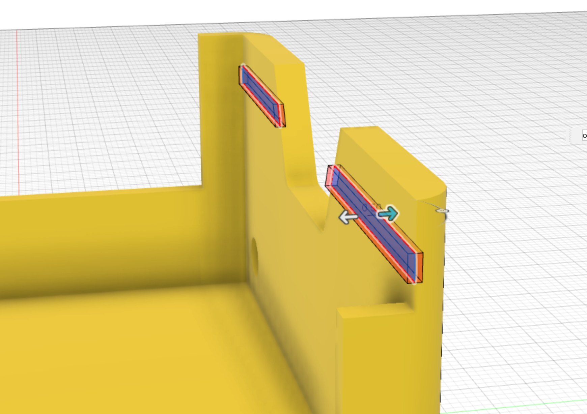

The [Arduino slot profile](15_slots.html) created previously is used to extrude a cut into the body, to a depth of 0.5mm.

* Arduino slot depth 0.5mm

This feature is mirrored across to the other side of the chassis.

{:class="img-fluid w-75 m-3"}

## Where you've got to

That's the outer shell finished! You now have the base, the shaped sides, the wheel holes and the slots the Arduino slides into. Save your design, because Part 2 builds on it.

## Check your understanding


? Why is the wheel hole 4.5mm across when the motor spindle is only 3mm?
- [x] To give the spindle plenty of clearance so it turns freely
- [ ] To make the chassis lighter
- [ ] So the wheel can push through the hole
> 3D prints aren't perfectly accurate, so holes need some clearance. 4.5mm leaves room for the 3mm spindle.

? You cut a slot on one side of the chassis. What's the quickest way to get the same slot on the other side?
- [ ] Sketch and cut it again
- [x] **Mirror** the feature across the middle of the chassis
- [ ] Use the Shell tool
> Mirror copies a feature across a plane, so both sides stay identical, even if you change the original later.


## Try it yourself

1. Change the shell thickness from 3mm to 2.5mm in the timeline and watch the whole design update.
2. Measure your Arduino Uno board: will it slide into the slots you've cut?

## What's next

Carry on with [Part 2: Motor Holders and Stub Wheels](/learn/smars_fusion360_part2/) to finish the chassis.
