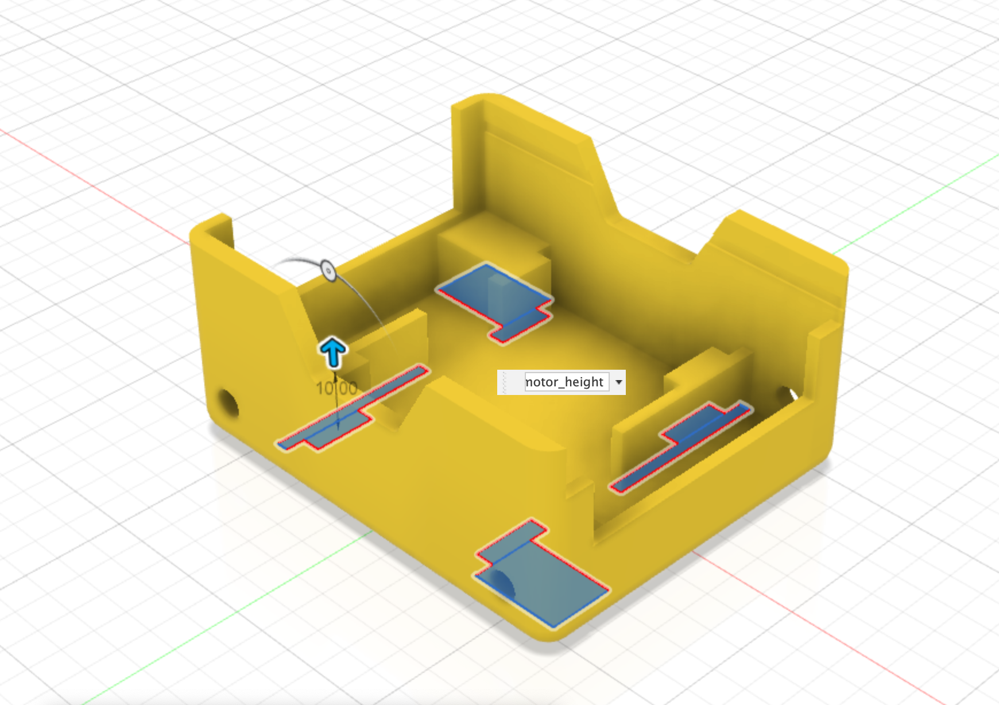

{:class="cover"}

---

By the end of this lesson you will be able to turn the motor holder profile into solid walls with the Extrude tool.

## From flat to solid

A sketch is only lines on a plane. Nothing can be printed until it has thickness. The [Motor holder profile](01_motor.html) is used to extrude up the motor holders, pulling the flat shape upwards from the floor of the chassis.

The dimensions are:

* height = 10mm

{:class="img-fluid w-75 m-3"}

## Keep it one body

When you extrude inside an existing body, Fusion offers a few operations. Here you want the new walls to become part of the chassis, so they must be **joined** to the body and not left as a separate body. If they end up separate, the slicer will treat them as loose parts floating inside the shell. After the extrude, look in the browser on the left: you should still have one chassis body.

Walls are also a printing trade-off. Taller walls use more plastic and print time, while walls that are too short do not grip. Stick to the 10mm in the drawing.

**Check after this step:** orbit the model and confirm that the walls rise from the chassis floor, that the browser still lists one body, and that the walls match the drawing.

## Try it Yourself

1. Find the Extrude feature in the timeline at the bottom and double-click it to see the 10mm value, then cancel.
2. Orbit around the part and check that every wall starts at the floor.
3. Challenge: use the Measure tool to check the height of a wall, then close the dialog without changing anything.

## Common Issues

- **Problem**: The walls appear as a separate body in the browser.
- **Solution**: Undo and extrude again, choosing the operation that joins to the existing body.
- **Why**: A separate body is exported as a separate shell, which can leave unsupported floating walls in your print.

- **Problem**: The extrude only picks up some of the walls.
- **Solution**: Click each region of the profile so all of them are highlighted before you confirm.
- **Why**: The profile contains several closed shapes, and each one must be selected.

## Check your understanding


? How tall are the extruded motor holders?
- [ ] 2mm
- [x] 10mm
- [ ] 16mm
> The extrude height is given as 10mm.

? Why should the walls join the chassis body?
- [ ] So they print faster
- [x] So they are part of one solid object, not loose bodies
- [ ] So they can be hidden
> A separate body would export as a separate part and could print unsupported.

? What does extrude do to a sketch profile?
- [x] Pulls the flat shape out into a solid with height
- [ ] Rounds the corners
- [ ] Copies it to the other side
> Extrude adds depth to a 2D profile.

