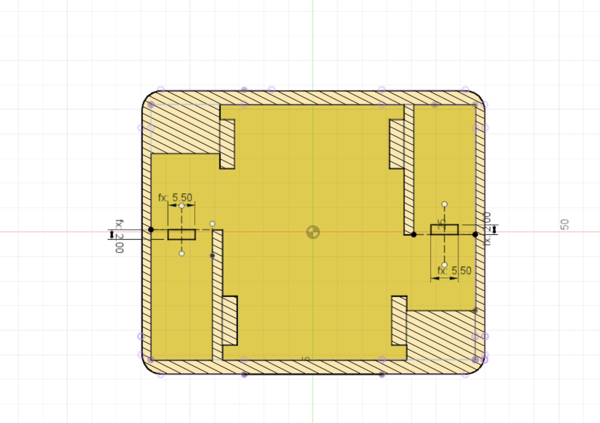
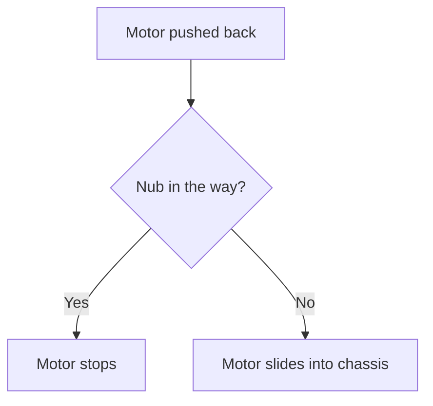

{:class="cover"}

---

By the end of this lesson you will be able to sketch a small stop (a nub) that stops the motor sliding back into the chassis.

## A tiny feature with a big job

The motor holders grip the sides of each motor, but nothing yet stops a motor being pushed backwards into the chassis body. A small nub does that. Think of the lip at the end of a drawer that stops it sliding out too far: the motor pushes against the nub and goes no further.

A small nub needs to be sketched. The dimensions are:

* motor nub height = 2mm
* motor nub width = 5.5mm

They are aligned to the top of the motor holder sides and centred within that area.

{:class="img-fluid w-75 m-3"}

## Centring the nub

"Centred within that area" is the part people get wrong. Rather than eyeballing it, use a sketch constraint to centre the rectangle between the two walls. A constraint keeps it centred even if you change the spacing later, while a rectangle placed by eye is only centred until something moves.

This is a general CAD habit worth learning: where a part is meant to be symmetric, say so with a constraint, not just with the mouse.

**Check after this step:** the sketch shows a 5.5mm wide, 2mm high rectangle aligned to the top of the holder sides, with equal gaps to the left and right.

## Try it Yourself

1. Draw the nub and check that the gaps on each side are equal.
2. Drag one corner. Does the shape move, or is it locked by dimensions?
3. Challenge: work out which part of the sketch decides how far back the motor can travel.

## Common Issues

- **Problem**: The nub sits slightly off-centre.
- **Solution**: Add a centring or equal constraint between the nub and the two walls, then re-check.
- **Why**: A rectangle placed by eye looks right at first but may be a fraction of a millimetre out, which shows up in the print.

- **Problem**: The nub is drawn on the wrong plane.
- **Solution**: Delete it and start the sketch on the top face of the motor holder sides.
- **Why**: Extruding from the wrong plane makes the nub appear in the wrong place or not touch the walls.

## Check your understanding


? What is the nub for?
- [ ] Holding the battery
- [x] Stopping the motor sliding backwards into the chassis
- [ ] Clipping on a lid
> The nub prevents the motor sliding backwards.

? What is the nub width?
- [ ] 2mm
- [x] 5.5mm
- [ ] 10mm
> Height is 2mm and width is 5.5mm.

? Why use a constraint to centre the nub?
- [x] It stays centred if you change other dimensions later
- [ ] It makes the print stronger
- [ ] Fusion will not allow otherwise
> Constraints record your design intent, so later edits keep it.

