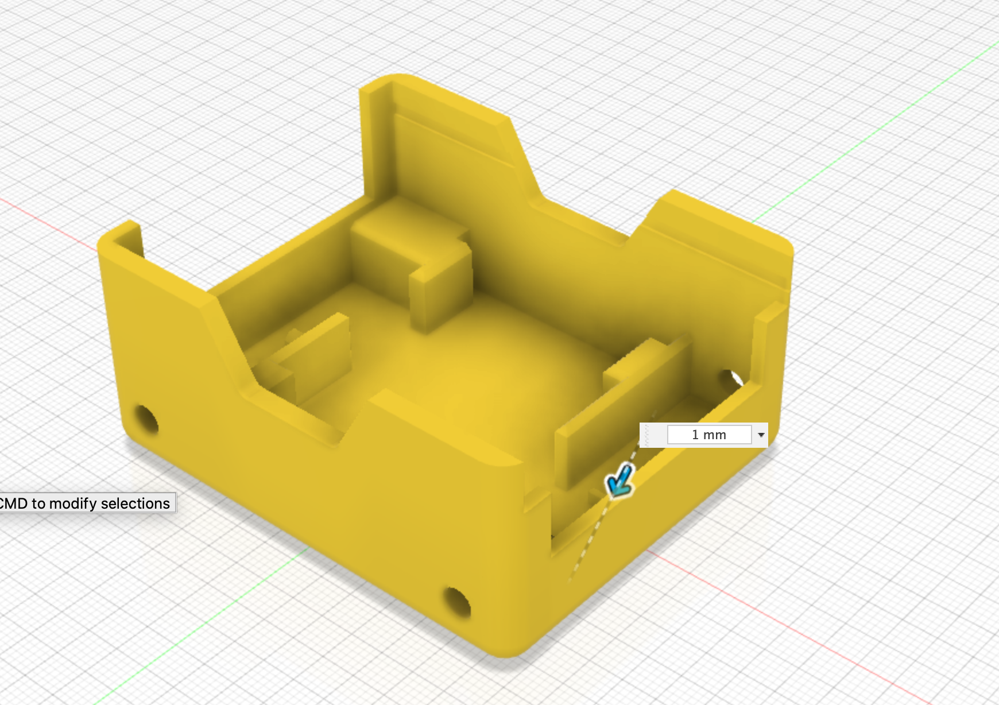

{:class="cover"}

---

By the end of this lesson you will be able to add a chamfer to the tops of the motor holders and nubs and explain how it differs from a fillet.

## Softening the tops

A small chamfer is applied to the tops of the extruded [motor holder profiles](01_motor.html) and [motor nubs](04_extrude.html).

The dimension of the chamfer is:

- motor holder chamfer = 1mm

{:class="img-fluid w-75 m-3"}

## Chamfer or fillet?

Both tools soften an edge, but in different ways:

| Tool | What it does to the edge |
| --- | --- |
| Chamfer | Cuts it off at an angle |
| Fillet | Rounds it into a curve |
{:class="table table-single"}

Here a chamfer is used on the tops of the walls and nubs. A bevelled top edge acts like a ramp: when you slide a motor in between the walls it is guided into the gap instead of catching on a sharp corner. It also takes the sharp edge off the print, which is kinder to fingers and to wires.

**Check after this step:** the tops of the walls and the nubs should each show a thin angled strip. If some edges are still sharp, you missed them in the selection.

## Try it Yourself

1. Select the top edges of one wall and apply the 1mm chamfer. Does the preview look like the drawing?
2. Preview a fillet of the same size, then cancel it. Which looks more like a ramp?
3. Challenge: explain why a chamfer at the bottom of a wall (where it meets the floor) would not help you slide a motor in.

## Common Issues

- **Problem**: Only some of the edges are chamfered.
- **Solution**: Hold Ctrl (or Cmd on a Mac) and click every top edge of the walls and the nubs before you confirm.
- **Why**: The chamfer tool only changes the edges you have selected.

- **Problem**: Fusion shows an error that the chamfer failed.
- **Solution**: Check the distance is 1mm and try again, selecting fewer edges at a time if needed.
- **Why**: A chamfer bigger than the surface it is cutting into cannot be built.

## Check your understanding


? What are the small motor nubs for?
- [ ] To hold the battery
- [x] To stop the motors sliding backwards into the chassis
- [ ] To clip the lid on
> The 2mm nubs sit behind each motor and hold it in place.

? What does a **Chamfer** do to an edge?
- [x] Cuts it at an angle
- [ ] Rounds it into a curve
- [ ] Makes it thicker
> A chamfer bevels an edge at an angle. A fillet rounds it instead.

? What size is the motor holder chamfer?
- [x] 1mm
- [ ] 2mm
- [ ] 5mm
> The chamfer dimension is 1mm.

