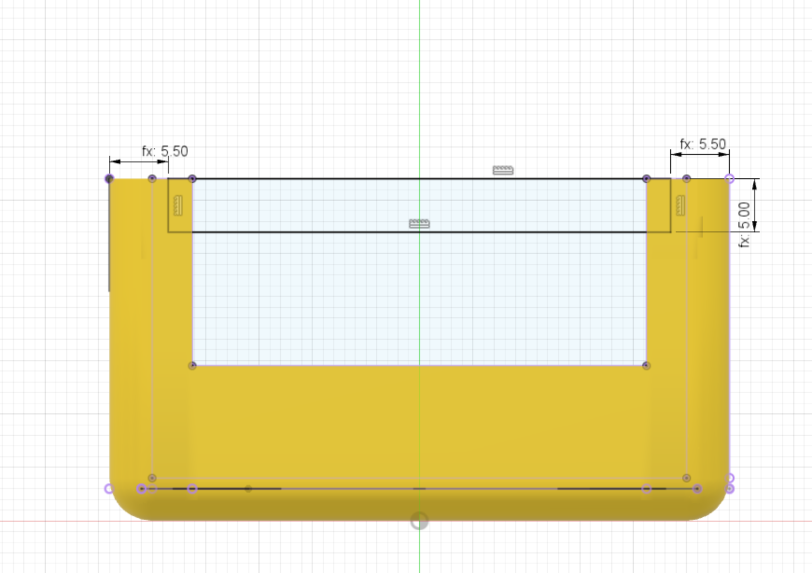

{:class="cover"}

---

By the end of this lesson you will be able to sketch a cut-out profile on the front of the chassis and place it by measuring from the side.

## Planning a cut

A profile sketch is needed to make a final cut to the front side. A cut works the opposite way to the extrudes you have been doing: instead of adding material, it removes it. To remove the right shape in the right place, you first draw that shape on a face of the chassis.

The dimensions of the cut are:

* width = 5mm
* distance from chassis side to profile = 5.5mm

{:class="img-fluid w-75 m-3"}

## How to place it

The distance from the chassis side (5.5mm) fixes where the cut sits, and the width (5mm) fixes how big it is. Those two numbers are all this sketch needs. If the sketch is not fully constrained you will see blue lines, which means something can still move.

**Check after this step:** the sketch is on the front, sits 5.5mm from the chassis side, is 5mm wide, and all lines are black.

Always finish the sketch before the next lesson. The cut tool can only use a profile from a finished sketch.

## Try it Yourself

1. Create the sketch and add both dimensions.
2. Drag one line to check it is locked in place.
3. Challenge: which dimension would you edit to move the cut closer to the side, and which to make it wider?

## Common Issues

- **Problem**: The profile is in the wrong place.
- **Solution**: Check you measured from the chassis side edge to the nearest edge of the profile.
- **Why**: Measuring to a different edge of the profile gives a different position.

- **Problem**: The sketch will not show up for the next step.
- **Solution**: Click Finish Sketch, then look for the sketch in the browser and make sure its light bulb is on.
- **Why**: A hidden or unfinished sketch cannot be picked as a profile.

## Check your understanding


? How wide is the front profile?
- [ ] 5.5mm
- [x] 5mm
- [ ] 2mm
> The width is 5mm. The 5.5mm is the distance from the chassis side.

? What does a blue line in a sketch usually mean?
- [x] It is not fully constrained and can still move
- [ ] It is ready to cut
- [ ] It is hidden
> Dimensions and constraints lock lines in place.

? What does a cut do in CAD?
- [ ] Adds material
- [x] Removes material in the shape of the profile
- [ ] Copies the body
> The cut removes the profile shape from the body.

