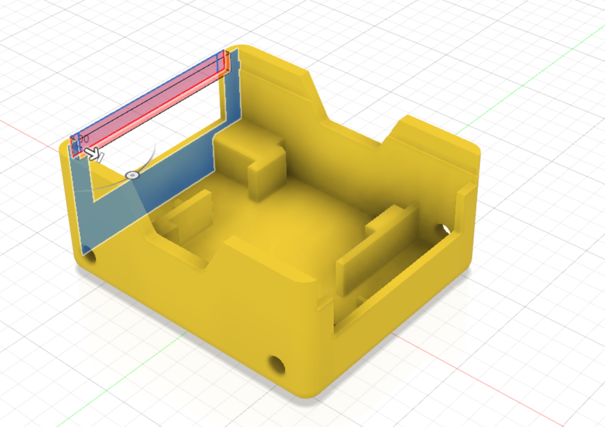

{:class="cover"}

---

By the end of this lesson you will be able to use a finished profile to extrude-cut an opening into the front of the chassis.

## Cutting it out

The [Front profile](06_front.html) created above is used to extrude a cut into the front side of the chassis.

{:class="img-fluid w-75 m-3"}

## How an extrude-cut works

An extrude-cut uses the same Extrude tool you have already met, but with the operation set to **Cut**. Fusion pushes the profile through the body and removes any material it passes through. Two things matter: which profile it uses, and how far it goes.

Think of pressing a biscuit cutter into dough. The shape is the profile and the depth is how far you push. This lesson gives no depth value for the cut, so judge it from the drawing: the opening should look like the one in the picture, with no thin skin left behind.

**Check after this step:** orbit round to the front and compare with the drawing. The opening should have clean, straight sides, and the rest of the chassis should be unchanged.

Thin skins are worth hunting for because of how a printer works. A sliver of wall left behind by a cut that stops a hair short prints as a fragile film, or may not print properly at all.

## Try it Yourself

1. Perform the cut and compare the result with the drawing.
2. Open the cut from the timeline, watch the preview as you change the distance, then cancel without saving a change.
3. Challenge: explain what would be left behind if the cut stopped slightly short.

## Common Issues

- **Problem**: The cut does not go all the way through.
- **Solution**: Edit the feature and extend the distance until the preview matches the drawing.
- **Why**: A short cut leaves a thin skin of plastic.

- **Problem**: The tool adds material instead of removing it.
- **Solution**: Change the operation in the Extrude dialog to Cut.
- **Why**: The same tool does both jobs, and the operation setting decides which.

## Check your understanding


? Which tool is used for this cut?
- [ ] Chamfer
- [x] Extrude with the operation set to Cut
- [ ] Revolve
> The profile is used to extrude a cut.

? What would a cut that stops short leave behind?
- [x] A thin skin of material
- [ ] A bigger hole
- [ ] Nothing
> A short cut leaves a fragile film that prints poorly.

? What must you do to the sketch before cutting?
- [ ] Delete it
- [x] Finish the sketch so its profile can be picked
- [ ] Turn it into a circle
> Only finished, visible sketches offer profiles.

