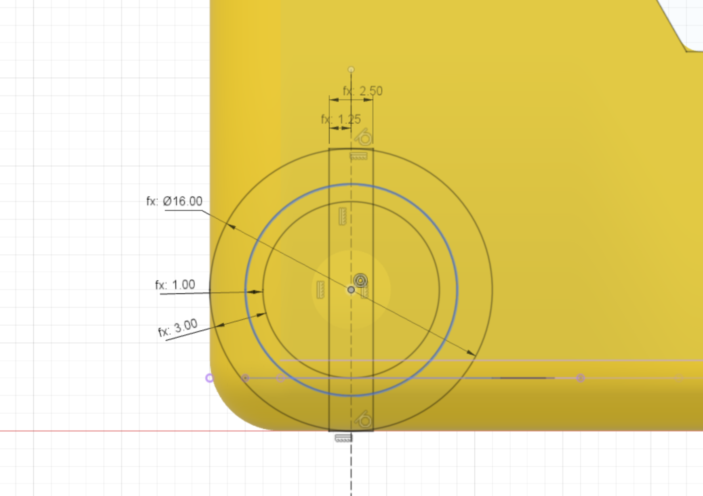
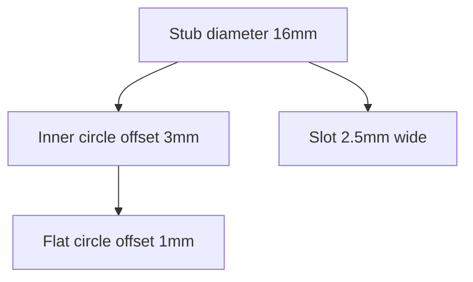

{:class="cover"}

---

By the end of this lesson you will be able to sketch the concentric circles and slot that make up the unpowered wheel stub.

## What is a stub?

Some of the SMARS wheels are driven by the motors. The others just roll along, and need a short axle to spin on. That axle is the stub. The design is "screwless", so the wheel is held on by a snap fit rather than a screw, and the stub has a slot so that it can squeeze together slightly. You will cut that slot in a later lesson.

The unpowered wheel stub profile is sketched next. It has several dimensions:

* stub diameter = 16mm
* stub inner diameter = 3mm (offset from stub diameter)
* stub flat diameter = 1mm (offset from the stub inner diameter)
* stub cut out slot width = 2.5mm

{:class="img-fluid w-75 m-3"}

## Reading the list

The word "offset" tells you how the circles are related: each inner circle is created as an offset of the one outside it, using the distance in the list. Using offsets instead of separate diameters means the circles stay concentric, sharing one centre, even if you change the outer size. Compare your sketch with the drawing to see which circle each dimension belongs to.

**Check after this step:** your sketch shows nested circles that share a centre, plus the 2.5mm slot, matching the drawing.

## Try it Yourself

1. Sketch the outer circle, then add the others using offsets.
2. Check that the circles share one centre point.
3. Challenge: which single dimension would you change to make the whole stub bigger while keeping the rings in proportion?

## Common Issues

- **Problem**: The circles are not centred on each other.
- **Solution**: Create the inner circles with the Offset tool from the outer circle, or add a coincident constraint between the centres.
- **Why**: Circles drawn separately by eye can be slightly out of line, which makes the printed wheel wobble.

- **Problem**: The slot width is measured to the wrong lines.
- **Solution**: Dimension across the two straight slot edges.
- **Why**: A slot is defined by its two sides.

## Check your understanding


? What is the stub diameter?
- [ ] 3mm
- [x] 16mm
- [ ] 2.5mm
> The stub diameter is 16mm.

? Why use offsets for the inner circles?
- [x] They stay concentric with the outer circle
- [ ] They print faster
- [ ] Fusion requires it
> An offset keeps all the rings on one centre.

? What is the slot width?
- [ ] 1mm
- [x] 2.5mm
- [ ] 3mm
> The cut out slot width is 2.5mm.

