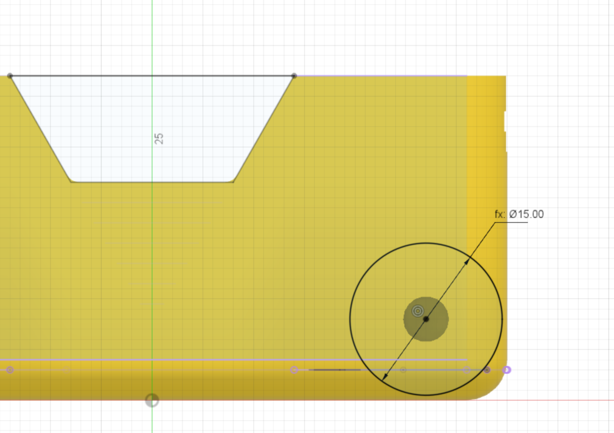

{:class="cover"}

---

By the end of this lesson you will be able to sketch the circle that links the stub to the chassis, centred on the wheel hole from Part 1.

## A base for the stub

A small extrusion is needed to join the stub wheel to the fillet at the bottom of the chassis. Without it the stub would have nothing solid to attach to.

Dimension:

* stub wheel diameter = 15mm

The center of the circle is located at the centre of the [wheel hole](/learn/smars_fusion360/13_wheel.html) you cut in Part 1.

{:class="img-fluid w-75 m-3"}

## Why the centre matters

Everything about the wheel depends on this centre being right. The unpowered wheel sits around it, so if the circle is a little off the wheel will rub on the chassis. Rather than clicking near the hole, snap the centre of the circle to the centre of the hole from Part 1, so the two are exactly concentric.

A note on numbers: this lesson gives the circle as 15mm, while the stub profile in [the previous lesson](08_stub.html) is 16mm across. Both are shown exactly as in the original lessons, so follow each one as written and check against the drawings.

**Check after this step:** the circle is centred on the wheel hole and is 15mm across.

## Try it Yourself

1. Start the sketch on the side of the chassis and snap the circle to the hole centre.
2. Check the circle and the hole share a centre point.
3. Challenge: why is it better to snap to a centre than to type distances from the edges?

## Common Issues

- **Problem**: The circle looks slightly off the wheel hole.
- **Solution**: Delete it and click the hole's centre point when placing the new circle.
- **Why**: Clicking close is not the same as snapping to the centre, and the difference shows as a wobble.

- **Problem**: The sketch is on the wrong side of the chassis.
- **Solution**: Check which face you selected and restart on the face with the wheel hole.
- **Why**: The profile must sit on the face where the stub will be built.

## Check your understanding


? What diameter is the circle in this lesson?
- [x] 15mm
- [ ] 3mm
- [ ] 2.5mm
> The stub wheel diameter in this lesson is 15mm.

? Where is the circle centred?
- [ ] On the chassis edge
- [x] On the centre of the wheel hole from Part 1
- [ ] On the nub
> The wheel hole centre is the reference.

? Why snap to the hole centre?
- [x] So the wheel is exactly concentric and does not rub
- [ ] To save time printing
- [ ] To make the circle bigger
> Concentric circles keep the wheel centred.

