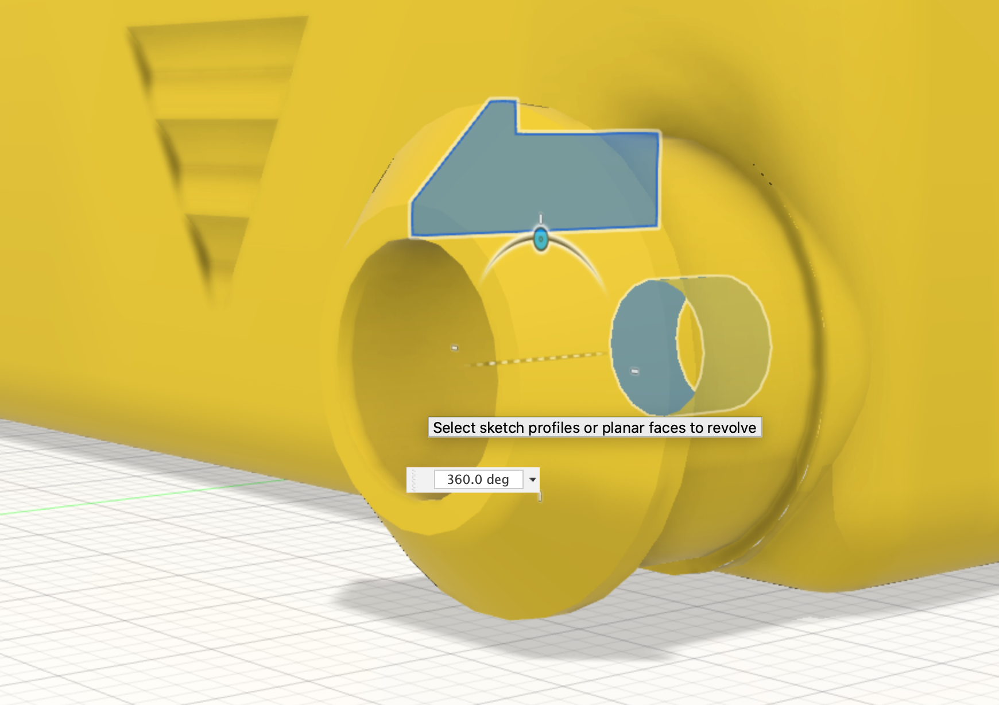
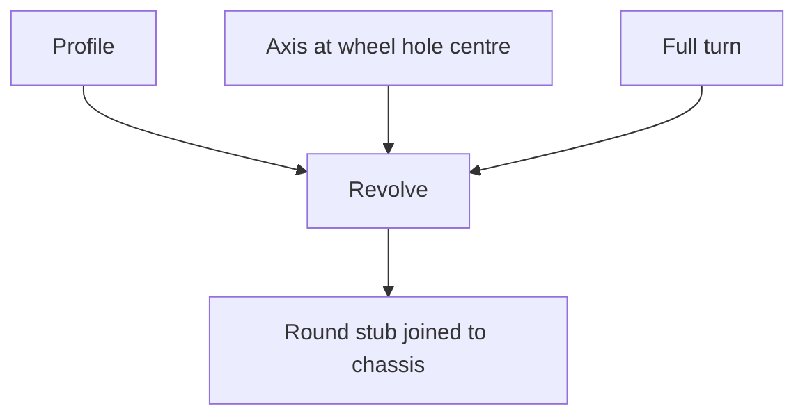

{:class="cover"}

---

By the end of this lesson you will be able to use the Revolve tool to spin a profile into a solid stub wheel joined to the chassis.

## Spinning the profile

The [Stub wheel profile](11_stub.html) created above is revolved around the center of the wheel hole to create a solid body. The revolve operation also joins this to the chassis.

{:class="img-fluid w-75 m-3"}

## What Revolve asks for

Revolve needs three choices: the profile, the axis to spin around, and how far round to go. Choose the profile from the last lesson, pick the centre of the wheel hole as the axis, and sweep it all the way round so the stub is a complete solid. The preview shows a round body forming, which is your check that the axis is right.

Why revolve instead of extruding circles stacked on top of each other? One profile gives you every ring and taper in a single feature. To tweak the shape later you edit one sketch and the whole stub updates.

**Check after this step:** the stub is round when you orbit around it, centred on the wheel hole, and joined to the chassis as one body.

## Try it Yourself

1. Revolve the profile and orbit around the stub.
2. Look at the stub from the side and check it is centred on the wheel hole.
3. Challenge: edit the profile sketch from the timeline, watch how the stub changes, then undo.

## Common Issues

- **Problem**: The stub is lopsided or off to one side.
- **Solution**: Edit the revolve and reselect the axis at the centre of the wheel hole.
- **Why**: The axis is the centre of the finished part, so the wrong axis moves the whole stub.

- **Problem**: The stub is a separate body.
- **Solution**: Undo and revolve again with the operation set to join.
- **Why**: A separate body would not be attached to the chassis in the print.

## Check your understanding


? What does Revolve do?
- [ ] Copies a body to the other side
- [x] Spins a 2D profile around an axis to make a round solid
- [ ] Rounds an edge
> This is the same idea as turning a part on a lathe.

? What is the axis for this revolve?
- [x] The centre of the wheel hole
- [ ] The edge of the chassis
- [ ] The motor nub
> The profile is revolved around the center of the wheel hole.

? What does the revolve also do?
- [ ] Removes a hole
- [x] Joins the stub to the chassis
- [ ] Mirrors the chassis
> The revolve operation also joins the stub to the chassis.

