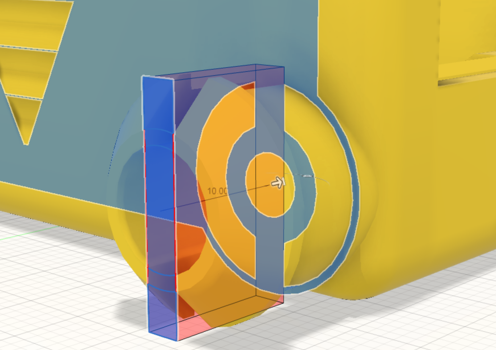

{:class="cover"}

---

By the end of this lesson you will be able to extrude-cut the slot through the stub to split it into two flexible halves.

## Making two halves

The [Stub wheel cutout profile](13_cut.html) is used to extrude-cut the section into the stub wheel to create two halves.

The cut operation goes through the stub wheel to the surface of the side of the chassis body.

{:class="img-fluid w-75 m-3"}

## Where the cut stops

The depth is the important part here. The cut should travel all the way through the stub and stop at the surface of the side of the chassis. That matters for two reasons:

- If it stops short, the two halves are still joined at the bottom and cannot flex properly.
- If it goes too far, it starts cutting into the chassis wall, which weakens what holds the stub on.

Using the side of the chassis as the stopping point, rather than typing a distance, also means the cut stays correct if you later change the length of the stub.

**Check after this step:** orbit around the stub. You should see a clean slot with two separate halves, and the chassis wall behind it should be undamaged.

> **Teachers**: The stub halves are thin and can snap if students flex them too hard on a first test. Have a spare print or two ready for a class.

## Try it Yourself

1. Perform the cut and look along the slot from above.
2. Use the Measure tool across the slot and compare it with the 2.5mm in the sketch.
3. Challenge: explain why using the chassis surface as the end point is better than typing a number.

## Common Issues

- **Problem**: The two halves are still joined at the bottom.
- **Solution**: Edit the cut and set its extent so it reaches the surface of the chassis side.
- **Why**: Any material left behind joins the halves, so they cannot squeeze together.

- **Problem**: The cut has bitten into the chassis wall.
- **Solution**: Edit the cut so it stops at the surface and not beyond it.
- **Why**: Cutting into the wall weakens the support behind the stub.

## Check your understanding


? Where does the cut stop?
- [ ] Halfway through the stub
- [x] At the surface of the side of the chassis body
- [ ] Through the whole chassis
> It goes through the stub to the chassis side surface.

? What does the cut create?
- [ ] A hole in the wall
- [x] Two halves of the stub wheel
- [ ] A new nub
> The cut splits the stub into two halves.

? How was the round stub made in the first place?
- [ ] By extruding a circle
- [x] By revolving a profile around the centre of the wheel hole
- [ ] By filleting a cube
> Revolve spins a 2D profile around an axis.

