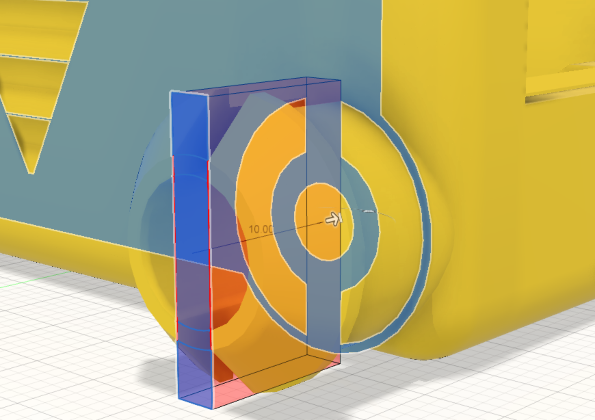

The [Stub wheel cutout profile](13_cut.html) is used to extrude-cut the section into the stub wheel to create two halves.

The cut operation goes through the stub wheel to the surface of the side of the chassis body.

{:class="img-fluid w-75 m-3"}

## Check your understanding


? How is the round stub wheel made?
- [ ] By extruding a circle
- [x] By **revolving** a profile around the centre of the wheel hole
- [ ] By filleting a cube
> Revolve spins a 2D profile around an axis to make a round solid, like a part turned on a lathe.

? Why does the stub wheel have a 2.5mm slot cut through its middle?
- [ ] To save plastic
- [ ] To let wires through
- [x] So the two halves can squeeze together when you push a wheel on
> The slot makes it springy, so an unpowered wheel snaps on and stays on.

