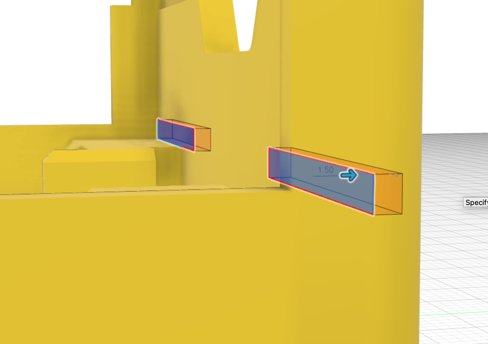

{:class="cover"}

---

By the end of this lesson you will be able to cut the slots into the chassis and mirror them to the other side.

## Cutting and mirroring

The [Motor holder slots profile](15_slots.html) is used to extrude-cut the slots into the chassis.

The dimensions for the cut are:

* extrude cut depth = 1.5mm

This feature is then mirrored across to the other side of the chassis.

{:class="img-fluid w-75 m-3"}

## Mirror or pattern?

Earlier you used a circular pattern to copy things around the centre. This feature is mirrored instead, which flips it across a plane to the other side. A common CAD decision is which to pick: if the opposite side is a reflection, mirror; if it is a turned copy, use a circular pattern.

**Check after this step:**

- Both sides of the chassis show a slot cut to the depth in the drawing.
- The two slots match.
- Nothing else has been removed from the chassis.

A shallow cut is easy to overdo. If it goes too deep it weakens the chassis wall, and if it is too shallow the holder will not seat. Type the value into the dialog rather than dragging the arrow by eye.

> **Teachers**: Pressure fits vary from printer to printer. Print one holder and a short section of slot as a test before printing for a whole class.

## Try it Yourself

1. Cut the slots with the 1.5mm depth and check the preview.
2. Apply the mirror and orbit to look at the other side.
3. Challenge: explain in your own words when you would choose mirror and when a circular pattern.

## Common Issues

- **Problem**: The slot appears only on one side.
- **Solution**: Run the mirror feature and make sure both the feature to mirror and the mirror plane are selected.
- **Why**: A mirror needs to know both what to copy and what to reflect it across.

- **Problem**: The cut went deeper than 1.5mm.
- **Solution**: Double-click the cut in the timeline and type 1.5mm.
- **Why**: Dragging by eye is imprecise, and typing sets the exact value.

## Check your understanding


? What is the extrude cut depth in this lesson?
- [ ] 2mm
- [x] 1.5mm
- [ ] 20mm
> The cut depth is 1.5mm.

? Which feature puts the slots on the other side?
- [ ] Chamfer
- [x] Mirror
- [ ] Revolve
> The feature is mirrored across to the other side.

? When is a mirror the right tool?
- [x] When the opposite side is a reflection
- [ ] When you want a turned copy
- [ ] When you want a thicker wall
> A turned copy uses a circular pattern instead.

