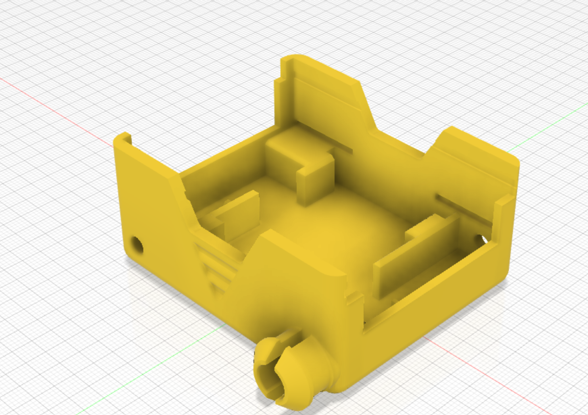

{:class="cover"}

---

By the end of this lesson you will be able to check your finished chassis against the final design and export it as an STL ready for your slicer.

## Your finished chassis

You should now have a finished chassis design, ready for saving out to an STL file and printing.

(Note this design has a few extra flourishes)

{:class="img-fluid w-75 m-3"}

## What you built

Over this course you added, step by step, everything that turns the shell from Part 1 into a working robot chassis:

| Stage | What you made | Key idea |
| --- | --- | --- |
| Motor holders | Walls, nubs and chamfers | Circular pattern, extrude, chamfer |
| Front cut | An opening in the front | Extrude-cut from a sketch |
| Stub wheels | Round snap-fit stubs with a slot | Revolve, pattern, snap fit |
| Motor holder slots | Shallow slots for a pressure-fit part | Extrude-cut, mirror |
{:class="table table-single"}

Before you export, orbit round the whole model and check it against this list. Is there one body in the browser? Are both sides alike? Does every cut open where it should? A few minutes of checking now saves a failed print later.

## Export it for printing

1. In the browser on the left, right-click the chassis body.
2. Choose **Save As Mesh**, pick **STL** and set the refinement to **High**.
3. Open the STL in your slicer. Print it with the base flat on the bed; PLA at 0.2mm layer height works well.

Autodesk Fusion is updated often, so if you cannot find **Save As Mesh** exactly as written, look for the export or mesh option in the right-click menu or the File menu.

> **Teachers**: A chassis takes a long time to print, so plan for it. Check the slicer preview as a class, and print one chassis per group rather than one per student.

## Try it yourself

1. Add your initials to the side of the chassis with the **Text** tool and an extrude-cut.
2. Export the STL and open it in your slicer without printing. Does the preview show anything unexpected, such as a missing slot?
3. Challenge: design a lid that clips onto the top of the chassis.

## Common Issues

- **Problem**: The slicer shows the chassis lying on its side or standing up.
- **Solution**: Rotate it in the slicer so the base is flat on the bed.
- **Why**: The part prints best with its base flat on the bed.

- **Problem**: The STL looks faceted or rough.
- **Solution**: Export again with the refinement set to High.
- **Why**: A mesh is made of triangles, and a higher refinement uses more of them to follow the curves.

## Check your understanding


? Why are the motor holder slots only 1.5mm deep?
- [ ] To save printing time
- [x] The motor holder parts are a pressure fit, so they only need a shallow slot
- [ ] Fusion 360 can't cut deeper slots
> A pressure fit relies on a snug fit rather than screws, so a short, tight slot is enough.

? Which file format do you export to 3D print your chassis?
- [ ] PNG
- [x] STL
- [ ] PDF
> STL describes the surface of the part as triangles, which is what slicers read.

? How should the chassis sit on the print bed?
- [ ] On its side
- [x] With the base flat on the bed
- [ ] Upside down on the nubs
> The lesson says to print with the base flat on the bed.


## What's next

- Build and code your robot with [Build a SMARS robot](/learn/smars/) and [SMARS programming](/learn/smars_code/)
- Prefer free and open source software? Design SMARS in [FreeCAD](/learn/freecad_smars/)
- Revisit the shell in [Part 1](/learn/smars_fusion360/)
