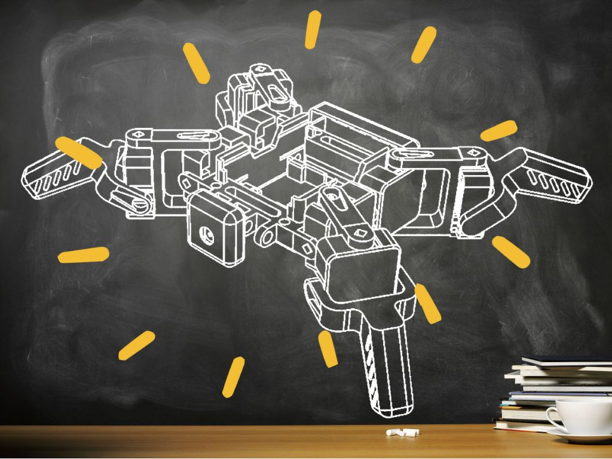

{:class="cover"}

## Watch the videos

Printing the parts:



Assembling and wiring it up:



---

## Overview

The SMARS Quad swaps the tracks of the original SMARS for four legs. Each leg has two servos, one to swing the leg and one to lift the foot, so it can walk, wave and dance. A PCA9685 board drives all eight servos, and a Raspberry Pi Zero runs the Python code.

## Course Content

- Printing the frame, servo holders, arms and feet
- Fitting the servos and assembling the legs
- Wiring the servos and PCA9685 board to the Raspberry Pi
- Downloading the SMARSLab code and making the quad move

## Key Results

By the end of this course you'll have a working four-legged robot and know how a PCA9685 lets one small computer control lots of servos over I2C.

## What you'll need

Item              | Description            | Qty |  Price
------------------|------------------------|:---:|------:
Raspberry Pi Zero | Raspberry Pi Zero 2 WH |  1  | £15.00
Servos            | SG90 Servos            |  8  |  £2.00
PCA9685           | PCA9685 Servo board    |  1  |  £3.00
{:class="table table-striped"}

You'll also need a 3D printer, a small screwdriver, jumper wires, a micro SD card with Raspberry Pi OS, and a 5V power supply or battery pack for the servos. Prices are a guide from when the course was written.

## How the course works

Each step has an instruction drawing from the build guide. Follow them in order, and use the videos if you want to see a step done. There's a short quiz at the end of each section.

## Prerequisites

None, but it helps to have built the [original SMARS](/learn/smars/) first. [Building a Robot Arm with Raspberry Pi and PCA9685](/learn/pca9685/) goes deeper into how the servo board works.
