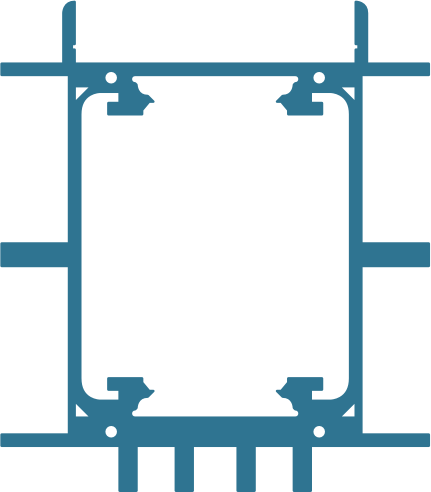
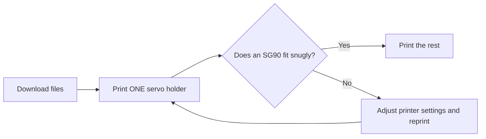

{:class="cover"}

---

By the end of this lesson you will be able to find the SMARS Quad files and list every part you need to print.

## Get the files

Let's start at the printer. Download the build files from Thingiverse. [Click here for the latest version.](https://www.thingiverse.com/thing:2755973) The page has a file for every part, plus the instruction drawings that this course follows step by step.

{:class="img-fluid w-25"}

## What gets printed

The quad has a frame in the middle and a leg at each corner. Each leg is built from servo holders, a servo arm and a foot. The parts come as normal and mirrored pairs, because the legs on one side of the robot are a mirror image of the other side. The part names below are the ones used in the next lessons.

| Part | How many | Lesson |
|---|:---:|---|
| Servo holder | 4 | 2 |
| Servo holder M (mirror image) | 4 | 2 |
| Servo arm | 4 | 5 |
| Foot | 2 | 9 |
| Foot M (mirror image) | 2 | 9 |
{:class="table table-single"}

The frame is also on the Thingiverse page. Check the file list there for the frame and for any extra parts you want to add later.

**Why this matters:** printers differ, and a servo holder that is slightly too tight or too loose spoils every leg. Printing one holder first costs a few minutes and saves a whole print job.

> **Teachers**: One full robot needs all of the parts above, so plan several print jobs. The print time depends on your printer and settings, so look at your slicer's estimate and start printing well ahead of the lesson. Shared printers are the usual bottleneck: print one set per pair and keep spares, because a cracked holder is the most common loss.

## Try it Yourself

1. Download the files and find the STL files for the servo holder, the servo arm and the foot. Do they match the table?
2. Print one servo holder and test-fit an SG90 servo in it.
3. Work out the total number of printed parts in the table above, not counting the frame.
4. Challenge: the Thingiverse page may offer more than one version of the files. Find which one the instruction drawings match.

## Common Issues

- **Problem**: The servo is too tight (or loose) in the holder
- **Solution**: Reprint with a small change to your printer's settings, such as flow or horizontal expansion, then test-fit again
- **Why**: Holders are designed to grip an SG90-sized servo snugly, so a few tenths of a millimetre decide whether it fits

- **Problem**: A mirrored part is printed twice instead of one of each
- **Solution**: Check the part name in your slicer. The mirrored files end in M
- **Why**: Left and right legs are mirror images, so you need both versions

## Check your understanding


? How many servo holders in total (normal plus mirrored M) do you need?
- [ ] 4
- [x] 8
- [ ] 2
> The table shows 4 servo holders and 4 servo holder M, which makes 8, one for each servo.

? Why print only one servo holder before the rest?
- [x] To test-fit a servo and check your printer settings first
- [ ] Because the other holders are different
- [ ] Servos only fit in the first print
> A single test print shows whether the SG90 fits snugly before you commit to the rest.

? What does the M in a part name mean?
- [ ] Metal
- [ ] Motor
- [x] Mirror image
> The M parts are mirrored copies for the opposite side of the robot.

