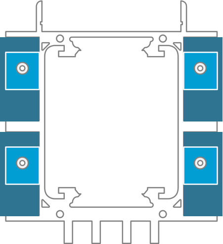
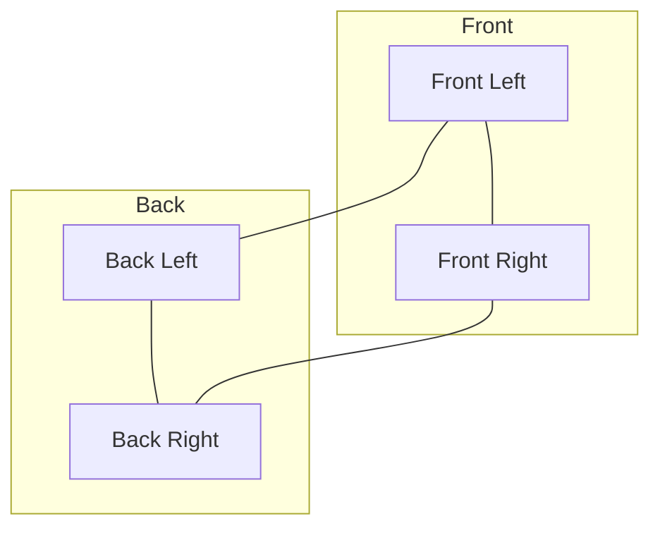

{:class="cover"}

---

By the end of this lesson you will be able to fit the remaining servo holders so that every corner of the frame has its holders.

## Attach the other servo holders to the frame

Fit the remaining servo holders into the frame in the same way, so there is one at each corner.

{:class="img-fluid w-25"}

## Keep a map of the corners

Now is a good time to name the corners, because the wiring in lesson 13 depends on it. Pick the front of the robot first, then call the sides left and right as you look at the robot from behind, looking forward.

Write the corner name on a small sticky label on each leg's servo wires as you go. In lesson 13 the PCA9685 channels are assigned by corner name, and a label saves a lot of confusion when eight identical wires hang from the robot.

Use the same firm, even press as lesson 4, and check each holder has clicked in. Compare each one against the instruction picture, because the normal and mirrored holders face opposite ways.

## Try it Yourself

1. Label each corner with its name (front left, front right, back left, back right) on a sticky note.
2. Put the frame on a table and check that it sits level. Does it rock?
3. Challenge: decide which way is "front" on your robot, and say why you chose it.

## Common Issues

- **Problem**: A holder looks the wrong way round
- **Solution**: Compare with the instruction picture and swap the normal and M holders if needed
- **Why**: Normal and mirrored holders look similar but fit opposite sides

- **Problem**: The frame rocks on the table
- **Solution**: Check every holder is fully clicked in
- **Why**: A half-fitted holder lifts one corner

## Check your understanding


? How many corners of the frame get servo holders?
- [ ] 2
- [ ] 3
- [x] 4
> There is a set at each corner, one for each leg.

? Why label the servo wires by corner now?
- [x] The wiring lesson assigns PCA9685 channels by corner name
- [ ] To make the robot lighter
- [ ] The labels power the servos
> Eight identical wires are easy to mix up without labels.

? What do you do if a holder looks the wrong way round?
- [ ] Leave it
- [x] Compare it with the instruction picture and swap normal and M if needed
- [ ] Glue it
> Normal and M holders face opposite ways.

