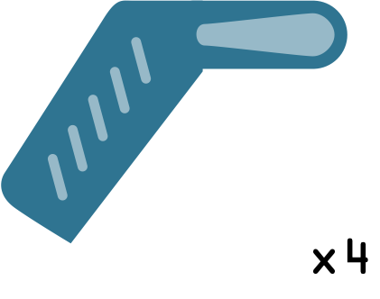
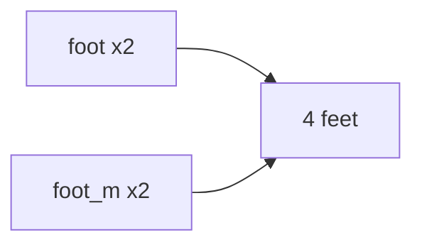

{:class="cover"}

---

By the end of this lesson you will be able to print the right mix of feet for the four legs.

## Print the feet x4

There are 2 types of feet that need to be printed - foot & foot_m, you will need 2x of each.

{:class="img-fluid w-25"}

## Two kinds again

The feet are a mirrored pair, like the holders in lesson 2: 2 foot plus 2 foot_m makes 4 feet, one for each leg. Mark them as you print them so they do not get mixed up.

The foot is the part that touches the ground, so check the bottom face is flat and clean. If your printer leaves a rough first layer, rub it gently on sandpaper laid on the table. A foot that rocks makes the whole robot unstable.

For extra grip on a smooth table you can try a small piece of rubber under the foot. Try one foot first and see whether the robot's walk is better or worse.

## Try it Yourself

1. Print one foot and put it on a flat table. Does it sit flat without rocking?
2. Print the rest and sort them into two piles of 2.
3. Challenge: try a grip material under one foot and decide whether it helps.

## Common Issues

- **Problem**: A foot rocks on the table
- **Solution**: Sand the bottom flat on sandpaper laid on a flat surface
- **Why**: A warped first layer leaves the foot touching at only one or two points

- **Problem**: I printed 4 of the same foot
- **Solution**: Print 2 more of the mirrored foot_m, and keep the correct pairs
- **Why**: Left and right feet are mirror images

## Check your understanding


? How many of each kind of foot do you print?
- [ ] 4 of each
- [x] 2 of each
- [ ] 1 of each
> The lesson says 2x of each, which makes 4 feet in all.

? What does foot_m mean?
- [x] A mirrored foot for the other side
- [ ] A metal foot
- [ ] A motor foot
> Like the M holders, it is a mirror image.

? Why should the bottom of a foot be flat?
- [ ] It looks neater
- [x] A rocking foot makes the robot unstable
- [ ] It makes the servo quieter
> The foot is the part touching the ground.

