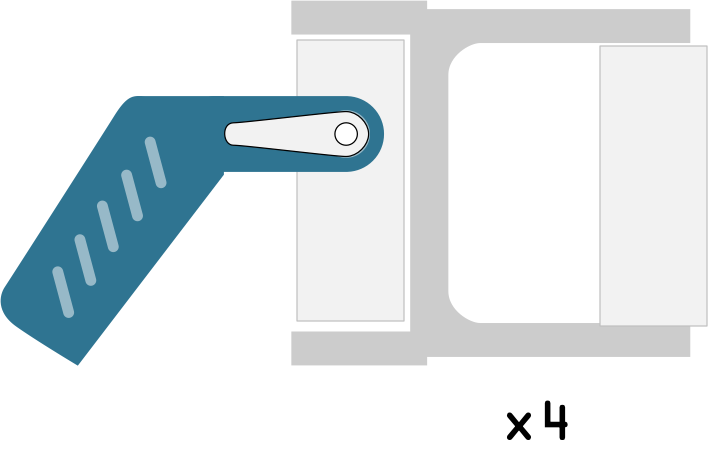
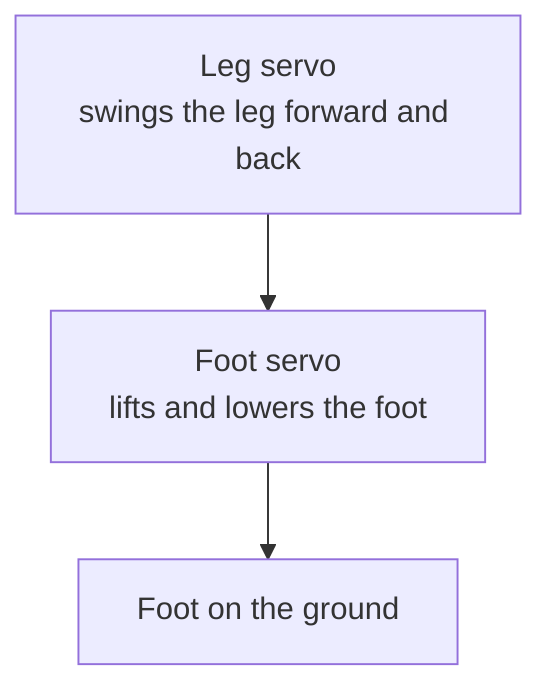

{:class="cover"}

---

By the end of this lesson you will be able to mount a foot on its servo and check it can rotate both ways before fixing the horn.

## Mount the foot on the servo holder

Adding the foot to the servo holder is simple, make sure the servo can rotate in both directions before you screw in the servo horn. You can check the precise angle of these later with the `centre.py` and `wiggle.py` scripts in lesson 13.

{:class="img-fluid w-25"}

## What the foot servo does

Each leg has two servos. One swings the leg forward and back, and the other lifts the foot off the ground. The foot has to lift clear and then come back down, so it needs room to turn in both directions.

Work through it in this order:

1. Fit the foot to the servo holder as the drawing shows.
2. Before screwing in the horn, turn the foot by hand a little in each direction. Stop as soon as you feel it stop.
3. Only then fit the horn and screw it in, just as for the arms in lesson 6.

Later, when the servos are wired, you will send each foot to its limits with `wiggle.py` and see if it moves cleanly through its range. If it rubs against the frame, take the horn off and refit it one spline round.

## Try it Yourself

1. Fit one foot and turn it gently each way. Does it hit anything?
2. Check that the foot clears the frame at both ends of its travel.
3. Challenge: why would a foot that can only lift one way be a problem for walking?

## Common Issues

- **Problem**: The foot catches on the frame when it turns
- **Solution**: Take the horn off, rotate it one spline and refit
- **Why**: The horn angle sets where the travel starts, and a bad start puts one end against the frame

- **Problem**: The foot flops down when the servo is not powered
- **Solution**: This is normal. Check again once the servo is powered and holding a position
- **Why**: A servo only holds its position while it is being sent pulses

## Check your understanding


? What does the foot servo do?
- [ ] Swings the leg forward and back
- [x] Lifts and lowers the foot
- [ ] Powers the Pi
> The leg servo swings the leg; the foot servo lifts the foot.

? What should you do before screwing in the horn?
- [x] Check the foot can turn in both directions
- [ ] Paint the foot
- [ ] Connect the battery
> The lesson says to check both directions first.

? What is the fix if a foot hits the frame at one end?
- [ ] Use a longer screw
- [x] Remove the horn, turn it one spline, and refit
- [ ] Cut the frame
> The horn angle sets where the travel starts.

