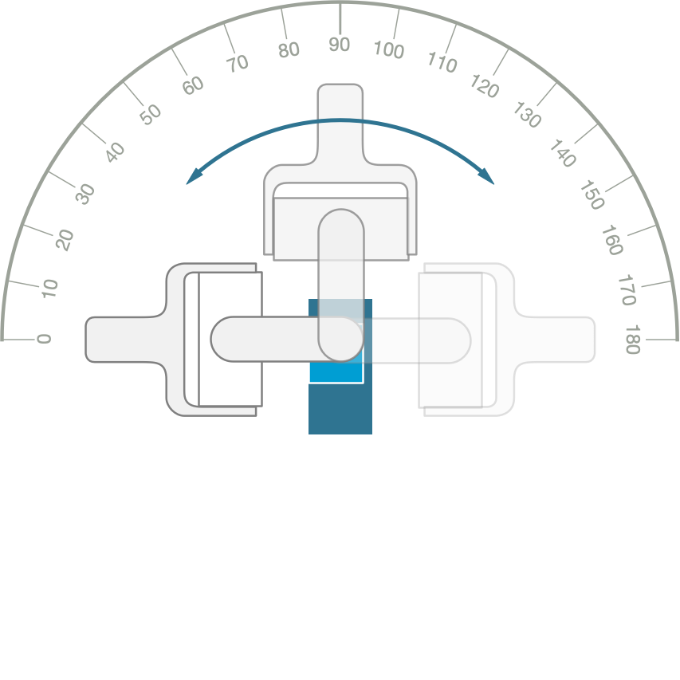
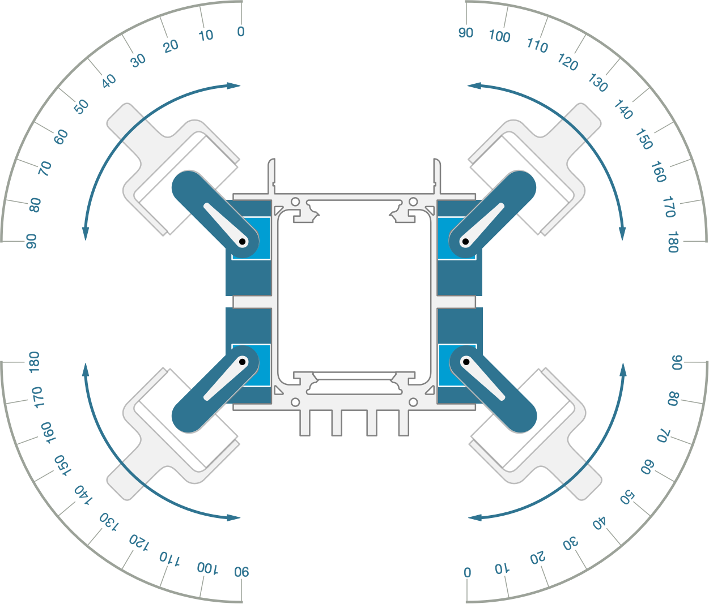
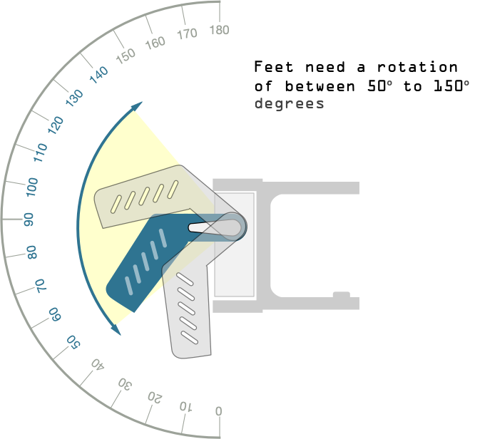

{:class="cover"}

---

By the end of this lesson you will be able to check that each foot can turn between 50 and 150 degrees, and turn those angles into PCA9685 counts.

## Check the servo rotation

You can check the precise angle of these later with the `wiggle.py` script in lesson 13. The foot should be able to rotate between 50 and 150 degrees.

{:class="img-fluid w-25"}
{:class="img-fluid  w-25"}

{:class="img-fluid  w-25"}

## What 50 to 150 means

A servo takes an angle from your program, usually between 0 and 180 degrees. The foot only needs part of that. If it had to go all the way to 0 or 180 it would hit the frame, so the working window for a foot is 50 to 150 degrees. That is 150 - 50 = 100 degrees of travel, with the middle of the window at (50 + 150) / 2 = 100 degrees.

Notice that 100 is not 90, the middle of the servo's full 0 to 180 range. That is fine: the window only has to be somewhere the foot can move freely, and you find exactly where by testing. This is what calibrating means, and you will do it per servo in lesson 13.

## From angle to count

The PCA9685 does not understand angles. It counts 4096 steps in each 20 ms servo pulse, and the servo reads the pulse length as an angle. A typical hobby servo expects about 1.0 ms at one end, 1.5 ms in the middle and 2.0 ms at the other, so:

- count = (1.0 + angle / 180) ms / 20 ms x 4096
- 0 degrees gives 205 counts, 90 degrees gives 307 and 180 degrees gives 410

Save this as `servo_maths.py`. It runs on any computer with Python 3, with no hardware.

```python
PERIOD_MS = 20.0        # one pulse every 20 ms (50 Hz)
STEPS = 4096            # the PCA9685 has 12-bit counts


def angle_to_count(angle):
    pulse_ms = 1.0 + angle / 180      # 1.0 ms at 0 degrees, 2.0 ms at 180
    return round(pulse_ms / PERIOD_MS * STEPS)


for angle in (0, 50, 90, 100, 150, 180):
    print("Angle", angle, "-> count", angle_to_count(angle))
```

The foot window of 50 to 150 comes out as counts 262 to 375, so the foot is allowed to travel across 113 counts. Cheap servos vary, so the exact 1.0 to 2.0 ms assumption can be a little off on yours. If a foot hits a stop before 50 or 150, narrow the window to suit.


## Try it Yourself

1. Run `servo_maths.py` and check the printed counts against the numbers above.
2. Change the list to print the counts for 60 and 140 degrees. How many counts is each degree worth?
3. Challenge: your servo's pulse range may be 0.5 ms to 2.5 ms. Change the formula to match and see how much the counts move.

## Common Issues

- **Problem**: A foot buzzes at the end of its travel
- **Solution**: Narrow the angle window until the buzzing stops, and stop the program straight away
- **Why**: The servo is pushing against its end stop or the frame and drawing high current

- **Problem**: The foot is not centred between its two limits
- **Solution**: Pull the horn off, turn it one spline and refit it, then test again
- **Why**: The horn can only be fitted in steps of one spline

## Check your understanding


? Between which angles should each foot be able to rotate?
- [ ] 0 and 30 degrees
- [x] 50 and 150 degrees
- [ ] 0 and 360 degrees
> The lesson says the foot should rotate between 50 and 150 degrees.

? What is the middle of the 50 to 150 degree window?
- [ ] 90 degrees
- [x] 100 degrees
- [ ] 75 degrees
> (50 + 150) / 2 = 100.

? What does the PCA9685 count in each 20 ms pulse?
- [x] 4096 steps
- [ ] 180 steps
- [ ] 50 steps
> The board has 12-bit counts, and 4096 steps in each pulse.

