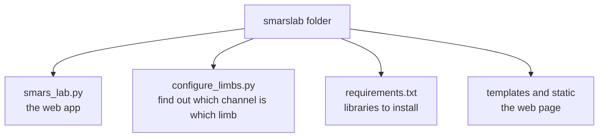

{:class="cover"}

---

By the end of this lesson you will be able to download SMARSLab onto your Raspberry Pi and know what the files do.

## Download the Python code

Download the Python library and test programs from GitHub onto your Raspberry Pi Zero by typing:

```bash
git clone https://github.com/kevinmcaleer/smarslab
```

Or [click here](https://github.com/kevinmcaleer/smarslab) to download it directly.

{:class="img-fluid w-25"}

## What you get

SMARSLab is a Python 3 program, not MicroPython. It runs on the Raspberry Pi itself, serves a small web page, and uses the Adafruit PCA9685 Python library to talk to the servo board. Here are the files we use in this course:



After cloning, look inside:

```bash
cd smarslab
ls
```

You should see `smars_lab.py`, `configure_limbs.py` and `requirements.txt`, among others. If the Pi cannot reach GitHub, check it is on Wi-Fi first with `ping github.com`.

Two things matter before you run any code:

1. **I2C must be on.** Lesson 14 shows how.
2. **Servo power is separate.** Never run the servos from the Pi. Lesson 13 explains the wiring and why.

> **Teachers**: `git clone` needs internet access. Some school networks block GitHub or restrict Wi-Fi on a Pi, so test it ahead of the lesson. You can download the files once on a normal computer and copy them to the Pi on a USB stick or SD card.

## Try it Yourself

1. Clone the repository and run `ls` inside it. Can you find `smars_lab.py`?
2. Open `requirements.txt` with `less requirements.txt` and look at the list of libraries. Which one drives the servo board?
3. Challenge: run `git log --oneline | head` and see the most recent changes made to SMARSLab.

## Common Issues

- **Problem**: `git: command not found`
- **Solution**: Run `sudo apt install git`
- **Why**: Git is not installed on every minimal Raspberry Pi OS image

- **Problem**: `Could not resolve host: github.com`
- **Solution**: Check the Pi is connected to Wi-Fi or a network cable and that the date and time are right
- **Why**: Cloning needs a working internet connection

## Check your understanding


? Which language does SMARSLab use on the Pi?
- [ ] MicroPython
- [x] Python 3
- [ ] C++
> It is a Python 3 program that runs on the Raspberry Pi.

? What command downloads SMARSLab?
- [x] git clone https://github.com/kevinmcaleer/smarslab
- [ ] pip install smars
- [ ] sudo reboot
> The lesson uses git clone to copy the repository to the Pi.

? Which file helps you find which limb is on which channel?
- [ ] requirements.txt
- [x] configure_limbs.py
- [ ] .gitignore
> The lesson describes configure_limbs.py for this.

