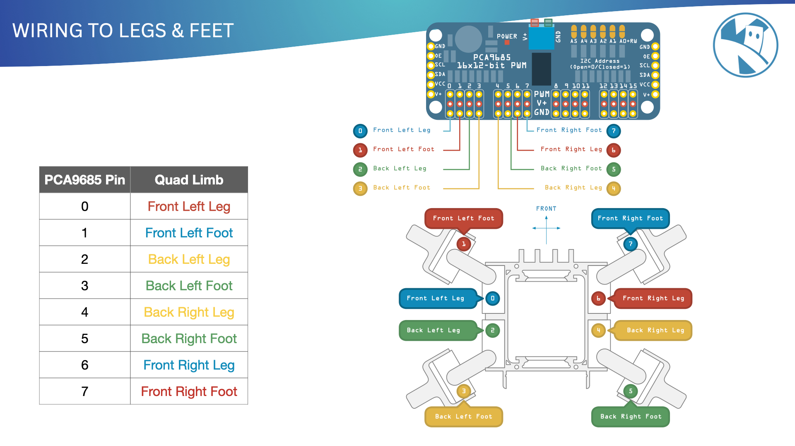

{:class="img-fluid w-100"}

{:class="img-fluid w-100"}

---

## PCA9685 Pinout

PCA9685 Pin | Quad Limb
:----------:|-----------------
     0      | Front Left Leg
     1      | Front Left Foot
     2      | Back Left Leg
     3      | Back Left Foot
     4      | Back Right Leg
     5      | Back Right Foot
     6      | Front Right Leg
     7      | Front Right Foot
{:class="table table-striped "}

---

## PCA9685 to Pi Wiring

PCA9685 | Raspberry Pi
:------:|:-----------:
  GND   |   6 (GND)
  VCC   |   1 (3.3V)
  SCL   |   5 (SCL)
  SDA   |   3 (SDA)
{:class="table table-striped "}

> ## Power the servos separately
>
> `VCC` only powers the PCA9685's chip, so connect it to 3.3V to keep the I2C signals safe for the Pi. Eight servos need far more current than the Pi can give, so connect a separate 5V supply or battery pack to the screw terminal (`V+` and `GND`) on the PCA9685.

---
