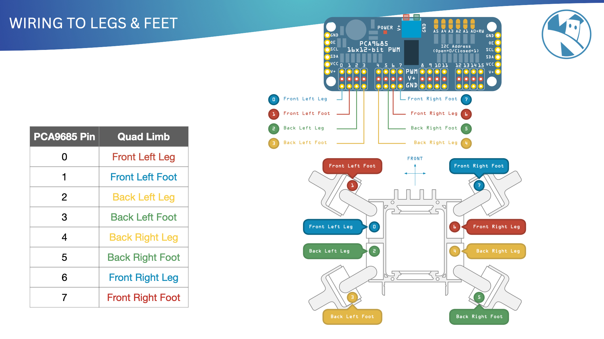
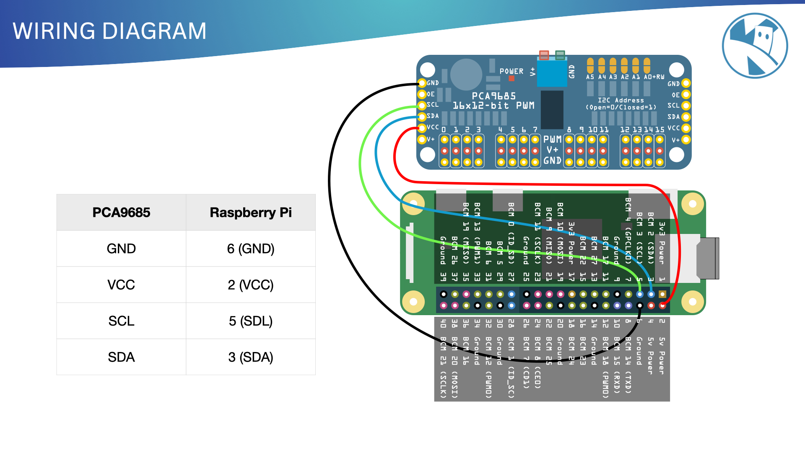
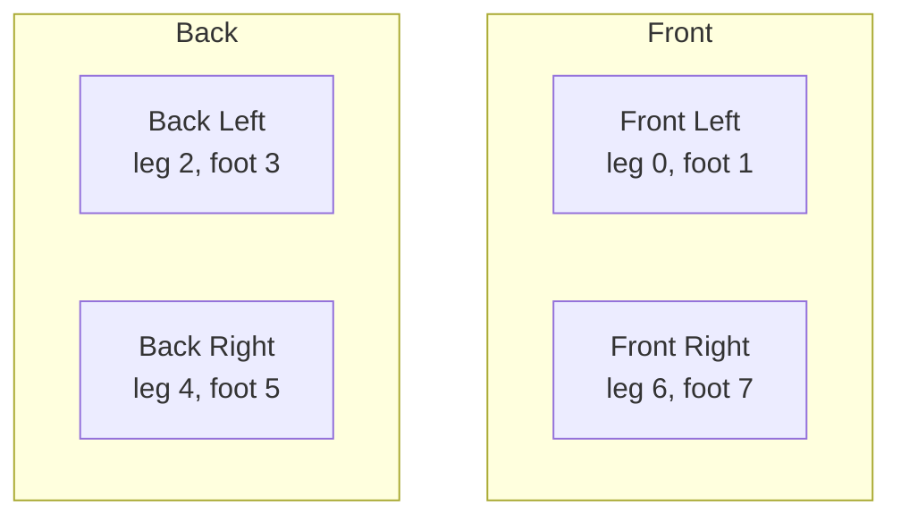
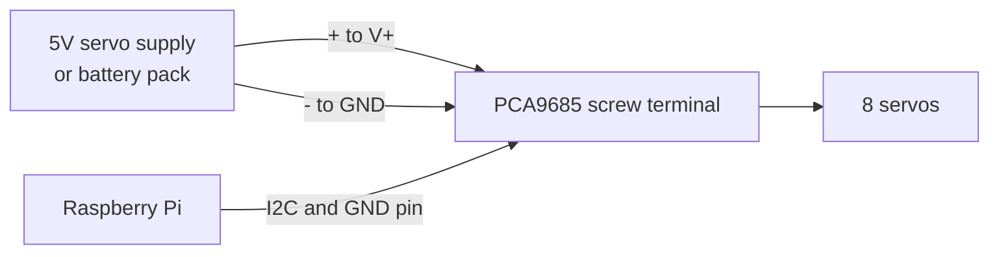

{:class="cover"}

---

By the end of this lesson you will be able to wire the PCA9685 to the Pi and the servos, power the servos from a separate supply, and test each limb.

{:class="img-fluid w-100"}

{:class="img-fluid w-100"}

---

## PCA9685 Pinout

Plug each servo into the channel for its limb. Plug it in the right way round: the signal (usually yellow or orange) wire goes to the PWM pin, the red wire to V+ and the brown or black wire to GND.

PCA9685 Pin | Quad Limb
:----------:|-----------------
     0      | Front Left Leg
     1      | Front Left Foot
     2      | Back Left Leg
     3      | Back Left Foot
     4      | Back Right Leg
     5      | Back Right Foot
     6      | Front Right Leg
     7      | Front Right Foot
{:class="table table-striped "}



The channels go round the robot: front left, back left, back right, front right. If your robot differs, trust your own wiring and fix the lists in the scripts. Lesson 14 makes it easy because the channel numbers sit in one dictionary.

---

## PCA9685 to Pi Wiring

PCA9685 | Raspberry Pi
:------:|:-----------:
  GND   |   6 (GND)
  VCC   |   1 (3.3V)
  SCL   |   5 (SCL)
  SDA   |   3 (SDA)
{:class="table table-striped "}

The numbers in brackets are the physical pin numbers on the Pi's header.

## Power the servos separately

`VCC` only powers the PCA9685's chip, so connect it to 3.3V to keep the I2C signals safe for the Pi. The servos get their power from the screw terminal (`V+` and `GND`) on the PCA9685, from their own 5V supply or battery pack.

Here is why. An SG90 draws a few hundred milliamps when moving, and datasheets give around 0.65 A when it stalls against something, so check your servo's datasheet. If all eight stall together that is 8 x 0.65 = 5.2 A, many times what the Pi's 5V pins and its power supply can spare. Use a supply that can give at least 2 A to start with, and more if you see resets when the legs push hard.



Two rules keep this safe:

- **Common ground.** The supply's ground, the PCA9685's ground and the Pi's ground must all connect. The Pi's GND pin to the board's GND does this. Without it the servo signals have no reference and the legs jitter.
- **Check polarity.** Putting the supply on the terminal the wrong way round can damage the board. Check + goes to V+ before you switch on.

> **Teachers**: This is the lesson where kit gets damaged and batteries get hot. Check each group's wiring before they switch on. Use a supply with a fuse or current limit, never a battery that can short, and never connect the servo supply to the Pi's pins. Put the robot on blocks, with the feet off the table, for the first power-up so a stuck leg cannot run away.

## Find which limb is which

Before assembling the final robot, test each channel on its own. First turn on I2C and install the library from lesson 14 (or from the SMARSLab `requirements.txt`), then save these two scripts.

`centre.py` sends every channel to its middle pulse, one at a time to spread the power surge:

```python
import time
from Adafruit_PCA9685 import PCA9685

pwm = PCA9685(busnum=1)
pwm.set_pwm_freq(50)            # one pulse every 20 ms

MIDDLE = 307                    # 1.5 ms, from lesson 11's maths
for channel in range(8):
    pwm.set_pwm(channel, 0, MIDDLE)
    print("Channel", channel, "centred")
    time.sleep(0.3)

print("All centred. Press Ctrl+C to stop and release the servos.")
try:
    while True:
        time.sleep(1)           # keep the pulses coming so the servos hold
except KeyboardInterrupt:
    for channel in range(8):
        pwm.set_pwm(channel, 0, 0)    # a count of 0 stops the pulses
```

`wiggle.py` moves one channel a small way each side of centre, so you can see which limb it is:

```python
import sys
import time
from Adafruit_PCA9685 import PCA9685

LOW, HIGH = 50, 150             # safe window from lesson 11


def angle_to_count(angle):
    angle = max(LOW, min(HIGH, angle))        # never go outside the window
    return round((1.0 + angle / 180) / 20.0 * 4096)


if len(sys.argv) != 2:
    print("Usage: python3 wiggle.py CHANNEL   (0 to 7)")
    sys.exit(1)

channel = int(sys.argv[1])
pwm = PCA9685(busnum=1)
pwm.set_pwm_freq(50)

for angle in (100, 80, 120, 80, 120, 100):
    print("Channel", channel, "to", angle, "degrees")
    pwm.set_pwm(channel, 0, angle_to_count(angle))
    time.sleep(0.6)

pwm.set_pwm(channel, 0, 0)      # stop the pulses
```

Run `python3 wiggle.py 0`, and the front left leg should move. Work through channels 0 to 7 and write down which limb moves, using the table above to catch crossed wires.

## Try it Yourself

1. Wire the PCA9685 to the Pi as in the table, then run `i2cdetect -y 1` after turning I2C on (lesson 14). Do you see `40`?
2. Run `wiggle.py` on each channel 0 to 7 and tick each one against the pinout table.
3. Run `centre.py` and check whether each arm points where you expect. If one does not, go back to lesson 7 and move its horn a spline.
4. Challenge: add a third argument to `wiggle.py` that sets the middle angle, so you can test different centres without editing the file.

## Common Issues

- **Problem**: The servos twitch or the Pi resets when the legs move
- **Solution**: Power the servos from their own 5V supply on the PCA9685's `V+` terminal, with enough current, and check the grounds are joined
- **Why**: Eight servos can pull amps, far more than the Pi can supply, so the Pi's voltage dips and it reboots

- **Problem**: A limb moves when I wiggle a different channel
- **Solution**: Swap the plugs, or update the channel list in your scripts to match the wiring
- **Why**: Eight identical plugs are easy to mix up, and the code only knows channel numbers

- **Problem**: Nothing moves and `i2cdetect` shows an empty grid
- **Solution**: Check I2C is on, SDA and SCL are not swapped, and `VCC` and `GND` are connected
- **Why**: The Pi can only talk to the board if both I2C wires go to the right pins

## Check your understanding


? Which PCA9685 channel is the Front Left Leg?
- [x] 0
- [ ] 4
- [ ] 7
> The pinout table puts Front Left Leg on channel 0 and Front Left Foot on 1.

? Why does the PCA9685 need its own supply for the servos?
- [x] Eight servos draw much more current than the Raspberry Pi can supply
- [ ] The PCA9685 does not work on 5V
- [ ] To make the robot walk faster
> Several amps are possible if the servos stall.

? What must the Pi, the PCA9685 and the servo supply share?
- [ ] A positive wire
- [x] A common ground
- [ ] Nothing
> Without a common ground the signals have no reference.

