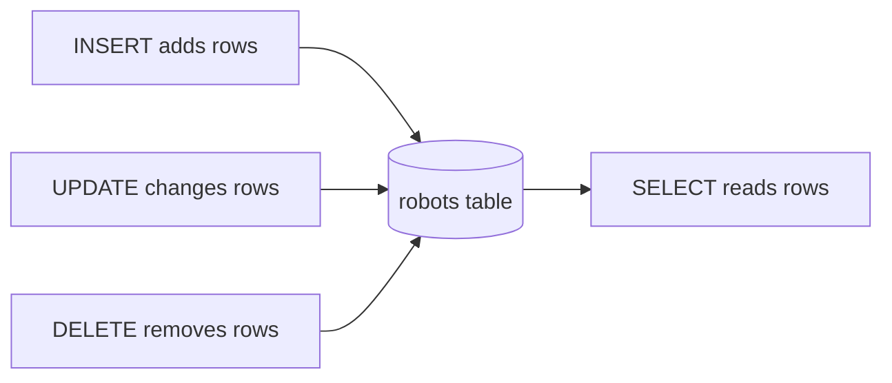

{:class="cover"}

---

By the end of this lesson you will be able to read, add, change and remove rows with `SELECT`, `INSERT`, `UPDATE` and `DELETE`, and explain why `UPDATE` and `DELETE` need a `WHERE`.

---

Almost everything you do with data comes down to four jobs: look at it, add to it, change it and remove it. Each has its own SQL command, and together they are often called **CRUD** (Create, Read, Update, Delete).



Open your database with `sqlite3 workshop.db` (and `.headers on`, `.mode column` if you like tidy output). It should still hold the three robots from the last lesson: Smars, Pico Walker and Arm Buddy.

## SELECT: look at the data

`SELECT` chooses columns, `FROM` says which table:

```sql
SELECT name FROM robots;
```

```text
name
-----------
Smars
Pico Walker
Arm Buddy
```

`SELECT *` means "every column". Add a `WHERE` to keep only the rows that match a condition:

```sql
SELECT * FROM robots WHERE name = 'Smars';
```

```text
robot_id  name
--------  -----
1         Smars
```

Notice that text goes in **single quotes**. `'Smars'` is a value, whereas `name` (no quotes) is a column.

## INSERT: add a row

```sql
INSERT INTO robots (name) VALUES ('Line Chaser');
```

You list the columns, then the values in the same order. Columns you leave out get their default, and `robot_id` fills itself in.

## UPDATE: change rows

Suppose Smars gets an upgrade and becomes the Mk2:

```sql
UPDATE robots SET name = 'Smars Mk2' WHERE robot_id = 1;
SELECT * FROM robots;
```

```text
robot_id  name
--------  -----------
1         Smars Mk2
2         Pico Walker
3         Arm Buddy
4         Line Chaser
```

We matched on `robot_id` because it is unique, so exactly one row changed.

## DELETE: remove rows

Arm Buddy has been taken apart for spares:

```sql
DELETE FROM robots WHERE name = 'Arm Buddy';
SELECT * FROM robots;
```

```text
robot_id  name
--------  -----------
1         Smars Mk2
2         Pico Walker
4         Line Chaser
```

Look at `robot_id`: 3 is now missing. The other IDs don't shuffle down to fill the gap, so never rely on IDs forming an unbroken sequence.

## The golden rule: always use WHERE

`UPDATE` and `DELETE` without a `WHERE` act on **every row**. This runs happily and wipes the table, with no "are you sure?":

```sql
DELETE FROM robots;
```

{: .no-snakie }

Here is a safe habit. Before you run an `UPDATE` or `DELETE`, run the same `WHERE` as a `SELECT` first and check the rows it finds are the ones you meant:

```sql
SELECT * FROM robots WHERE name = 'Line Chaser';
```

If that shows the right row, swap `SELECT *` for `DELETE` and run it.

## Try it Yourself

1. Insert a new robot called `Mystery Bot`, then update its name to `Mystery Bot v2`.
2. Use `SELECT` with a `WHERE` to check what you're about to delete, then delete `Mystery Bot v2`.
3. Challenge: write a `SELECT` that returns only the robots whose `robot_id` is greater than 1. Hint: `>` works in a `WHERE` just like `=`.

## Common Issues

- **Problem**: `Error: near "FROM": syntax error` or the statement never finishes.
- **Solution**: Check for a missing comma between columns, an unclosed quote, or a missing semicolon.
- **Why**: SQL is strict about punctuation. The error names the word where SQLite got confused, which is usually just after the real mistake.

- **Problem**: My `UPDATE` ran but `SELECT` shows nothing changed.
- **Solution**: Check the spelling and case in the `WHERE` text. `WHERE name = 'smars'` will not match `Smars`.
- **Why**: Comparing text with `=` is case-sensitive in SQLite. A `WHERE` that matches nothing is not an error, it simply changes zero rows.

- **Problem**: I deleted every row by forgetting `WHERE`.
- **Solution**: If you've not closed SQLite, you can't undo it in this lesson. Lesson 5 shows transactions, which let you roll back. For now, re-insert the rows.
- **Why**: SQL does exactly what you ask. It cannot know you meant only one row.

## Check your understanding


? What happens if you run `UPDATE robots SET kind = 'rover';` with no `WHERE`?
- [ ] SQLite asks which row you mean
- [ ] Only the first row changes
- [x] Every row in the table is changed
> Without a `WHERE`, `UPDATE` and `DELETE` affect all rows, with no warning.

? Which statement adds a row to the `robots` table?
- [ ] `ADD robots (name) VALUES ('Smars');`
- [x] `INSERT INTO robots (name) VALUES ('Smars');`
- [ ] `SELECT INTO robots (name) VALUES ('Smars');`
> `INSERT INTO table (columns) VALUES (values)` is the form to remember.

? Why is it good practice to run a `SELECT` with your `WHERE` before an `UPDATE` or `DELETE`?
- [x] It shows exactly which rows would be affected
- [ ] It makes the later statement run faster
- [ ] It is required by SQL
> Previewing the rows costs nothing and catches a wrong condition before it does damage.


In the next lesson we'll stop using the bare-bones table and design one properly.
