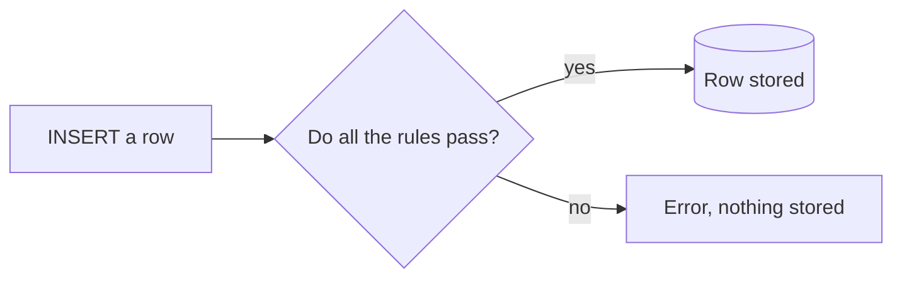

{:class="cover"}

---

By the end of this lesson you will be able to design a table with sensible data types and constraints, link two tables with a foreign key, and change a table with `ALTER TABLE`.

---

Our first `robots` table was bare bones. A good table does more than hold data: it **refuses bad data**. Let's rebuild it with rules, and add the `sensors` table that points at it.

First, a fresh start. `DROP TABLE` deletes a table and everything in it, so only run it on practice data like ours:

```sql
DROP TABLE robots;
```

## Data types in SQLite

SQLite has just a handful of storage types, and every column prefers one:

| Type | Holds | Robot example |
|------|-------|---------------|
| `INTEGER` | Whole numbers | `battery_mah` of 2000 |
| `REAL` | Decimal numbers | a sensor `price` of 2.5 |
| `TEXT` | Words and characters | a robot `name` |
| `BLOB` | Raw bytes, such as a small image | a photo of the robot |
| `NUMERIC` | A number, if the value looks like one | rarely needed |
{:class="table table-single"}

You will see `DATE`, `BOOLEAN` and `VARCHAR(50)` in other tutorials. SQLite accepts those words but has no true date or yes/no type. The habit that works everywhere is:

- Store **dates as text** in the form `2025-03-01` (or `2025-03-01 10:00:00`). That format sorts correctly and SQLite's date functions understand it (lesson 14).
- Store **true/false as 0 and 1** in an `INTEGER` column.

You can ask SQLite what type a value really is:

```sql
SELECT typeof(1), typeof(2.5), typeof('hi'), typeof(NULL);
```

```text
typeof(1)  typeof(2.5)  typeof('hi')  typeof(NULL)
---------  -----------  ------------  ------------
integer    real         text          null
```

`NULL` means "no value": unknown or not filled in. It is not zero and not an empty string.

## Constraints: the rules a column enforces



Here is the `robots` table with its rules:

```sql
CREATE TABLE robots (
    robot_id    INTEGER PRIMARY KEY,
    name        TEXT NOT NULL UNIQUE,
    kind        TEXT NOT NULL DEFAULT 'rover',
    battery_mah INTEGER,
    built_on    TEXT
);
```

| Constraint | What it does |
|------------|--------------|
| `PRIMARY KEY` | Makes the value identify one row. `INTEGER PRIMARY KEY` numbers itself |
| `NOT NULL` | The column must always have a value |
| `UNIQUE` | No two rows may share a value |
| `DEFAULT 'rover'` | Used when you leave the column out of an `INSERT` |
{:class="table table-single"}

Let's test the rules. A row with only a name uses the default `kind`:

```sql
INSERT INTO robots (name) VALUES ('Test Bot');
SELECT * FROM robots;
```

```text
robot_id  name      kind   battery_mah  built_on
--------  --------  -----  -----------  --------
1         Test Bot  rover
```

Now break the rules on purpose. Both of these fail, and the error says which rule:

```sql
INSERT INTO robots (name) VALUES ('Test Bot');
INSERT INTO robots (name, kind) VALUES (NULL, 'walker');
```

```text
UNIQUE constraint failed: robots.name
NOT NULL constraint failed: robots.name
```

Clean up the practice row:

```sql
DELETE FROM robots;
```

That is safe here because the table holds only our test row. The `sqlite3` tool may put a prefix such as `Runtime error:` in front, and some versions add a code in brackets afterwards.

## A foreign key

Now the `sensors` table. Its `robot_id` column points at `robots`:

```sql
CREATE TABLE sensors (
    sensor_id INTEGER PRIMARY KEY,
    robot_id  INTEGER REFERENCES robots (robot_id),
    model     TEXT NOT NULL,
    kind      TEXT NOT NULL,
    price     REAL
);
```

SQLite has an odd quirk: it **ignores foreign keys unless you switch them on** for each session. Run this every time you open the database:

```sql
PRAGMA foreign_keys = ON;
INSERT INTO sensors (robot_id, model, kind, price) VALUES (99, 'HC-SR04', 'distance', 2.50);
```

```text
FOREIGN KEY constraint failed
```

There is no robot 99, so the database refuses a sensor that claims to belong to it. We left `robot_id` without `NOT NULL` on purpose, so a spare sensor in the drawer can exist with no robot.

## Changing a table later

```sql
ALTER TABLE robots ADD COLUMN notes TEXT;
ALTER TABLE robots DROP COLUMN notes;
```

`ADD COLUMN` works in every version. `DROP COLUMN` needs SQLite 3.35 or newer, and fails on older ones. Check with `SELECT sqlite_version();`.

To see what a table looks like, use `.schema robots`, or the SQL way:

```sql
PRAGMA table_info(robots);
```

## About AUTOINCREMENT

You will often see `AUTOINCREMENT` in tutorials. In SQLite, `INTEGER PRIMARY KEY` already numbers itself. Adding the word `AUTOINCREMENT` changes just one thing: SQLite will never reuse a number, even after you delete the highest row. Most tables don't need it. In MySQL the equivalent is `AUTO_INCREMENT`, and in PostgreSQL you'd use `SERIAL` or an identity column.

## Try it Yourself

1. Add a `CHECK (price >= 0)` rule to a new table `test_prices (item TEXT, price REAL CHECK (price >= 0))`, then try inserting a negative price.
2. Add a `weight_g INTEGER` column to `robots` with `ALTER TABLE`, then remove it again.
3. Challenge: design a `readings` table on paper for a distance sensor. Which columns would be `NOT NULL`, and which type would you use for the time?

## Common Issues

- **Problem**: A foreign key lets me insert a sensor for a robot that doesn't exist.
- **Solution**: Run `PRAGMA foreign_keys = ON;` at the start of each session.
- **Why**: SQLite switches foreign-key checking off by default for historical reasons, and the setting lasts only for the current connection.

- **Problem**: `Error: near "DROP": syntax error` on `ALTER TABLE ... DROP COLUMN`.
- **Solution**: Your SQLite is older than 3.35. Update it, or create a new table and copy the data across.
- **Why**: Dropping columns was added to SQLite relatively late.

- **Problem**: `UNIQUE constraint failed` when I insert a robot.
- **Solution**: That name is already in the table. Pick another, or update the existing row instead.
- **Why**: `UNIQUE` is doing its job of stopping duplicates.

## Check your understanding


? How should you store a date such as 1 March 2025 in SQLite?
- [ ] In a `DATE` column, which SQLite checks for validity
- [x] As text in the form `2025-03-01`
- [ ] As the number 12025
> SQLite has no true date type. Text in the `YYYY-MM-DD` form sorts correctly and works with its date functions.

? What does `NOT NULL` on a column mean?
- [ ] The column must hold a number
- [x] A value must always be supplied (or come from a `DEFAULT`)
- [ ] The value must be unique
> `NOT NULL` forbids empty values. `UNIQUE` is the one about duplicates.

? Why might a foreign key not be enforced in SQLite?
- [x] Foreign keys are off until you run `PRAGMA foreign_keys = ON;` in the session
- [ ] Foreign keys only work on `TEXT` columns
- [ ] They are only checked when you delete rows
> SQLite needs `PRAGMA foreign_keys = ON;` each time you connect.


Our tables are ready and waiting. Time to fill them.
