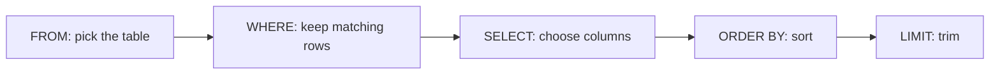

{:class="cover"}

---

By the end of this lesson you will be able to pick columns, sort and limit results, remove duplicates, search text with `LIKE`, and test for missing values with `IS NULL`.

---

`SELECT` is the command you'll use most, so let's give it a proper workout on the five robots from lesson 5. If your database isn't in that state, rerun the setup from lesson 5.

## Picking and renaming columns

List only the columns you need, and use `AS` to give a column a friendlier heading:

```sql
SELECT name AS robot, battery_mah AS battery FROM robots;
```

```text
robot        battery
-----------  -------
Smars        2000
Pico Walker  1500
Arm Buddy
Line Chaser  1200
Mystery Bot
```

The blanks are `NULL`: we don't know those batteries yet.

## Sorting with ORDER BY

Rows come back in no promised order unless you ask for one. `ORDER BY` sorts, and `DESC` reverses it:

```sql
SELECT name, battery_mah FROM robots ORDER BY battery_mah DESC;
```

```text
name         battery_mah
-----------  -----------
Smars        2000
Pico Walker  1500
Line Chaser  1200
Arm Buddy
Mystery Bot
```

In SQLite, `NULL` counts as smaller than any number, so with `DESC` the unknowns drop to the bottom (and with the default ascending order they would come first). You can sort by several columns. This groups robots by kind and puts each group in name order:

```sql
SELECT name, kind FROM robots ORDER BY kind, name;
```

```text
name         kind
-----------  ------
Arm Buddy    arm
Line Chaser  rover
Mystery Bot  rover
Smars        rover
Pico Walker  walker
```

## LIMIT and OFFSET

`LIMIT` keeps only the first few rows, which is perfect for "top 2" questions:

```sql
SELECT name, battery_mah FROM robots
WHERE battery_mah IS NOT NULL
ORDER BY battery_mah DESC
LIMIT 2;
```

```text
name         battery_mah
-----------  -----------
Smars        2000
Pico Walker  1500
```

`OFFSET` skips rows first, which is how websites build "page 2" of results: `LIMIT 3 OFFSET 3` gives the second page of three.

## DISTINCT: no repeats

```sql
SELECT DISTINCT kind FROM robots;
```

```text
kind
------
rover
walker
arm
```

Three kinds, though five robots. Add `ORDER BY kind` if you want them sorted.

## LIKE: searching text

`LIKE` matches patterns. `%` stands for "any number of characters", and `_` for exactly one:

```sql
SELECT name FROM robots WHERE name LIKE 'S%';
SELECT name FROM robots WHERE name LIKE '%bot%';
```

```text
name
-----
Smars

name
-----------
Mystery Bot
```

The second query found `Mystery Bot` even though we typed `bot` in lower case. In SQLite, `LIKE` ignores upper and lower case for ordinary English letters, whereas `=` does not. So `WHERE kind = 'Rover'` finds nothing, because the data says `rover`.

## NULL needs special handling

This looks right but returns **nothing**:

```sql
SELECT name FROM robots WHERE battery_mah = NULL;
```

`NULL` means unknown, and "is this unknown thing equal to another unknown thing?" is itself unknown, never true. Use `IS NULL` instead:

```sql
SELECT name FROM robots WHERE battery_mah IS NULL;
```

```text
name
-----------
Arm Buddy
Mystery Bot
```

## The order SQL really reads your query

You write `SELECT` first, but the database works in a different order, which explains why some things behave as they do:



That is why `ORDER BY` can use a nickname you made with `AS`, but `WHERE` cannot: `WHERE` runs before `SELECT` has created the nickname.

## Try it Yourself

1. List the `name` and `built_on` of every robot, newest first. Where do the robots with no build date appear?
2. Find robots whose name contains the letter `r`, using `LIKE`.
3. Challenge: list the single robot with the biggest battery, using only `ORDER BY` and `LIMIT`. Then explain why you need `WHERE battery_mah IS NOT NULL` if you sort ascending instead.

## Common Issues

- **Problem**: My `WHERE battery_mah = NULL` returns no rows, with no error.
- **Solution**: Write `WHERE battery_mah IS NULL`, or `IS NOT NULL` for the opposite.
- **Why**: Comparing with `NULL` using `=` is never true, so no row passes.

- **Problem**: `LIKE` finds more than I expected, or the case seems ignored.
- **Solution**: Remember `%` and `_` are wildcards, and SQLite's `LIKE` is case-insensitive for English letters. Use `=` for an exact, case-sensitive match.
- **Why**: `LIKE` is designed for fuzzy searching, and `=` for exact matching.

- **Problem**: `no such column: robot` when I use my `AS` nickname in `WHERE`.
- **Solution**: Repeat the original column name in the `WHERE`, or use the nickname only in `ORDER BY`.
- **Why**: `WHERE` is evaluated before `SELECT` creates the nickname.

## Check your understanding


? Which query correctly finds robots with no battery figure?
- [ ] `WHERE battery_mah = NULL`
- [ ] `WHERE battery_mah = 0`
- [x] `WHERE battery_mah IS NULL`
> `= NULL` never matches anything. `IS NULL` is the test for a missing value, and zero is a real number, not "missing".

? What does `LIMIT 2` do?
- [x] Returns at most the first two rows of the result
- [ ] Deletes all but two rows from the table
- [ ] Shows only two columns
> `LIMIT` trims the result, not the table. Pair it with `ORDER BY` so you know which rows count as "first".

? What does `LIKE 'S%'` match?
- [ ] Text that is exactly `S%`
- [x] Text that starts with S
- [ ] Text that ends with S
> `%` stands for any run of characters, so `'S%'` means "S followed by anything".


So far we've looked at everything. Next, let's get choosier with more powerful filters.
