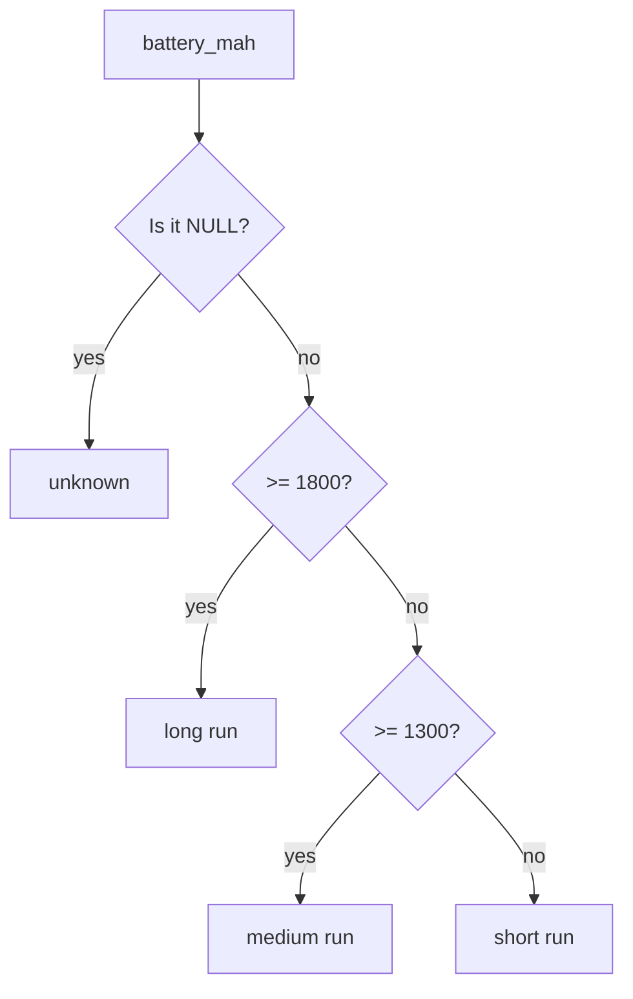

{:class="cover"}

---

By the end of this lesson you will be able to combine several conditions correctly, use `IN` and `BETWEEN` as shortcuts, and use `CASE` to turn numbers into labels.

---

One `WHERE` condition answers simple questions. Real questions have more parts: "rovers with a big battery", "walkers or arms", "built during 2024". Let's build up to them.

## AND, OR and NOT

`AND` needs both conditions to be true:

```sql
SELECT name, kind, battery_mah
FROM robots
WHERE kind = 'rover' AND battery_mah >= 1500;
```

```text
name   kind   battery_mah
-----  -----  -----------
Smars  rover  2000
```

`OR` needs at least one:

```sql
SELECT name, kind FROM robots WHERE kind = 'walker' OR kind = 'arm';
```

```text
name         kind
-----------  ------
Pico Walker  walker
Arm Buddy    arm
```

`NOT` flips a condition, so `WHERE NOT battery_mah > 1500` keeps robots at 1500 mAh or below. Robots with a `NULL` battery are left out, because `NULL > 1500` is unknown, not false.

## The precedence trap

`AND` is done **before** `OR`, exactly like multiplication before addition. That surprises people. What did we mean here?

```sql
SELECT name, kind FROM robots
WHERE kind = 'rover' OR kind = 'arm' AND battery_mah IS NULL;
```

```text
name         kind
-----------  -----
Smars        rover
Arm Buddy    arm
Line Chaser  rover
Mystery Bot  rover
```

SQL read that as "any rover, **or** (an arm with no battery figure)". Every rover came back, which is probably not what we wanted. Parentheses say what you mean:

```sql
SELECT name, kind FROM robots
WHERE (kind = 'rover' OR kind = 'arm') AND battery_mah IS NULL;
```

```text
name         kind
-----------  -----
Arm Buddy    arm
Mystery Bot  rover
```

Now it means "rovers or arms, that also have no battery figure". When you mix `AND` and `OR`, always add parentheses, even when you think you don't need them.

## IN: a tidy list of options

`kind = 'walker' OR kind = 'arm'` gets long fast. `IN` does the same job:

```sql
SELECT name, kind FROM robots WHERE kind IN ('walker', 'arm');
SELECT name, kind FROM robots WHERE kind NOT IN ('walker', 'arm');
```

The second returns the three rovers: Smars, Line Chaser and Mystery Bot.

## BETWEEN: a range

`BETWEEN` includes both ends:

```sql
SELECT name, battery_mah FROM robots WHERE battery_mah BETWEEN 1200 AND 1500;
```

```text
name         battery_mah
-----------  -----------
Pico Walker  1500
Line Chaser  1200
```

It works for text dates too, because `YYYY-MM-DD` sorts in date order. For a date range, comparison operators avoid fuss about the end point:

```sql
SELECT name, built_on FROM robots
WHERE built_on >= '2024-06-01' AND built_on < '2025-01-01';
```

```text
name         built_on
-----------  ----------
Pico Walker  2024-06-21
Arm Buddy    2024-09-02
```

## CASE: turn numbers into labels

`CASE` is SQL's if/else. It checks each `WHEN` from the top and uses the first that is true:



```sql
SELECT name, battery_mah,
    CASE
        WHEN battery_mah IS NULL THEN 'unknown'
        WHEN battery_mah >= 1800 THEN 'long run'
        WHEN battery_mah >= 1300 THEN 'medium run'
        ELSE 'short run'
    END AS runtime
FROM robots;
```

```text
name         battery_mah  runtime
-----------  -----------  ----------
Smars        2000         long run
Pico Walker  1500         medium run
Arm Buddy                 unknown
Line Chaser  1200         short run
Mystery Bot               unknown
```

The `NULL` check comes first on purpose. Because `CASE` stops at the first match, order matters.

## Try it Yourself

1. List robots that are not rovers and were built in 2024.
2. Use `IN` to find sensors whose `kind` is `line` or `motion`.
3. Challenge: write a `CASE` on the `sensors` table that labels each sensor `cheap` (under 2), `mid` (2 to under 5) or `pricey` (5 or more). Which sensor is `pricey`?

## Common Issues

- **Problem**: My `OR` query returns far more rows than I expected.
- **Solution**: Put parentheses around the `OR` part, as in `(a OR b) AND c`.
- **Why**: `AND` binds more tightly than `OR`, so without brackets SQL groups your conditions differently from how you read them.

- **Problem**: Rows with a `NULL` disappear from a `NOT` or `NOT IN` query.
- **Solution**: Add `OR column IS NULL` if you want the unknowns too.
- **Why**: Any comparison with `NULL` is unknown, and `WHERE` only keeps rows that are true.

- **Problem**: My `CASE` gives the wrong label.
- **Solution**: Reorder the `WHEN` lines so the most specific test comes first.
- **Why**: `CASE` stops at the first `WHEN` that is true, so a broad test placed early hides the later ones.

## Check your understanding


? In `WHERE a OR b AND c`, which part is evaluated first?
- [ ] `a OR b`
- [x] `b AND c`
- [ ] The conditions are evaluated left to right with no priority
> `AND` has higher priority than `OR`. Use parentheses to be explicit.

? Is 1500 included by `battery_mah BETWEEN 1200 AND 1500`?
- [x] Yes, both ends are included
- [ ] No, the upper end is excluded
- [ ] Only if you write `<=`
> `BETWEEN` is inclusive at both ends.

? What does a `CASE` expression do when more than one `WHEN` is true?
- [ ] It returns an error
- [ ] It combines the results
- [x] It uses the first one that is true
> This is why the order of the `WHEN` lines matters.


Now let's stop looking at one table at a time and connect robots to their sensors.
