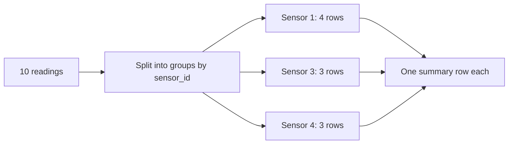

{:class="cover"}

---

By the end of this lesson you will be able to summarise rows with aggregate functions, group them with `GROUP BY`, and filter whole groups with `HAVING`.

---

A robot taking a reading every second makes thousands of rows. You rarely want to read them all. You want the average, the closest object, how many readings were taken. These summaries are called **aggregates**.

## A table of readings

We need some data to summarise. Add a `readings` table, with a few distance readings in centimetres (and a few acceleration readings in g from the MPU6050):

```sql
CREATE TABLE readings (
    reading_id INTEGER PRIMARY KEY,
    sensor_id  INTEGER NOT NULL REFERENCES sensors (sensor_id),
    taken_at   TEXT NOT NULL,
    value      REAL NOT NULL
);

INSERT INTO readings (sensor_id, taken_at, value) VALUES
    (1, '2025-03-01 10:00:00', 25.4),
    (1, '2025-03-01 10:01:00', 18.2),
    (1, '2025-03-01 10:02:00',  9.8),
    (1, '2025-03-01 10:03:00', 31.0),
    (3, '2025-03-01 10:00:00', 40.1),
    (3, '2025-03-01 10:01:00', 38.7),
    (3, '2025-03-01 10:02:00', 12.5),
    (4, '2025-03-01 10:00:00',  0.98),
    (4, '2025-03-01 10:01:00',  1.02),
    (4, '2025-03-01 10:02:00',  1.50);
```

Sensors 1 and 3 are the HC-SR04 distance sensors on Smars and Pico Walker, and sensor 4 is Pico Walker's MPU6050.

## Aggregate functions

An aggregate squashes many rows into one answer:

```sql
SELECT COUNT(*)              AS readings_taken,
       MIN(value)            AS lowest,
       MAX(value)            AS highest,
       ROUND(AVG(value), 2)  AS average,
       ROUND(SUM(value), 1)  AS total
FROM readings;
```

```text
readings_taken  lowest  highest  average  total
--------------  ------  -------  -------  -----
10              0.98    40.1     17.92    179.2
```

`COUNT(*)` counts rows. `COUNT(column)` counts only rows where that column is not `NULL`, which matters for our batteries:

```sql
SELECT COUNT(battery_mah) AS known, COUNT(*) AS robots,
       ROUND(AVG(battery_mah), 1) AS average
FROM robots;
```

```text
known  robots  average
-----  ------  -------
3      5       1566.7
```

Five robots, three known batteries, and the average ignores the two `NULL`s. That is usually what you want, but be aware of it.

## GROUP BY: one answer per group



`GROUP BY` splits the rows into buckets and gives each bucket its own aggregate:

```sql
SELECT sensor_id, COUNT(*) AS n,
       MIN(value) AS closest, MAX(value) AS furthest
FROM readings
GROUP BY sensor_id
ORDER BY sensor_id;
```

```text
sensor_id  n  closest  furthest
---------  -  -------  --------
1          4  9.8      31.0
3          3  12.5     40.1
4          3  0.98     1.5
```

Every column in your `SELECT` must either be in the `GROUP BY` or be wrapped in an aggregate. Here is another grouping, on the sensors table:

```sql
SELECT kind, COUNT(*) AS how_many, ROUND(SUM(price), 2) AS total_cost
FROM sensors
GROUP BY kind
ORDER BY kind;
```

```text
kind      how_many  total_cost
--------  --------  ----------
distance  3         11.0
line      3         3.6
motion    1         3.8
```

`GROUP_CONCAT` joins the values of a group into one piece of text, which is a handy way to see what is in each bucket:

```sql
SELECT kind, GROUP_CONCAT(name, ', ') AS robots
FROM robots
GROUP BY kind
ORDER BY kind;
```

```text
kind    robots
------  -------------------------------
arm     Arm Buddy
rover   Smars, Line Chaser, Mystery Bot
walker  Pico Walker
```

## WHERE versus HAVING

Both filter, but at different moments:

- `WHERE` filters **rows before** they are grouped.
- `HAVING` filters **groups after** they have been summarised.

Count only readings above 10 cm, per sensor, using `WHERE`:

```sql
SELECT sensor_id, COUNT(*) AS n
FROM readings
WHERE value > 10
GROUP BY sensor_id
ORDER BY sensor_id;
```

Now keep only the sensors whose **average** is above 5, using `HAVING`. You can't put an aggregate in `WHERE`, because the averages don't exist yet at that point:

```sql
SELECT sensor_id, ROUND(AVG(value), 1) AS avg_value
FROM readings
GROUP BY sensor_id
HAVING AVG(value) > 5
ORDER BY sensor_id;
```

```text
sensor_id  avg_value
---------  ---------
1          21.1
3          30.4
```

The MPU6050 (sensor 4) averages about 1.17, so its group is dropped.

## Grouping across joined tables

How many sensors does each robot carry, including robots with none? Combine a `LEFT JOIN` with `COUNT` on the *sensor* column:

```sql
SELECT r.name, COUNT(s.sensor_id) AS sensors_fitted
FROM robots AS r
LEFT JOIN sensors AS s ON s.robot_id = r.robot_id
GROUP BY r.robot_id
ORDER BY r.robot_id;
```

```text
name         sensors_fitted
-----------  --------------
Smars        2
Pico Walker  2
Arm Buddy    0
Line Chaser  2
Mystery Bot  0
```

Had we written `COUNT(*)`, Arm Buddy and Mystery Bot would each show **1**, because the left join still produces one row for them, with empty sensor columns. Counting a column from the right-hand table counts only real matches.

## Try it Yourself

1. Find the average, smallest and largest reading for sensor 3 using `WHERE`.
2. How many readings did each sensor take? Show only sensors with 4 or more, using `HAVING`.
3. Challenge: for each robot with a distance sensor, show the robot's name, the average distance and the number of readings. You'll need to join `readings`, `sensors` and `robots`.

## Common Issues

- **Problem**: `misuse of aggregate function AVG()` in a `WHERE`.
- **Solution**: Move the aggregate test into a `HAVING` clause.
- **Why**: `WHERE` runs before the groups are made, so no averages exist yet.

- **Problem**: A `LEFT JOIN` count shows 1 for robots that have nothing.
- **Solution**: Count a column from the right-hand table, such as `COUNT(s.sensor_id)`, not `COUNT(*)`.
- **Why**: `COUNT(*)` counts rows, and the join keeps one row per unmatched robot.

- **Problem**: SQLite returns a column I didn't group by, and the value looks arbitrary.
- **Solution**: Add that column to the `GROUP BY`, or wrap it in an aggregate.
- **Why**: SQLite allows it silently and picks one row's value from the group. Other databases stop you with an error.

## Check your understanding


? What is the difference between `WHERE` and `HAVING`?
- [ ] They are identical
- [x] `WHERE` filters rows before grouping, `HAVING` filters groups after aggregating
- [ ] `HAVING` filters rows before grouping, `WHERE` filters groups
> Use `WHERE` for row conditions and `HAVING` for conditions on `COUNT`, `AVG` and the like.

? Five robots, three with a battery figure. What does `COUNT(battery_mah)` return?
- [ ] 5
- [x] 3
- [ ] 0
> `COUNT(column)` skips `NULL`s. `COUNT(*)` would give 5.

? Why use `COUNT(s.sensor_id)` rather than `COUNT(*)` after a `LEFT JOIN`?
- [x] An unmatched robot still produces one row, but its `sensor_id` is `NULL` and is not counted
- [ ] `COUNT(*)` is not allowed with joins
- [ ] It makes the query faster
> That is how Arm Buddy correctly shows 0 sensors instead of 1.


We can now summarise data. Next, let's look at how to design the tables in the first place.
